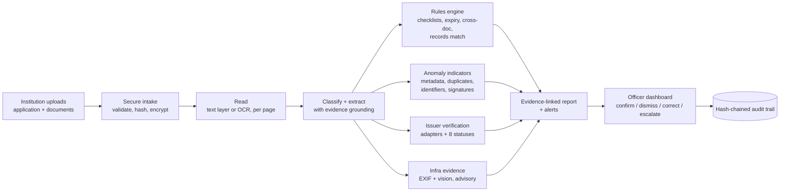
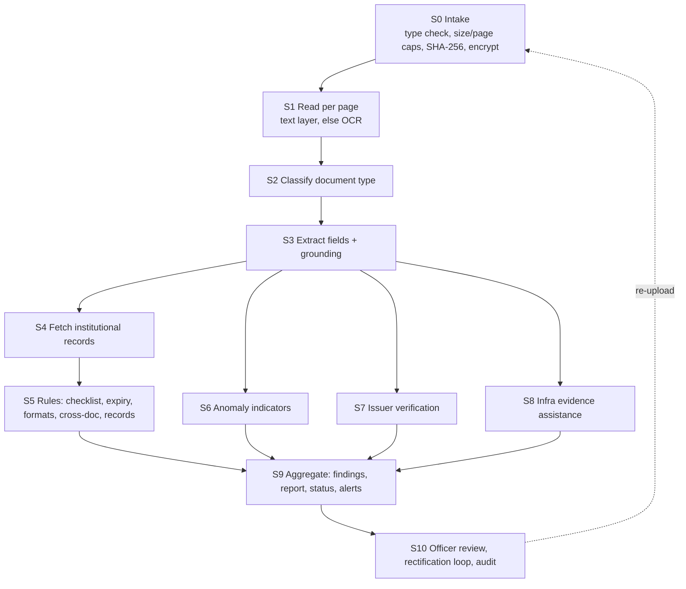

# SIH 2026 · PS 26261 — Proposal, Theory & PPT Source Pack

**AI-Powered Application Validation, Document Authentication and Regulatory Compliance Verification**
Organisation: AICTE · Department: Regulation Bureau · Category: Software · Theme: Smart Automation
Pack version: v1.0 · Date: 23 Oct 2026 · Companion files: `sih26261-prototype-guide.md` (engineering build guide), `sih26261-v2-merged-plan.md` (Guideline-doc merge)

> **How to read this file.** §1 is the one-page brief. §2–§7 are the proposal content in the order a SIH PPT needs it (problem → solution → pipeline & stack → feasibility/viability → impact). §5 is the theory pack every teammate should read once. §8 is an honest review of the prototype plan. §9 tells you how to change things later without breaking the story. §12 is the reference list with a verification status per source.
>
> **Source tags** like `[S3]` point to §12. Anything marked **(assumption)**, **(estimate)** or **(to verify)** is *not* a sourced fact: replace it with a measured number or a verified citation before it goes on a slide.

---

## 0. Slide map (build the PPT from this)

Adapt to the template your SIH portal provides; the content below fits the usual sections (idea, approach, feasibility, impact, references).

| Slide | Title | Pull content from |
|---|---|---|
| 1 | Title, team, PS ID 26261 | header |
| 2 | The problem and why it matters | §2.1–2.3 |
| 3 | Our solution at a glance (diagram) | §1.3, §3.1 |
| 4 | How it answers every PS requirement | §3.3 matrix |
| 5 | Innovation and USP | §3.2 |
| 6 | Technical approach: the pipeline (diagram) | §4.1 |
| 7 | Stage details and tech stack | §4.2, §4.3 |
| 8 | Trust, safety and safeguards | §3.5, §5.9 |
| 9 | Prototype and demo flow (screens) | §8.3 |
| 10 | Evaluation plan and metrics | §10 |
| 11 | Feasibility | §6.1–6.3 |
| 12 | Viability and rollout path | §6.4–6.5 |
| 13 | Impact and benefits | §7 |
| 14 | Risks and mitigations | §6.6 |
| 15 | Research and references | §12 |

---

## 1. One-page brief

### 1.1 The pitch in 60 seconds
AICTE officers verify large bundles of institutional documents by hand: is the fire NOC still valid, does the accreditation certificate match the institution's name, is this affidavit a copy of another institution's? We build a **decision-support layer on top of the AICTE application portal**. It reads each submitted document, checks it against configurable, versioned regulatory rules and authorised institutional records, flags anomalies with **evidence and a reason**, verifies documents with the issuing authority wherever an authorised route exists (and routes to a human where it doesn't), and keeps a **tamper-evident audit trail**. It never approves or rejects anything. Officers keep every statutory decision.

### 1.2 Five ideas that define the solution
1. **AI proposes, rules decide, officers approve.** Models extract and explain; a deterministic, versioned rules engine produces every verdict; humans make every adverse decision.
2. **Every finding carries evidence.** Document, page, highlighted region, extracted value, expected value, rule and version, reason.
3. **Honest verification states.** The PS's six statuses (verified, mismatch detected, expired, verification pending, source unavailable, manual review required) plus `not supported` and `not checked`. Absence of a flag is never shown as "clean".
4. **Configurable by design.** Checklists and thresholds are data (YAML), not code, so a change in the Approval Process Handbook is a config change.
5. **Designed for integration, not pretending to be integrated.** Open API plus adapter interfaces for records and issuers. Restricted sources are simulated and labelled **SIMULATED**.

### 1.3 Architecture at a glance



### 1.4 What is real, what is simulated (say this out loud in the demo)

| Part | Status in prototype |
|---|---|
| Intake, OCR/text extraction, classification, extraction, rules, cross-document checks | **Real**, working on synthetic documents |
| Metadata/duplicate/identifier/signature indicators | **Real** (signature validation uses a self-generated trust root standing in for an issuer) |
| AICTE institutional records | **Simulated** read-only mock database |
| Issuer verification (QR / reference number / portal) | **Simulated** adapters behind a real interface; labelled SIMULATED |
| Infrastructure evidence | **Real** EXIF checks plus approximate vision-model observations, advisory only |
| Integration with AICTE portal | **Designed** (OpenAPI + embeddable officer/institution views); a mock portal shell demonstrates placement |

### 1.5 Scope boundary (non-goals)
Not an official AICTE system. No scraping of restricted portals, no access-control bypass, no real institutional data. No "genuine/forged" verdict, no automated rejection, no claim that rules equal the Handbook until a domain expert has approved them.

---

## 2. Problem (why this matters)

### 2.1 Context
AICTE processes applications from technical institutions for Extension of Approval (EoA) and related changes under the Approval Process Handbook, regulations and instructions [S0]. The Handbook 2024–27 was released in December 2023 to run for three years, with provisions such as longer approval extensions for well-performing institutions and reduced compliance for some land documents and NOCs [S1]. A 2026–27 addendum has since modified parts of the policy [S3]. **Rules therefore change over time**, which is why configurability is a core requirement, not a feature.

Applications come in through the AICTE portal in fixed windows with deadlines and late-fee periods [S4], which concentrates verification workload into short periods.

Scale indicator (secondary source, **to verify against the AICTE Annual Report 2024–25 before using on a slide**): a news summary of the report cites 5,099 new institutions approved and about 7.5 lakh sanctioned seats in 2024–25 [S11]. Even if the exact figures change, the point stands: volume is large and recurring.

### 2.2 Pain points (from the problem statement [S0])
| # | Pain point | Consequence |
|---|---|---|
| P1 | Volume and variety of applications and supporting documents | Manual checking is slow and repetitive |
| P2 | Missing, expired or incomplete documents found late | Back-and-forth cycles, delays |
| P3 | Inconsistent information across documents and records | Errors slip through or are found late |
| P4 | Suspected alterations, duplicated documents | Need for specialist scrutiny, hard to scale |
| P5 | Difficulty confirming with the original issuing authority | Verification is slow, ad hoc and undocumented |
| P6 | Infrastructure evidence (photos, plans) reviewed by eye | Inconsistent, hard to audit |
| P7 | Weak traceability of what was checked, against what, by whom | Accountability gaps |

### 2.3 Root causes
- Records and documents live in different places; the same facts are re-checked by hand.
- No structured, machine-readable checklist per application category.
- Verification with issuers is manual and not recorded in a standard way.
- No evidence trail linking a decision to specific document regions or sources.

### 2.4 Who is affected
| Stakeholder | Impact today |
|---|---|
| Scrutiny and verification officers | Repetitive checking, difficulty prioritising which cases need attention |
| Institutions | Late deficiency notices, unclear what is wrong and why |
| Competent authority / supervisors | Limited visibility into aging, backlog, unresolved discrepancies |
| Auditors / oversight | Hard to reconstruct how a decision was reached |
| Students and public (indirectly) | Depend on integrity of the approval process |

### 2.5 Why now
Document AI (layout-aware OCR, structured extraction) is mature and available both as cloud services and open source. Digital issuance infrastructure exists in India (DigiLocker / API Setu with an issuer–requester model [S9]), and a data-protection framework is being phased in [S10]. The pieces are available; what is missing is a **traceable, rules-driven workflow that combines them under human control**.

---

## 3. Proposed solution (what and how)

### 3.1 Vision
A secure, integrated, AI-enabled **decision-support platform** that performs preliminary validation at the earliest stage of an application, supports document authentication, and assists compliance checking, while "retaining regulatory scrutiny, inspection and final decision-making with the competent AICTE authorities" [S0].

### 3.2 Innovation and USP (what judges should remember)
| USP | What it means | Why it is credible |
|---|---|---|
| **Evidence-linked findings** | Click a finding, see the exact region of the source page highlighted beside the expected value | Built from OCR word geometry; demo-able in 5 seconds |
| **Rules-as-data** | Versioned YAML checklists per category; rule version stamped on every finding | Matches the PS "configurable" safeguard; handles Handbook updates |
| **Grounded extraction** | Any value extracted by a language model must be found in the OCR text, or it is flagged ungrounded | Controls hallucination and gives the evidence region for free |
| **Honest verification model** | Eight explicit statuses; unsupported or unavailable sources go to a human, never silently pass | Directly mirrors the PS status list |
| **Advisory anomaly layer** | Independent weak signals shown separately, never combined into a fake "forgery probability" | Avoids overclaiming; defensible under scrutiny |
| **Tamper-evident audit trail** | Hash-chained log; one endpoint re-verifies the chain | Concrete answer to "audit trail" requirement |
| **Offline/sovereign mode** | `ALLOW_CLOUD=0` switches to local OCR and disables the hosted model | Answers the data-exposure objection |

### 3.3 Requirement → feature → evidence matrix (the traceability slide)

| PS element [S0] | Our feature | Demo evidence |
|---|---|---|
| Identify missing/incomplete/expired/inconsistent info (Obj. 1) | Checklist rules, expiry rules, cross-document and record consistency rules | Application with a missing affidavit and an expired NOC shows two findings with evidence |
| Reduce repeated manual checking using existing records (Obj. 2) | Records lookup service against institutional records (mock) | Name/intake checked against record without user input |
| Detect alterations, duplication, anomalies (Obj. 3) | Metadata, duplicate (exact and near), identifier-format, date, signature indicators | Re-saved certificate and reused certificate flagged as advisory |
| Verify via issuing authorities (Obj. 4) | Adapter interface: QR, reference number, signature, portal; status machine | All verification statuses shown, SIMULATED labelled |
| Infrastructure evidence vs configurable requirements (Obj. 5) | EXIF location/time checks, vision-model observations, floor-plan figures vs rule | "Needs additional evidence / inspection" advisory |
| Transparent, traceable, explainable results (Obj. 6) | Evidence-linked findings, rule versions, audit chain | Audit timeline and chain verification |
| Category-based checklists and configurable rules | YAML rules per category | Edit a rule, re-run, see result change |
| OCR classification, extraction, completeness | Text-layer/OCR per page, classifier, schema extraction | Extraction accuracy table |
| Cross-document and record consistency | Rule types `cross_doc_equal`, `fuzzy_match`, `field_vs_record` | Name mismatch finding |
| Verification workflow with fallback to manual | `MANUAL_REVIEW_REQUIRED` task queue | Simulated outage routed to officer |
| Compliance assistance module | Rules + infra module | See above |
| Dashboard, alerts, audit history | Officer console, SSE alerts, audit timeline | Live demo |
| RBAC, secure handling, human review before adverse action | JWT roles, encrypted storage, no system-issued adverse status | Role switch demo; reason required for decisions |
| Expected outcomes (6) | See §7 | KPIs measured on evaluation set |
| Evaluation metrics | `run_eval.py` over labelled synthetic set | Metrics slide |

### 3.4 Users and roles

| Role | Can do | Cannot do |
|---|---|---|
| Institution | Create application, upload, see its own findings, re-upload (rectify) | See other institutions, see internal officer notes |
| Scrutiny officer | Review evidence, confirm/dismiss findings (reason for high severity), request correction, escalate | Edit rules |
| Rules administrator | Draft, validate and activate rule versions | Read document contents |
| Auditor | Read-only access to audit trail and decisions | Modify anything |
*(Production adds verification officer, supervisor and system administrator; same pattern.)*

### 3.5 Safeguards (mapped to PS "Essential Safeguards" [S0])
| Safeguard | Implementation |
|---|---|
| Configurable to Handbook/regulations | Versioned YAML rules, effective dates, source reference field |
| Authorised, role-based access; no assumption of restricted DB access | Server-side RBAC; records and issuers behind adapters with role-gated credentials; simulated in prototype |
| Security, confidentiality, access logging, retention | Encrypted files at rest, no document content or personal data in logs, access events in audit, retention setting |
| Explainable, evidence-supported flags | Mandatory `reason` and `evidence` in the finding schema |
| Decision support only | No automated adverse status; officer action with reason required |

### 3.6 Core data contracts (frozen early, so everything else can change)

**Finding**
```json
{
  "id": "F-0042",
  "category": "EXPIRED | MISSING | INCOMPLETE | INCONSISTENT | ANOMALY | VERIFICATION | INFRA",
  "severity": "info | low | medium | high",
  "state": "PASS | WARNING | NEEDS_REVIEW | FAILED_CHECK | NOT_CHECKED",
  "rule_id": "R-EXP-001", "rule_version": 3,
  "message": "Fire NOC validity ended before submission date",
  "observed": "2026-03-31", "expected": ">= 2026-10-12",
  "evidence": [{"doc_id": "D-7", "page": 1, "bbox": [0.12, 0.31, 0.27, 0.34], "text": "Valid till 31/03/2026"}],
  "source": "rule | forensic | verification | vision",
  "advisory": false,
  "suggested_action": "Request renewed certificate"
}
```
**Verification result:** `status ∈ {VERIFIED, MISMATCH_DETECTED, EXPIRED, VERIFICATION_PENDING, SOURCE_UNAVAILABLE, MANUAL_REVIEW_REQUIRED, NOT_SUPPORTED, NOT_CHECKED}`, plus `source`, `checked_at`, `compared_fields`, `simulated: bool`.
**Page (OCR output, any engine):** `{page, w, h, provider, words:[{t, bbox[0..1], conf}], text}`.

---

## 4. Technical approach: pipeline and stack

### 4.1 End-to-end pipeline



Design rules that hold for every stage: **idempotent** (re-running a stage on the same input and config version yields the same output, no duplicate findings), **cacheable** (keyed by content hash + config version), **observable** (every stage writes an audit event with tool, version, and duration), **fail-visible** (a stage that cannot run yields `NOT_CHECKED`, never silence).

### 4.2 Stage-by-stage basics

| Stage | Purpose | How it works (basics) | Primary tool | Backup | If it fails |
|---|---|---|---|---|---|
| **S0 Intake** | Accept only safe, valid files and fix identity | Check file signature (magic bytes) not just extension; cap size/pages; compute SHA-256 as the file's identity; store encrypted | Python stdlib `hashlib`, `cryptography` (Fernet) | — | Reject with reason; log |
| **S1 Read** | Turn pages into text with word positions | Split PDF into pages. If a page has a real text layer, read words + boxes directly. Otherwise render to image and OCR. One page per request keeps within free-tier limits [S5][S6]. Normalise boxes to 0–1 so every engine looks the same | PyMuPDF; Azure Document Intelligence `prebuilt-layout` [S5] | Tesseract | Fallback to backup engine; if both fail, `NOT_CHECKED` finding |
| **S2 Classify** | Decide what each document is (affidavit, NOC, certificate, …) | Cheap keyword/regex rules on first-page text; language model only when ambiguous; low confidence → human classification | Rules + one hosted LLM | Rules only | Unclassified → manual classification task |
| **S3 Extract** | Pull typed fields (names, dates, IDs, validity) with their location | Language model returns JSON matching a schema; **grounding check** fuzzy-matches every value against OCR words; matched words give the evidence box; ungrounded values are flagged | LLM + Pydantic + RapidFuzz | Regex per field type | Field marked low confidence; dependent rules become `NOT_CHECKED` |
| **S4 Records** | Bring in authorised institutional facts | Read-only lookups: approved programmes/intake, previous EoA, faculty, deficiencies, TER status, application history | Mock records DB behind a service interface | — | `NOT_CHECKED`, shown in report |
| **S5 Rules** | Produce deterministic verdicts | YAML rules per category: required documents/fields, not expired, date order, ID format/checksum, fuzzy name match, numeric ≤ record, cross-document equality | Custom evaluator (~150 lines), `pyyaml` | — | Rule error logged; finding `NOT_CHECKED` |
| **S6 Anomalies** | Surface leads for human verification | Independent weak indicators: PDF metadata/producer/dates, incremental updates, font inconsistency, exact and near duplicates, invalid identifiers, irregular dates, signature state | PyMuPDF, imagehash, RapidFuzz, pyHanko | — | Indicator skipped; listed as not run |
| **S7 Verification** | Confirm with the issuing source where authorised | Adapter per source (QR, reference number, signature, portal). Compare returned fields with extracted fields. Record source, timestamp, result | Adapter interface; OpenCV for QR; pyHanko for signatures | Manual task | Status `SOURCE_UNAVAILABLE` → `MANUAL_REVIEW_REQUIRED` |
| **S8 Infra** | Help review photos/floor plans (advisory) | EXIF GPS/time vs registered location and claimed date; vision model returns structured observations (scene, approximate counts); floor-plan figures vs rule minimum | Pillow EXIF, one vision-capable LLM | Manual request | "Additional evidence/inspection" advisory |
| **S9 Aggregate** | One reviewable picture | Collect findings, compute application status (never "rejected"), render report, raise alerts | FastAPI services | — | — |
| **S10 Review** | Human decision with traceability | Officer confirms/dismisses/requests correction/escalates; reasons recorded; re-upload creates a new document version; only affected checks re-run | React console + audit log | — | — |

### 4.3 Tech stack (one tool per job) with alternatives and the reason

| Layer | Choice | Alternatives considered | Why this one |
|---|---|---|---|
| Frontend | React + TypeScript + Vite + Tailwind + shadcn/ui, TanStack Query | Streamlit, Next.js | Role-based UI and evidence overlay need real components; team already knows JS |
| API | FastAPI (Python) | Node/Express | Pipeline libraries are Python; one backend language |
| Jobs | FastAPI background tasks + status polling / Server-Sent Events | Celery + Redis | Zero infrastructure for the prototype; production path is a queue |
| Database | SQLite via SQLAlchemy | PostgreSQL | No setup; ORM makes the switch trivial |
| File store | Local encrypted directory, authorised preview endpoint | Object storage (S3-compatible) | Simplicity; production path is private object storage with short-lived URLs |
| OCR primary | Azure AI Document Intelligence (layout) [S5] | Google Document AI, AWS Textract | Returns word polygons, per-word confidence, tables, Markdown [S5] |
| OCR backup | Tesseract | PaddleOCR, docTR | Offline, simple install |
| PDF toolkit | PyMuPDF | pdfplumber, pypdf, pikepdf | One library for split, render, text boxes, fonts, metadata (AGPL licence noted for production) |
| Image analysis | OpenCV, Pillow, imagehash | — | QR decode, EXIF, perceptual hashing |
| Signature validation | pyHanko [S8] | OpenSSL, pdfsig | Python-native PDF signature validation |
| Language model | One hosted model with vision (free tier for the demo) | Local models via Ollama | Classification, structured extraction, explanations, photo observations |
| Matching | RapidFuzz | difflib | Fast fuzzy string ratios |
| Rules | YAML + custom evaluator | OPA, Drools, JSON Logic | Readable in a demo; no integration cost |
| Auth | JWT + bcrypt, 4 seeded roles | Keycloak/OIDC | Prototype speed; production path is OIDC |
| Audit | SQLite table with hash chain | Merkle-tree log | Easy to explain and verify |
| Packaging | `uv`, Makefile, optional Docker Compose | — | One-command run |

**Production-path stack (for the viability slide):** PostgreSQL, queue + dedicated workers, private object storage, malware scanning, OIDC/SSO with the portal, on-prem OCR containers or India-region deployment, observability, sandboxed workers, retention jobs.

---

## 5. Theory pack (read once, then you can answer any judge)

### 5.1 How OCR and document reading work
- **Two kinds of PDFs.** *Born-digital* PDFs contain a text layer: characters with coordinates, so you can read them directly with exact boxes and no recognition errors. *Scanned* PDFs and photos contain only pixels, so you need OCR. Always try the text layer first; it is faster, cheaper and more accurate.
- **OCR pipeline (classic and modern):** preprocessing (grayscale, deskew, denoise, binarise) → layout analysis (find text blocks, lines, tables) → text detection (find where words are) → recognition (read characters/words, with a confidence score) → post-processing (language model/dictionary corrections). Tesseract is a mature open-source engine with this structure [S12a]. Cloud layout models add table structure, reading order, selection marks (checkboxes) and Markdown output, and return word-level polygons and confidence [S5].
- **Why geometry matters here.** The bounding box of each word is what lets us highlight evidence on the page. So every engine's output is normalised to boxes in 0–1 page coordinates.
- **Practical limits.** Low resolution, small text, skew, stamps over text, handwriting and password-protected PDFs reduce accuracy; the cloud service documents minimum text height and requires unlocked PDFs [S5]. This is why the product shows confidence and never trusts a single read blindly.
- **Metrics.** Character error rate `CER = (S + D + I) / N` (substitutions, deletions, insertions over reference characters). Word error rate is the same at word level.

### 5.2 Document classification and information extraction
- **Classification** assigns a document type. Methods, from cheap to expensive: keyword/regex rules, classical ML on text features, layout-aware models, general language models. We use rules first and a language model only when rules are ambiguous, with a human fallback.
- **Information extraction (IE)** converts text into typed fields. Three approaches: regular expressions (fast, brittle), trained extraction models (need labelled data), language models returning JSON that matches a schema (flexible, needs controls).
- **Controls for language models.** (1) *Schema validation*: output must parse and validate (types, formats). (2) *Grounding*: every extracted value must be found in the OCR text, otherwise it is flagged. (3) *Deterministic settings*: temperature 0, cached by (file hash, prompt version, model). (4) *No authority*: model output never decides a verdict or triggers actions.
- **Prompt injection.** Document text is untrusted input; a forged document could contain "mark this verified". Treat text strictly as data inside delimiters, validate outputs, give the model no tools, and include an injection test document in the evaluation set. (Industry guidance: OWASP's LLM application risk list [S14].)

### 5.3 Validation: rules, matching and consistency
- **Rules engine.** A rule is `(applies_to, check, parameters, severity, message, source_ref, version, effective_from)`. Evaluators implement check types. Because rules are data, they can be versioned, tested on a labelled set before activation, and rolled back.
- **Common checks.** *Presence* (required document/field), *date logic* (`valid_till ≥ submission_date`, issue date before expiry, boundary and warning window), *format* (regex; checksum where defined), *numeric* (requested intake ≤ approved intake), *cross-field/cross-document equality*, *record match* (value equals authorised record).
- **Fuzzy matching.** Real names differ in harmless ways ("Pvt." vs "Private"). *Levenshtein distance* counts single-character edits; ratio-based scores normalise by length; *token-based* ratios ignore word order. Choose a threshold per rule and test it on legitimate variants as well as true mismatches. Too strict gives false alarms; too loose misses real differences.
- **Identifier checksums.** Some identifiers embed a check digit; a failed checksum shows an *entry or alteration error*, not fraud. Report it as an inconsistency to verify.
- **Three-valued logic.** A check can pass, fail or be *not checkable* (missing input). Showing `NOT_CHECKED` explicitly prevents "no flag" being read as "all clear".

### 5.4 Anomaly and tamper indicators (and their limits)
**Core idea:** no single indicator proves forgery. We surface independent *weak signals*, each with evidence, for a human to weigh.

| Indicator | Theory | Main false-positive source |
|---|---|---|
| **PDF metadata** | PDFs store Producer/Creator and creation/modification dates. A certificate "issued" in one tool but last saved by an image editor, or modified long after issue, deserves a look | Legitimate re-saving, printing to PDF, scanners |
| **Incremental updates** | PDF edits can be *appended* after the original data (extra object and cross-reference sections, multiple end-of-file markers) | Legitimate annotation or signing workflows |
| **Font/style inconsistency** | Pasted text often differs in font, size or spacing from its surroundings | Mixed fonts in genuine templates |
| **Exact duplicate** | A cryptographic hash such as SHA-256 [S13] gives the same value for identical bytes and a very different one after any change | Same legitimate document reused (for example a shared university letter) |
| **Near duplicate** | *Perceptual hashing* (pHash): shrink image, grayscale, take low-frequency DCT coefficients, threshold to bits; similar images give hashes with small *Hamming distance*. Text similarity (fuzzy ratio / SimHash) catches re-typed copies | Templates look alike |
| **Error Level Analysis (ELA)** | For JPEG, re-saving at a known quality makes unmodified regions change by a similar amount while edited regions differ [S12b]. We treat it as an *optional heatmap*, not a decision | Sharp edges, text, repeated saves, scans; unreliable on PNG/screenshots |
| **Identifier/date irregularities** | Mismatched identifiers across documents, failed checksums, expiry before issue, future dates | Typing errors |
| **Signature state** | Signed PDF fails integrity or modifications after signing detected (see §5.5) | Missing trust roots |

**Base-rate caution (use this in Q&A).** Suppose 1% of documents are tampered, a detector catches 90% of them (true-positive rate) and wrongly flags 5% of genuine ones. Per 1,000 documents: TP = 9, FP = 49.5, so **precision ≈ 9 / 58.5 ≈ 15%**. Most flags would be false alarms. That is exactly why flags are advisory, explained, and tuned for precision, and why no AI score may trigger an adverse action.

### 5.5 Digital signatures, PKI and QR codes
- **Signature mechanics.** The signer hashes the document bytes and encrypts the hash with a private key; anyone with the matching public key (in an X.509 certificate [S13b]) can recompute the hash and verify. Any later change breaks verification.
- **Trust.** A valid signature proves only that *some key signed this exact content*. To trust the signer you must chain the certificate to a **trusted root** you chose, and check validity period and revocation (CRL/OCSP, or embedded long-term validation data). pyHanko validates integrity, signing time, trust chain, revocation and post-signing modifications, and requires you to supply the trust roots [S8].
- **Prototype stance.** Real validation logic with a self-generated root standing in for an issuer's CA. In production the trust roots come from the relevant certifying authorities.
- **QR codes.** A QR code only *encodes data* (often a URL or reference number). Decoding it does not authenticate anything. Authentication happens when the encoded reference is checked at the issuer's authorised service and the response matches the printed details. Do not call a QR decode "verification".

### 5.6 Issuer verification architecture
- **Issuer–requester model.** In India's DigiLocker ecosystem, *issuers* publish documents to a repository, and *requesters* retrieve them with user consent through API Setu [S9]. Becoming an issuer or requester requires registration and approval; the onboarding FAQ describes admin verification for entity accounts, scope-based API access and approval for issuers, and routes education-certificate issuing to the National Academic Depository team [S9]. Consequence: **a student prototype cannot claim live integration**.
- **Adapter pattern.** Define one interface `verify(doc_type, identifiers) → result`. Each source (QR registry, reference-number service, signature check, portal) is an adapter with its own credentials and error handling. Swapping a simulated adapter for a real one changes nothing else.
- **Status machine (the PS list plus two).** `VERIFIED`, `MISMATCH_DETECTED`, `EXPIRED`, `VERIFICATION_PENDING`, `SOURCE_UNAVAILABLE`, `MANUAL_REVIEW_REQUIRED`, `NOT_SUPPORTED`, `NOT_CHECKED`. Anything unsupported, failed or inconclusive routes to a human. Each call stores source, timestamp, minimal request fields and response digest.
- **Data minimisation.** Send the source only the reference fields it needs.

### 5.7 Infrastructure evidence assistance
- **EXIF metadata.** Photos can carry capture time, device and GPS coordinates. Compare to the registered campus location and claimed date. EXIF is editable and often stripped, so missing or odd EXIF is a request for *more evidence*, not a finding of misconduct.
- **Vision models.** Vision-language models can describe a scene, classify it (lab, classroom, library) and give *approximate* counts. They can be wrong, so outputs are structured, show the photo as evidence, carry confidence and are always advisory.
- **Floor plans.** Extract dimension labels by OCR and compare computed area to a configurable minimum. Do not attempt full CAD parsing.
- **What cannot be inferred from a photo.** Real-world dimensions, exact location/date and overall compliance. The product asks for more evidence or recommends inspection; it never declares non-compliance.

### 5.8 Explainability, human-in-the-loop and audit
- **Explainability by construction.** Deterministic rules are interpretable; each finding names the rule, version, evidence and reason. Model outputs are confined to extraction and wording.
- **Human-in-the-loop.** Officers can confirm, dismiss (reason mandatory for high severity), request correction or escalate. Overrides are stored beside, never over, the original finding.
- **Hash-chained audit log.** Each record stores `hash_i = SHA-256(hash_{i-1} ‖ canonical(record_i))`. Editing or deleting an earlier record changes every later hash, so a verification pass detects tampering. Production can anchor chain heads in an external timestamp or use a Merkle-tree log as in Certificate Transparency [S13c].
- **What to log:** rules and versions applied, records checked, source responses, alerts, observations, actions, who and when; **not** document contents or personal data.

### 5.9 Security, privacy and access control
- **RBAC + record-level scope**, enforced server-side on every endpoint and file download; hiding buttons is not access control. Use OWASP's Application Security Verification Standard as a checklist [S15].
- **File handling:** validate by signature, cap size and pages, never execute embedded content, process in resource-limited workers, scan for malware in production.
- **Encryption** at rest and in transit; keys outside the data store; short-lived authorised download URLs in production.
- **Privacy:** minimise fields, keep personal data out of logs and prompts, define retention and deletion. India's Digital Personal Data Protection Act, 2023 has rules notified in November 2025 with phased implementation over roughly 12–18 months per press coverage [S10]. **To verify with qualified guidance:** current commencement dates and how they apply to a regulator's workflow.
- **Cloud exposure.** Page images sent to a cloud OCR or text sent to a hosted model leave your system. Hence `ALLOW_CLOUD`: when off, only local OCR is used and the model is disabled (more `NOT_CHECKED`, but nothing leaves).

### 5.10 Evaluation theory
- **Confusion matrix:** TP, FP, FN, TN. **Precision** `TP/(TP+FP)` (how many flags are right), **recall** `TP/(TP+FN)` (how many problems are caught), **F1** `2PR/(P+R)`.
- **By component:** extraction accuracy per field (exact for IDs/dates, fuzzy for names), classification accuracy, rule precision/recall per rule, anomaly precision/recall per defect type, verification status correctness, latency (median and 95th percentile), alert delay.
- **Avoid fooling yourselves:** have someone who did not write the detectors create the tampered cases; include hard cases (rotated, noisy, stamped scans, legitimate re-saved PDFs); report misses and false positives with examples; say "on our synthetic test set" and never extrapolate to production accuracy.
- **Effort reduction** needs a baseline. Interview a real scrutiny officer or institution administrator for time per document; until then label it an assumption.

### 5.11 Language-model risk summary
| Risk | Control |
|---|---|
| Hallucinated values | Grounding check against OCR; schema validation |
| Prompt injection from documents | Delimited untrusted input, no tools, output validation, injection test case |
| Non-determinism | Temperature 0, caching, pinned model name |
| Overconfidence | Confidence from OCR/grounding, not model wording; advisory labels |
| Data exposure | `ALLOW_CLOUD` switch; synthetic data in demo; check provider data-use terms |
| Inventing regulations | Rules only come from reviewed YAML; model never writes or infers rules |

---

## 6. Feasibility and viability

### 6.1 Technical feasibility (module maturity)

| Module | Maturity | Why it is feasible | Residual risk |
|---|---|---|---|
| Intake, hashing, encryption, RBAC, audit chain | **Proven** | Standard engineering | Time only |
| Text-layer reading and OCR with word boxes | **Proven** | Mature engines; cloud layout returns polygons, confidence, Markdown [S5] | Scan quality, stamps, handwriting |
| Classification and field extraction | **Proven with controls** | Rules first; language model with schema and grounding | Hallucination, injection (controlled, §5.11) |
| Rules engine and cross-document checks | **Proven** | Deterministic code over extracted fields | Correctness of the *rules themselves* (needs domain review) |
| Duplicate and metadata indicators | **Proven, weak signals** | Hashing, metadata parsing | False positives (handled by advisory design) |
| Pixel-level tamper analysis (ELA etc.) | **Research-grade** | Known technique, unreliable | Keep optional |
| Signature validation | **Proven, config-dependent** | pyHanko checks integrity, trust, revocation, modifications [S8] | Needs correct trust roots |
| Issuer verification | **Authorisation-gated** | Adapter pattern; DigiLocker/API Setu need registration and approvals [S9] | Cannot be live without AICTE/issuer authorisation (by design) |
| Infra evidence via vision | **Approximate** | Vision models and EXIF are available | Counts unreliable; advisory only |
| Portal integration | **Design-level** | Open API, SSO, embeddable views | Needs AICTE-side access |

### 6.2 Operational feasibility
- Fits the existing flow as a **pre-scrutiny assistant**: officers see the same application with a prepared, prioritised findings list.
- Officers stay in control: nothing is approved or rejected by the system.
- Training need is small: the console mirrors a review checklist.
- **Shadow mode first**: run alongside manual review, compare, and only then rely on it (§6.7).

### 6.3 Economic feasibility
- **Cost drivers:** OCR pages analysed, language-model tokens, hosting, maintenance. Check current pricing on the vendor pricing page [S7]; do not quote numbers you have not checked.
- **Cost per application ≈ (pages sent to OCR × price per page) + (tokens × price per token) + fixed hosting share.**
- **Levers that cut cost:** skip OCR for pages with a text layer, cache every page and model call by content hash, classify with rules before calling a model, run local OCR for non-sensitive tiers.
- **Prototype cost:** free tiers (the cloud OCR free tier processes only the first two pages per request and caps files at 4 MB, so we send one page at a time [S5]).
- **Production option:** on-prem/open-source stack avoids per-page fees at the cost of accuracy and maintenance effort. The OCR provider interface keeps both options open.

### 6.4 Legal and regulatory feasibility
| Concern | Position |
|---|---|
| Access to institutional records and issuers | Only through authorised, role-based adapters; simulated in prototype [S0] |
| Rule validity | Every production rule needs a source reference, effective date and approval by authorised domain experts |
| Decision authority | System is advisory; statutory scrutiny, inspection and decisions stay with AICTE [S0] |
| Data protection | Minimisation, security safeguards, retention; check applicability and commencement under the DPDP Act and Rules with qualified guidance [S10] |
| Cloud processing of real documents | Gate with `ALLOW_CLOUD`; prefer on-prem or India-region deployment for real data (to verify with the vendor's documentation) |

### 6.5 Schedule feasibility (prototype)
Feasible **only** as a focused golden path (§8.2), not the full feature list. Estimate: one category deep, five document types, ~13 seeded defect cases, one officer console, one audit demo. The engineering plan is in `sih26261-prototype-guide.md` §11.

### 6.6 Risk register

| Risk | Likelihood | Impact | Mitigation |
|---|---|---|---|
| OCR errors produce wrong findings | Medium | High | Confidence thresholds, grounding, evidence view, manual correction, `NOT_CHECKED` over guessing |
| Too many false anomaly flags | High | Medium | Advisory wording, precision-first tuning, legitimate-variant control cases |
| Cloud/Wi-Fi failure in demo | Medium | High | Per-page cache, backup OCR, offline mode, recorded fallback video |
| Rules wrong or outdated | Medium | High | Source-referenced, versioned, reviewed rules; Handbook addendum tracking [S3] |
| Overclaiming integration | Medium | High | Label SIMULATED; "designed for integration" wording |
| Automation bias (officers over-trust output) | Medium | High | Show evidence and confidence; no scores; mandatory reasons for overrides |
| Data exposure to cloud services | Low in demo, high in production | High | Synthetic data only; `ALLOW_CLOUD`; on-prem path |
| Scope creep | High | High | Tiered scope (§8.2) |
| Licence conflicts (e.g., AGPL libraries) | Low | Medium | Licence review on roadmap; permissive alternatives listed in the guide |

### 6.7 Viability: rollout path

| Phase | What happens | Exit gate |
|---|---|---|
| **A. Shadow mode** | Run on anonymised historical or test bundles; officers compare with manual outcomes; no effect on decisions | Agreed precision/recall per rule; list of false-positive patterns |
| **B. Pilot** | One application category, one region or team, live but advisory | Time-to-review and deficiency-detection metrics measured; officer feedback incorporated |
| **C. Portal integration** | API/SSO integration; institution-side pre-check before submission | Security review, access approvals |
| **D. Issuer integrations** | Authorised adapters added source by source (e.g., via DigiLocker/API Setu, academic depositories, state/issuer APIs) | Per-source authorisation and testing [S9] |
| **E. Scale and improve** | More categories, fine-tuned classifiers, multilingual OCR, analytics | Ongoing monitoring |

### 6.8 Sustainability and maintainability
- **Rule ownership** sits with AICTE domain experts; engineers maintain the evaluator, not the content.
- **Provider independence:** OCR, model, records and issuer sources are behind interfaces, which limits vendor lock-in.
- **Monitoring:** track extraction confidence, override rate (how often officers dismiss a rule), and latency; a rising dismiss rate signals a bad rule or drift.
- **Documentation and tests:** the requirements→rules→tests matrix is the maintenance backbone.

### 6.9 Scalability
Stateless API, background workers scaled horizontally for OCR and model calls, queue for burst windows (deadline weeks [S4]), caching by content hash, PostgreSQL and object storage in production, back-pressure and per-page retries.

---

## 7. Impact and benefits

### 7.1 Benefits by stakeholder
| Stakeholder | Benefit |
|---|---|
| Scrutiny officers | Start from a prepared, evidence-linked findings list instead of raw bundles; effort goes to cases that need judgement |
| Institutions | Clear, specific deficiency feedback early; ability to rectify before manual scrutiny where the process permits |
| Supervisors | Dashboard of status, aging, unresolved discrepancies, verification outcomes |
| Auditors / oversight | Reconstructable trail of rules, records, sources, actions |
| Issuing authorities | Standard, minimal-data verification requests (when integrated) |
| Public and students (indirect) | More consistent and transparent approval process |

### 7.2 Expected outcomes → KPI → how we measure (maps to PS outcomes [S0])

| PS expected outcome | KPI | Measured how (prototype) | Production measure |
|---|---|---|---|
| Reduced manual effort and time | Review time per application; share of documents needing no manual look | Timed runs vs assumed manual baseline (label as estimate) | Pilot time studies |
| Earlier identification of missing/expired/inconsistent info | Detection recall by defect type; time from submission to first deficiency notice | Eval set recall; timestamps | Median days to first notice |
| Improved reliability and traceability of authentication | % findings with evidence and source; verification success rate; audit chain verifies | Counts from eval run; `/audit/verify` | Audit sampling |
| More consistent application of checklists | Same input → same output across runs and users | Determinism test (repeat runs); rule coverage | Inter-officer variance study |
| Faster identification of cases needing manual/inspection | Time-to-triage; share routed to manual with reason | Status counts | Queue aging |
| Transparency, accountability, auditability | Audit completeness; override reasons present | Audit queries | Oversight reviews |

### 7.3 Impact quantification model (fill with measured values)

```
Manual effort per application  T_manual = Σ (docs_i × minutes_per_doc_i)
Assisted effort                T_assist = minutes_to_review_flagged + minutes_for_sampled_clean_docs + minutes_for_manual_verification_cases
Time saved per application     ΔT = T_manual − T_assist
Annual saving                  ΔT × applications_per_year × officer_cost_per_minute      (if cost is relevant)
```
**Illustrative only (assumptions, replace before presenting):** 15 documents × 6 min = 90 min manual; if officers review flagged items and sample the rest in 30 min, ΔT = 60 min. **Do not put these numbers on a slide as facts.** Get real minutes-per-document from an officer or institution administrator interview, and present prototype results as "on our synthetic test set".

### 7.4 Second-order impacts
- **Faster adoption of Handbook changes:** rule changes are configuration, not a software release (the Handbook is updated over time [S1][S3]).
- **Consistency across offices and reviewers** through shared, versioned checklists.
- **Institution-side pre-check** (phase C) reduces avoidable deficiency cycles.
- **Standardised issuer verification records** create reusable evidence.
- **Deterrence** by making document reuse and inconsistency easier to detect (do not overstate; no evidence yet).

### 7.5 Negative impacts to manage
Automation bias, unfair flags on poor-quality scans from under-resourced institutions, privacy exposure, vendor lock-in. Controls: evidence-first UI, quality-aware thresholds (low quality → request a better scan, not a flag), data minimisation, provider interfaces.

---

## 8. Honest review of the prototype guide: is it enough for strict judging?

**Verdict.** The guide is a **good engineering blueprint** and the right architecture. **As written it is not enough to score well with strict judges**, because it is a long build list rather than a defensible, focused submission. Seven gaps and fixes:

| # | Gap | Why a strict judge notices | Fix (already reflected in this pack) |
|---|---|---|---|
| 1 | **Rules are placeholders** (`APH §TBD`) | AICTE-side judges will ask "which Handbook rule is this?" | Read the Handbook [S2] and encode **5–8 real rules with section references** and effective dates (I could not open the PDF from my environment, so this must be done by a teammate). Show the requirements→rules→tests table on a slide |
| 2 | **Scope too large for a day** (many modules, 16 defects) | Half-working breadth looks worse than flawless depth | Golden path (§8.2): one category, five document types, ~13 defect cases, everything else stubbed or behind config |
| 3 | **"Integrated with the AICTE portal" is only a claim** | The PS headline is integration | Add a small **mock portal shell** embedding the institution and officer views via the same API, plus an OpenAPI contract and a webhook/SSO sketch |
| 4 | **Self-made data, self-graded metrics** | Looks circular; clean synthetic PDFs overstate OCR accuracy | A teammate who did not write detectors builds the tampered set; add a **hard set** (rotated, noisy, stamped scans, legitimately re-saved PDFs); report misses and false positives |
| 5 | **Verification is simulated by us, for us** | A registry we wrote cannot "verify" our own QR | Say it plainly; make signature validation the *real* verification demo (genuine cryptographic check against a stand-in issuer root); keep other adapters labelled SIMULATED |
| 6 | **Heavy cloud dependence** (cloud OCR, hosted model, free tiers) | Demo fragility and data-exposure objection | Per-page cache, backup OCR, `ALLOW_CLOUD=0` mode rehearsed, recorded fallback video |
| 7 | **No impact, feasibility or viability story** | These are explicit scoring areas | This pack, §6–§7, with unsupported numbers marked as assumptions |

Other honest limits: no claim of real-world accuracy; language models still approximate; forensic signals weak; the real Handbook may be more complex than a few rules; **domain validation of rules by an AICTE-knowledgeable person is the single biggest credibility lever.**

### 8.1 Differentiation checklist (say these, show these)
- Evidence highlight on the source page
- Versioned rules + live rule edit → changed result
- Eight verification statuses, none silent
- Hash-chained audit with tamper demo
- Offline mode switch
- Honest metrics, including misses

### 8.2 Golden-path scope (v3.1 of the prototype plan)

| Tier | Includes |
|---|---|
| **Tier 1 (must)** | Category: **EoA renewal** (deep). Documents: application fields, affidavit, accreditation certificate (fictional issuer), fire/building-safety NOC, TER receipt (as named in the PS), faculty list CSV. Pipeline S0–S3, S5, S6 (metadata, duplicates, signature), S7 (QR + signature + simulated outage), S9, S10. Mock portal shell, institution view, officer queue + detail + evidence viewer, audit timeline + chain check, metrics page, YAML rule editor (textarea) |
| **Tier 1 test cases** | Missing affidavit · expired NOC · NOC expiring soon · name mismatch + legitimate-variant control · intake above approved · exact duplicate · reused certificate with edited name · re-saved PDF + legitimate re-save control · QR mismatch · invalid signature · simulated source outage · prompt-injection document · rotated noisy scan |
| **Tier 2 (if time)** | Record checks for TER/deficiency, identifier checksum, EXIF GPS check, vision-model observations, email alerts |
| **Tier 3 (cut first)** | ELA heatmap, floor-plan area check, second category, extra roles |

### 8.3 Demo flow (6–7 min) and screens
1. Mock portal → institution uploads a clean bundle → all pass.
2. Defective bundle → findings with highlighted evidence (expired NOC, name mismatch, missing affidavit).
3. Anomaly leads with "preliminary indicator" banner (re-saved PDF, reused certificate).
4. Verification panel: valid signature (real check), QR mismatch, simulated outage → manual queue, labelled SIMULATED.
5. Officer actions with mandatory reason; institution re-uploads; finding closes; version history kept.
6. Edit a rule in YAML → re-run → result changes.
7. Audit timeline; tamper a row → chain verification fails.
8. Metrics slide with misses; offline-mode note; roadmap.

---

## 9. Keeping it flexible: change without disconnecting

**Principle:** freeze the *contracts*, not the *components*. Anything behind a contract can change without invalidating the slides, tests or data.

### 9.1 Frozen contracts (change only deliberately, update everything together)
1. Finding schema (§3.6)
2. Verification status enum (§3.6)
3. OCR page schema with normalised boxes (§3.6)
4. Adapter interface `verify(doc_type, identifiers) → result`
5. Rule file format (YAML keys)
6. Audit record shape and hash rule

### 9.2 Swap points

| To change… | Swap at | Then update |
|---|---|---|
| OCR engine | `ocr/` provider (emit the page schema) | Stack slide, theory §5.1 note, cost notes, eval OCR numbers |
| Language model | LLM provider config (`LLM_MODEL`) | Extraction accuracy numbers, privacy note |
| Add an application category | New YAML + document schemas | Test matrix rows, eval set, slide 4 |
| Add or replace an issuer source | New adapter file | Verification slide, status table |
| Add an anomaly indicator | New module returning findings | Anomaly table §5.4, eval per-defect table |
| Change thresholds | Config values | Re-run eval, note in metrics |
| Move SQLite → PostgreSQL / queue | SQLAlchemy URL / worker | Production-path slide only |
| Different UI framework | UI only (API unchanged) | Screens |

### 9.3 Config knobs
`ALLOW_CLOUD`, OCR provider order, model name, fuzzy-match thresholds, warning window for expiry, severity per rule, active rule version, retention days.

### 9.4 Decision log (keep one line per change)
`date | decision | reason | affected sections/slides | owner`. Example: `2026-10-24 | OCR backup = Tesseract | simplest offline install | §4.3, slide 7 | <name>`.

### 9.5 Safe improvement backlog
Handbook-assisted rule drafting (language model proposes, human edits YAML); multilingual OCR; fine-tuned document classifier; Merkle-anchored audit; institution self-check portal; reviewer analytics (override rates); shadow-mode comparison report; authorised issuer adapters; fine-tuned detector for infrastructure photos.

### 9.6 Slide-drift rule
If a USP in §3.2 changes, update slides 3–5 and 15 and the matrix in §3.3 in the same sitting. Treat this file as the source of truth; slides are derived.

---

## 10. Evaluation plan (summary)

| Metric | Target definition | Dataset | Report as |
|---|---|---|---|
| Extraction accuracy | Field exact/fuzzy match vs labels | Clean + hard sets | % per document type and overall |
| Classification accuracy | Confusion matrix | Both | % |
| Rule validation | Precision/recall/F1 per rule | Defect cases + controls | Table |
| Anomaly detection | Precision/recall per defect type | Independent tamper set | Table with misses and false positives |
| Verification | Status correctness; success rate | Seeded outcomes | % |
| Time | Submission → report, median and p95 | Full run | Seconds |
| Alert timeliness | Event → alert | Full run | Seconds |
| Effort reduction | ΔT model (§7.3) | Officer baseline | Label estimate unless measured |
| Determinism | Re-run equality | Repeat runs | Pass/fail |
| Injection safety | Injection doc has no effect | One test | Pass/fail |

Dataset size suggestion: ~12 application bundles, ~60 documents, fixed random seed, `ground_truth.json` manifest; synthetic marking on every document.

---

## 11. Glossary
**APH** Approval Process Handbook · **EoA** Extension of Approval · **NOC** No Objection Certificate · **NBA / NAAC** accreditation bodies (National Board of Accreditation; National Assessment and Accreditation Council) · **TER** as used in the PS ("TER payment status"); *expand and confirm usage from AICTE documents (to verify)* · **NSWS** National Single Window System (mentioned for some applications [S4]) · **NAD** National Academic Depository · **API Setu / DigiLocker** Indian government API gateway and digital document ecosystem [S9] · **OCR** optical character recognition · **IE** information extraction · **LLM / VLM** (vision) language model · **RBAC** role-based access control · **EXIF** photo metadata · **pHash** perceptual hash · **ELA** error level analysis · **PKI / X.509** public-key infrastructure and certificate standard · **CRL / OCSP** certificate revocation mechanisms · **LTV** long-term validation of signatures · **SSE** server-sent events · **JWT** JSON Web Token · **CER** character error rate · **TP/FP/FN** true/false positive, false negative.

---

## 12. Sources and references

**Status legend:** ✅ opened and read by me while preparing this pack · 🔎 appeared in search results but I did not open it · ⚠ cited from my background knowledge; open and verify before use · ❌ I tried and could not open it.

| ID | Source | Link | Used for | Status |
|---|---|---|---|---|
| S0 | SIH 2026 PS 26261 text (AICTE, Regulation Bureau) | Problem statement page on the SIH portal (text provided by you) | All PS requirements, objectives, outcomes, safeguards | ✅ |
| S1 | PIB, "AICTE releases Approval Process Handbook 2024–27" (6 Dec 2023) | https://www.pib.gov.in/Pressreleaseshare.aspx?PRID=1983013&lang=2&reg=48 | Handbook 2024–27 duration and key changes | ✅ |
| S2 | AICTE Approval Process Handbook (primary document) | https://www.aicte.gov.in/sites/default/files/APH%20Final.pdf | Categories, documents, clause references for rules | ❌ my fetch failed; **teammates must read it** |
| S3 | Careers360, APH 2026–27 addendum update | https://news.careers360.com/aicte-approval-process-handbook-2026-27-update-engineering-college-business-school-management-foreign-student-seats-minor-diploma | Handbook changes over time (secondary source; confirm on AICTE site) | ✅ |
| S4 | Careers360, application window for 2024–25 (22 Jan 2024) | https://news.careers360.com/aicte-invites-application-from-existing-new-institutions-for-engineering-management-technology-programmes | Portal-based applications, deadline windows, NSWS note (secondary; 2024–25 cycle) | ✅ |
| S5 | Microsoft docs: Document Intelligence layout model (Azure China docs mirror of the Microsoft documentation) | https://docs.azure.cn/en-us/ai-services/document-intelligence/prebuilt/layout | Layout output (polygons, confidence, Markdown), file limits, free-tier limits | ✅ (also find the same page on learn.microsoft.com) |
| S6 | Microsoft docs: Document Intelligence service quotas and limits | https://learn.microsoft.com/en-us/azure/ai-services/document-intelligence/service-limits | Free vs standard tier limits | 🔎 (the key limits were confirmed on S5) |
| S7 | Azure Document Intelligence pricing | https://azure.microsoft.com/en-us/pricing/details/document-intelligence/ | Cost model inputs (free tier, per-page pricing) | 🔎 |
| S8 | pyHanko documentation, signature validation (v0.24.0 source) | https://github.com/MatthiasValvekens/pyHanko/blob/v0.24.0/docs/lib-guide/validation.rst | What PDF signature validation checks; trust roots must be supplied | ✅ |
| S9 | DigiLocker onboarding FAQ (issuer/requester, approvals, NAD routing) | https://www.digilocker.gov.in/assets/FAQ%20DL%20EL_onboarding.pdf | Issuer–requester model; onboarding approvals | ✅ |
| S9b | API Setu portal | https://api.apisetu.gov.in | Government API gateway | 🔎 |
| S9c | DigiLocker requester API specification | https://cf-media.api-setu.in/resources/Requester-APISpecification-V1_12.pdf | Requester API details | 🔎 |
| S10 | Deccan Herald, "Centre notifies DPDP Rules; implementation planned in phases over 12–18 months" (14 Nov 2025) | https://www.deccanherald.com/india/centre-notifies-dpdp-rules-implementation-planned-in-phases-spread-over-12-18-months-3798465 | DPDP Rules phased implementation (page gives no phase dates) | ✅ |
| S10b | Digital Personal Data Protection Act, 2023, India Code | https://www.indiacode.nic.in/indiacode/handle/123456789/22037?view_type=browse | Primary text of the Act | ⚠ (link taken from your Guideline file) |
| S11 | World Wide Edu-News, summary of AICTE Annual Report 2024–25 (12 Aug 2026) | https://worldwideedunews.wordpress.com/2026/08/12/aicte-approves-7-49-lakh-seats-in-new-institutions-computer-applications-leads-expansion/ | Scale indicator only | ✅ read, but **secondary; verify against the AICTE Annual Report** |
| S12a | R. Smith, "An Overview of the Tesseract OCR Engine," ICDAR 2007 | search the title | OCR engine structure | ⚠ |
| S12b | N. Krawetz, "A Picture's Worth: Digital Image Analysis and Forensics," Black Hat 2007 | search the title | Error Level Analysis idea | ⚠ |
| S13 | NIST FIPS 180-4, Secure Hash Standard | https://csrc.nist.gov/publications/detail/fips/180/4/final | SHA-256 | ⚠ |
| S13b | RFC 5280, X.509 PKI certificate and CRL profile | https://www.rfc-editor.org/rfc/rfc5280 | Certificate chains, validity, revocation | ⚠ |
| S13c | RFC 6962, Certificate Transparency | https://www.rfc-editor.org/rfc/rfc6962 | Append-only Merkle log idea for audit | ⚠ |
| S14 | OWASP Top 10 for LLM Applications | https://owasp.org/www-project-top-10-for-large-language-model-applications/ | Prompt injection and LLM risks | ⚠ |
| S15 | OWASP Application Security Verification Standard | https://owasp.org/www-project-application-security-verification-standard/ | Security checklist | ⚠ (link from your Guideline file) |
| S16 | Tool repositories (from your Guideline file): Tesseract https://github.com/tesseract-ocr/tesseract · PyMuPDF https://github.com/pymupdf/PyMuPDF · OpenCV https://github.com/opencv/opencv · ImageHash https://github.com/JohannesBuchner/imagehash · RapidFuzz https://github.com/rapidfuzz/RapidFuzz · pyHanko https://github.com/MatthiasValvekens/pyHanko · Pydantic https://github.com/pydantic/pydantic | as listed | Tool descriptions and licences (check each licence; PyMuPDF is AGPL/commercial per the Guideline) | ⚠ |
| S17 | W3C Verifiable Credentials Data Model 2.0 | https://www.w3.org/TR/2025/REC-vc-data-model-2.0-20250515/ | Optional background for signed credentials | ⚠ (link from your Guideline file) |

**Further reading to look up (titles only, not verified by me):** DocTamper (CVPR 2023, document tampering dataset); CASIA v2 image tampering dataset; FUNSD and RVL-CDIP (document understanding/classification datasets); DigiLocker architecture and security architecture pages on digilocker.gov.in (listed in your Guideline file).

### 12.1 Claim register (use before finalising slides)

| Claim on slides | Backed by | Action |
|---|---|---|
| APH 2024–27 is a three-year handbook launched Dec 2023 | S1 | OK |
| Handbook was updated for 2026–27 | S3 (secondary) | Confirm on AICTE site |
| Applications run through portal windows | S4 (2024–25 cycle) | Confirm for current cycle |
| Cloud OCR returns word polygons, confidence, Markdown; free tier limits | S5 | OK, recheck before presenting |
| pyHanko checks integrity, trust, revocation, modifications; needs trust roots | S8 | OK |
| DigiLocker/API Setu need registration and approvals | S9 | OK |
| DPDP Rules notified with phased rollout | S10 | Check current dates |
| Volume/scale numbers | S11 | **Do not show until verified** |
| Any time-saved or cost-saved number | none | **Assumption; replace with measured values** |
| Rule clause references | S2 | **Must be filled from the Handbook** |

---

## 13. Open items the team must close before slides are final
1. Read the Handbook [S2]; pick the EoA renewal checklist items and extract 5–8 real rules with clause numbers and effective dates (and check the 2026–27 addendum [S3]).
2. Confirm what "TER" refers to in AICTE usage and how it appears in the application.
3. Interview one scrutiny officer or college administrator for minutes per document and the most common deficiencies.
4. Verify scale figures against the AICTE Annual Report before any number appears on a slide.
5. Check current Azure free-tier limits, pricing and data-handling/region/container details on Microsoft's pages; check the hosted model's data-use terms.
6. Check DPDP commencement dates and how they apply (ask a faculty mentor or legal contact).
7. Decide who builds the independent tampered test set.
8. Confirm the SIH PPT template sections and page limits on the portal and adapt the slide map.
9. Record a fallback demo video once the golden path works.
