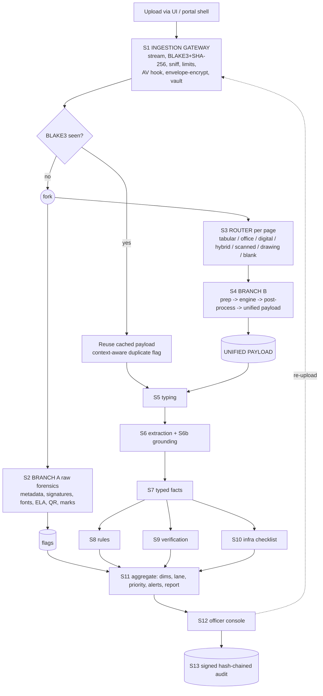

# SIH 2026 · PS 26261: AICTE Application Validation Platform
## Prototype Build Guide v4.2

---

### 0.2 How to Setup Agent to Code with this guide

Suggested repository layout (file names are the "files/modules guide"; responsibilities are in §2.5):

```
aicte-validator/
  CLAUDE.md                     # <=150 lines: ground rules, commands, definition of done (Appendix A.1)
  docs/spec/                    # this guide split by section; Claude Code reads only the one it needs
  docs/contracts/               # payload / flag / fact / check_result / finding / verification JSON Schemas + openapi.yaml
  docs/decisions.md             # calibrated thresholds, pinned versions, smoke-test results
  backend/{ingest,forensics,pipeline,extract,facts,rules,verify,infra,records,audit,jobs,api}/  cli.py
  rules/                        # EOA_RENEWAL.yaml, infra checklist, schemas/<DOC_TYPE>.yaml
  scripts/{gen_data.py, smoke/}
  tests/<module>/               # fixtures come from the synthetic corpus
  ui/   docker/{compose.yml, compose.online.yml, nginx.conf}
```

Per-module loop (repeat; one module per session):
1. Point Claude Code at `CLAUDE.md` plus the one spec file. 2. It writes **tests first** from the spec's I/O and test vectors. 3. It implements. 4. `make test-<module>` must pass. 5. It records calibrated thresholds and pinned versions in `docs/decisions.md`. Prompt template: Appendix A.2.

**Freeze after Phase 0:** the six JSON contracts in §3 and `openapi.yaml`. The UI builds against fixtures until the backend is live.

### 0.3 Change log v3 → v4

**Kept unchanged (do not touch):** BLAKE3 identity + SHA-256 digest; immutable original with separate derived copies; per-page routing; preprocessing order (DPI → gray → conditional flatten → bilateral/CLAHE → skew → single rotation) with stored `M`/`M⁻¹`; engine-specific levels `L0`/`L1`; JSON-first unified payload with Markdown as a view; deterministic rules with AI only extracting; eight verification statuses; "hash chain, not blockchain"; evidence viewer as the centrepiece; synthetic corpus with seeded defects and clean controls; Docker-first delivery with models in a mapped volume; Docling-offline / Azure-online split; the vocabulary rule (no "forged/fraud/fake").

| ID | Area | v3 | v4 change | Why / source |
|---|---|---|---|---|
| P0-1 | Mixed-page payload | `map_bbox_to_source(box, metas[i]) if metas` crashes when `metas[i]` is `None` | Map only when that page's meta is not `None` (§8.4) | Crash on the exact mixed PDFs the router exists for |
| P0-2 | `findings` DDL | Expression inside table-level `UNIQUE` | Separate `check_results` (immutable) and `findings` (lifecycle) with a `fingerprint` column and a normal unique index (§3.2) | PostgreSQL table `UNIQUE` takes columns only [S10] |
| P0-3 | Worker | No rollback before retry update; `dead` child blocks join; stale `running` jobs never recovered | Lease + heartbeat + reaper; `pending_children` counter decremented in the same transaction as the child's terminal state (§10.2) | Analysis §4.2 |
| P0-4 | Offline mode | `app` on both `internal` and `egress` networks | Reverse proxy on `edge`+`internal`; `app`/`worker`/`postgres` on `internal` only; optional egress proxy under a profile (§18.4) | A container on an internal and a normal network still reaches the internet [S9] |
| P0-5 | Egress | Confidentiality check only in `hybrid` | One `egress_gate()` for every cloud OCR/LLM/VLM/verification call in every mode (§2.4) | `online` must not override "confidential" |
| P0-6 | Dates | `date` object stored in JSONB then compared | Typed facts: ISO string in storage, parsed at the adapter boundary; two-digit years go to review (§11.4) | Round-trip returns strings; `99 → 2099` is wrong |
| P0-7 | Rules | YAML names evaluators that do not exist; they silently became `NOT_CHECKED` | Activation validator rejects unknown types and placeholder references (§12.4) | Analysis §5.2 |
| P0-8 | Grounding | Some evaluators emitted findings with no/one-sided evidence; `conf < 0.6` crashes on `None` | One precondition gate and a two-sided evidence rule (§12.2) | "Every finding is evidence-linked" must be enforced |
| P0-9 | Ingest | "Streaming" read the whole object; `finally: pass` leaked plaintext temp files; orphan vault objects | True stream, `finally` cleanup, header-validated reuse of existing objects, reconcile job (§4.3) | Analysis §3.3 |
| P0-10 | Auth | Local JWT presented as portal SSO | Two issuers: `local` (HS256) and `portal` (RS256/JWKS, design-only) (§15.3) | Never trust a token merely because it names the portal |
| P1-1 | Storage | Prefix path check; HEAD-then-PUT | `is_relative_to`, absolute/`..` keys rejected; conditional write; object-lock not assumed (§3.3) | Prefix checks accept `/data-evil` when root is `/data` |
| P1-2 | Names | `canon_name` deleted `pvt/ltd/trust/society` | Compare core name and legal form separately (§11.4) | Distinct legal entities must not collapse |
| P1-3 | Confidence | One threshold `tau=0.80` across engines | Store raw engine score and method; thresholds per engine; "uncalibrated" never equals 0.80 (§8.6) | Docling layout score ≠ Azure word confidence ≠ heuristic |
| P1-4 | Watermarks | Default removal on a copy | Default `detect_only`; `clean_copy` enabled only after a preservation test passes (§7.6) | Seals/letterheads can repeat on every page |
| P1-5 | Verification | Catches only `TimeoutError`/`ConnectionError` | Adapters normalise errors to three internal classes; QR never supplies the host (§13) | SDKs raise their own exceptions; DNS rebinding |
| P1-6 | Signature | One "SIG_VALID_TRUSTED" label | Three separate fields: integrity, trust chain, source verification (§13.3) | Valid against a demo root ≠ issuer verified |
| P1-7 | Audit | `ts` column not verified | Verify `ts`, validate schema, separate owner/app DB roles (§15.1) | A DB operator could edit `ts` unnoticed |
| P1-8 | Infra | Whole module cuttable | Checklist + escalation baseline is **mandatory**; VLM counts and floor-plan areas deferred (§14) | PS names infrastructure assistance explicitly |
| P1-9 | Status | `VALIDATED_NO_ISSUES` ≈ "no findings" | Strict definition; four separate state dimensions (§1.3) | Never let a green page hide an unchecked item |
| P1-10 | Scope | ~22 h "Tier 1" | Phase A vertical slice → B hardening → C stretch, with exit gates (§20) | Estimate not credible for the full list |
| P1-11 | Evaluation | No mapping to the PS metric list | Explicit PS-metric ↔ measured-metric table; held-out templates; narrower watermark claim (§19) | PS names alert timeliness, verification time, source-verification rate |
| P1-12 | Azure quota | Refund on failure | No automatic refund on ambiguous timeouts; record the reserved month (§8.5) | Provider may have processed the page |
| New | Sniffing | CSV check decoded the first 4096 bytes (a cut multibyte character rejects valid files) | Incremental decoder (§4.2) | Small but real false rejection |
| New | Category | Model could influence application category | Category is a portal input; the system only suggests *document* types (§11.1) | PS: "identify the application category" from the application |

### 0.3a Change log v4 → v4.1 (patch release)
Method: the problem statement was re-read; the critical analysis of v4 was checked claim by claim against v4's own text and public sources; a change was made only where (a) the PS names a requirement v4 under-delivers, or (b) v4 contains a defect. **Everything not listed here is unchanged** (including every item under "Kept unchanged" in §0.3, Appendix B and its expected results). Reviewed and deliberately *not* changed: an `AFTER INSERT` audit trigger (releasing the lock inside it would let a later transaction miss an earlier uncommitted row and fork the chain, §15.1); YOLO object counts (COCO has no desk/extinguisher class, AGPL, §14); hard-coded area norms (not confirmed); plain-ZIP expansion (Phase C).

| ID | Area | v4 | v4.1 | Why |
|---|---|---|---|---|
| Q1 | Cross-references | §11.x and §20.7 pointers off by one (§1.1, §2.2, §0.3, §20.1) | Corrected | Claude Code reads the split spec by section; a wrong pointer sends it to the wrong file |
| Q2 | Grounding (§11.3) | First/best substring match over the page | Provenance first: extractor returns block/cell; repeated value without provenance → ungrounded (`AMBIGUOUS_MATCH`) | A repeated value (a date, `60`) highlighted the wrong box while claiming `grounded=true` |
| Q3 | Audit lock (§15.1) | Advisory lock held for the caller's whole transaction | `audit()` is the last statement before commit; `lock_timeout`; early release rejected | A long transaction froze every audit writer |
| Q4 | Verification cache + breaker (§13.2) | Process-local | Postgres-backed | v4 §18.1 promotes `--scale worker=4`, where per-process state diverges |
| Q5 | Activation validator (§12.4) | Rejected unknown rule types even for `planned` rules | `planned` rules are skipped | Phase B rule types listed in the YAML would block Phase A activation |
| Q6 | Enumerations | `conf_kind` list lacked `engine_score_calibrated`; no category for a norm shortfall | Added `engine_score_calibrated`, `COMPLIANCE_GAP` | Code and DDL disagreed |
| Q7 | Router (§6.1) | A CAD floor plan with room labels classified `digital` | Dense-vector/sparse-text rule → `vector_drawing` | Floor-plan checks (§14.1 #10) need the page routed correctly |
| Q8 | TER (§11.5, §21.3) | "Confirm what TER means" | Resolved: Technical Education Regulatory fee [S15] | Open item closed with a source |
| P1 | Category (R1, §11.1, §12.1) | Portal input only; one rule set | + `CATEGORY_DOCUMENT_MISMATCH` advisory cross-check; second rule set in Phase B | PS: "identify the application category"; "category-based checklists" (plural) |
| P2 | Rules (§12.2) | Name, intake, sums, ID format, expiry | + `id_match`, cross-document `date_order`, `faculty_ratio`; record rules made concrete | PS: "mismatched identifiers", inconsistencies "across application records", "faculty records" |
| P3 | Infra (§14, §4.2, §6) | Photos only; videos and floor plans absent or deferred | + video keyframes, usability check, floor-plan area schedule (text layer / OCR). Object-count vision stays deferred | PS names photographs, videos and floor plans |
| P4 | Forensics (§5.6b) | Whole-file duplicates only | + `mark_reuse` by embedded-image hash (scanned crops Phase C) | PS: "duplicated documents", "suspicious alterations" |
| P5 | Report (§11.8, §16, §17) | JSON/print report | + draft deficiency notice and inspection brief (templates, human-sent) | PS: reduce administrative effort; rectification where permitted |
| S1 | ExifTool (§5.3) | Persistent `-stay_open` helper | One-shot call per file | Removes sentinel/deadlock code; still reads MP4/MOV |
| S2 | Storage (§3.3, §4.1, §4.3, §18.4) | Envelope encryption on the Phase A path; `os.link` only | `storage.encryption: none \| envelope` (envelope = Phase B); `os.link` fallback | Schedule risk and Docker Desktop/WSL hard-link failures (smoke #10) |
| S3 | Egress (§2.4) | `egress_gate()` | + one `SafeHttpClient` funnel with a repo test | Makes "every call goes through the gate" testable |
| S4 | Sniffing (§4.2) | Video unspecified; plain ZIP rejected implicitly | Video accepted for infra slots only; plain ZIP rejected with a message | PS: videos |
| S5 | Plan (§20) | Phase B ≈ 2–3 days | ≈ 3–4 days with a new cut order; queue fallback (§10.2) | The additions above must not endanger the core |
| R1 | DDL (§3.2) | `verification_attempts` named, not defined | Table and index added | Claude Code would invent column types and skip the index |
| R2 | Verification cache key (§13.2) | adapter + identifier | + canonical submitted fields | A rectified re-upload reused a stale MATCH/MISMATCH |
| R3 | Funnel test (§2.4) | Repo-wide import ban; SDKs claimed to use the funnel | Scoped to `backend/`; SDK call sites call `egress_gate()` | `TestClient` uses httpx; Azure/Ollama SDKs bring their own transport |
| R4 | Floor-plan rows (§14.1 #10) | Words parsed as rows | Cluster words by vertical centre first | A label and its area often land in different PyMuPDF blocks/lines |
| R5 | `mark_reuse` (§5.6b) | Hash the base image | + soft mask; skip single-colour images | A transparent signature is stored as RGB + `/SMask`; the RGB part alone is often a plain rectangle |
| R6 | Faculty roster (§11.3) | Count rows | De-duplicate by HMAC id inside the file | Listing one person twice inflates `regular_count` |
| R7 | Housekeeping | Dangling companion-file reference; router prose used other metric names than the code; stray DDL line | Fixed | Consistency |

### 0.4 Verification status of claims
Checked in this session (23 Oct 2026): **Docling** `PdfPipelineOptions` fields `artifacts_path`, `do_ocr`, `do_table_structure`, `ocr_options` (`force_full_page_ocr`, `bitmap_area_threshold` default 0.05), `TableFormerMode`, `enable_remote_services` default `False` [S11]; **pyHanko** `validate_pdf_signature(sig, ValidationContext(trust_roots=[...]))` returning a `PdfSignatureStatus` with `intact/valid/trusted/coverage/modification_level` [S12]. Carried forward from the critical analysis and v3 (re-check before presenting): Azure F0 limits [S5], handbook title [S7], Docker/Postgres behaviours [S9][S10], MinIO status [S6]. **Not confirmed:** PyMuPDF `get_texttrace()` `type == 3` meaning "invisible" and `delete_image`; Docling `doc.pages[...]` indexing and `result.confidence` field names; RapidOCR/Azure `₹` handling. These are in the **Day-1 smoke tests** (§21).
No code in this guide was executed as a repository. Treat snippets as logic specifications.
**v4.1 re-checked this session (23 Oct 2026):** TER = Technical Education Regulatory fee [S15]; faculty:student 1:20 on a basis of **S = sum of approved intake over all years of the programme**, and cadre ratio 1:2:6, as published in APH Appendix 7 excerpts [S16] (secondary copies; confirm in the official Handbook). **Not confirmed:** built-up and laboratory area norms, the cadre formula beyond 1:2:6, the architect registration-number format, OpenCV video codec support in the image (smoke #11), CAD routing thresholds (smoke #12).

---

## 1. Problem alignment

### 1.1 Requirement trace (problem statement → module → deterministic output → acceptance test)

| # | PS requirement | Module | Deterministic output | Acceptance test |
|---|---|---|---|---|
| R1 | Identify application category; apply the checklist | §11.1, §12 | `application.category` comes from the portal form and is never changed by the system; `rule_set = select(category, submitted_on)`; documents are *cross-checked* against it (`CATEGORY_DOCUMENT_MISMATCH`, advisory); the model only suggests *document* types | `test_rule_set_selection` (date boundary, unknown category, two categories), `test_category_cross_check` |
| R2 | Use records already in authorised AICTE systems | §11.5 | `RecordsAdapter` calls return `{data, source_version, fetched_at, simulated}`; "no record" → `NOT_CHECKED`, never "does not exist" | `test_records_missing_is_not_checked` |
| R3 | Detect missing / incomplete / expired / inconsistent | §9, §11, §12 | One `check_result` per checklist item: `PASS · WARNING · FAILED_CHECK · NOT_CHECKED · NEEDS_REVIEW` plus a category (`MISSING · INCOMPLETE · EXPIRED · INCONSISTENT`) | per-rule `tests:` block |
| R4 | Structured validation report; rectification where permitted | §11.8 | Report JSON carries `evaluation_run_id`, `rule_set_version`, `data_snapshot_id`; re-upload creates version+1, history kept | `test_rectification_keeps_history` |
| R5 | Anomaly/manipulation indicators with evidence and reason; preliminary only | §5, §11.6 | Flags in one contract; tier from fixed rule; never a score or "forged" | `test_flag_contract`, FP rate on clean controls |
| R6 | Verify through issuing authorities; named statuses; manual fallback | §13 | Eight statuses; `simulated` flag on every result | all eight reachable in tests |
| R7 | Configurable checklists from Handbook/regulations | §12 | Versioned YAML with source metadata, tests, approver, effective dates; unknown types fail activation | `test_activation_validator` |
| R8 | Infrastructure evidence, advisory | §14 | Checklist inventory + EXIF/duplicate leads + video keyframes + floor-plan area schedule → `ADDITIONAL_EVIDENCE_REQUIRED`, `INSPECTION_SUGGESTED` | `test_infra_baseline`, `test_floorplan_schedule`, `test_video_keyframes` |
| R9 | Dashboard, alerts, audit trail | §15, §17 | Queue with lanes, alerts, signed hash chain | `test_alert_latency`, `test_audit_chain` |
| R10 | Role-based access, secure handling, human review before adverse action | §15 | Resource-level RBAC; no "rejected" state anywhere; decision needs a human and a reason | cross-tenant negative tests |
| R11 | Demo on synthetic data; evaluation | §19 | `aicte eval run` → `metrics.json` | §19.3 table |

### 1.2 Ground rules (non-negotiable)
1. **AI proposes, rules decide, officers approve.** Rules evaluate *encoded* conditions; they do not replace statutory scrutiny or settle facts the evidence cannot establish.
2. **Every finding = rule + version + evidence for both compared sides + reason**, with `bbox_precision` stated (`word | line | block | page`).
3. **Absence of a flag is not "clean".** A check that could not run is `NOT_CHECKED`.
4. **Raw is sacred.** Forensics, signatures, QR and stamp detection use original bytes. Derived rasters feed OCR only.
5. **Nothing leaves the machine unless `egress_gate()` allows it** (§2.4). Every decision (allowed or denied) is audited.
6. **Vocabulary.** "Preliminary indicator requiring human verification." Never "forged", "fraud", "fake".
7. **No claim without a passing test.** README and slides say only what `aicte eval run` and the acceptance list demonstrate.
8. **Real versus simulated is visible** in the API (`simulated: true`) and the UI (badge).

### 1.3 Four separate state dimensions (never overload one `status`)

| Dimension | Values | Owner |
|---|---|---|
| **Check result** (per rule evaluation) | `PASS · WARNING · FAILED_CHECK · NOT_CHECKED · NEEDS_REVIEW` | rules engine |
| **Verification status** (per document) | `VERIFIED · MISMATCH_DETECTED · EXPIRED · VERIFICATION_PENDING · SOURCE_UNAVAILABLE · MANUAL_REVIEW_REQUIRED · NOT_SUPPORTED · NOT_CHECKED` | verification gateway |
| **Finding lifecycle** (per actionable non-pass) | `open · acknowledged · rectification_requested · dismissed(reason) · escalated · resolved` | officer actions |
| **Application workflow** | `DRAFT → SUBMITTED → VALIDATING → {VALIDATED_NO_ISSUES · NEEDS_RECTIFICATION · NEEDS_MANUAL_REVIEW} → UNDER_OFFICER_REVIEW → OFFICER_DECISION_RECORDED` | aggregation + human |

**`VALIDATED_NO_ISSUES` is true only if all hold:** every *mandatory* rule in the active set is `PASS` (a `WARNING` or `NOT_CHECKED` blocks it); every document that has a supported verification adapter is `VERIFIED`; no open `medium`/`high` flag; OCR quality gates met for every page used by a rule. It means "no unresolved automated indicators under the enabled checks". It is **not** approval. `FAST_REVIEW` is a queue lane, nothing more.

### 1.4 The pitch sentence you can defend
> "A decision-support prototype designed for integration with the AICTE portal, using synthetic institutional records and simulated issuing-authority adapters where live access is unavailable. It demonstrates traceable extraction, configurable checks, preliminary anomaly indicators, a verification workflow and officer review. It does not make regulatory decisions."

Do not write "integrated with AICTE" unless real, authorised access exists and a real source response test has passed.

### 1.5 Flag contract (every detector emits this; unchanged from v3)

```json
{
  "code": "EDITING_TOOL_IN_METADATA",
  "severity": "info | low | medium | high",
  "reason": "Producer metadata names an image editor.",
  "evidence": {"page": 1, "bbox_norm": [0.1, 0.2, 0.4, 0.25], "bbox_precision": "block",
               "artifact_uri": "derived/<blake3>/<ver>/p1_ela.png", "value": "Adobe Photoshop 25.1"},
  "advisory": true,
  "requires_human_review": true,
  "detector": {"name": "pdf_metadata", "version": "4.0.0"}
}
```
A detector that raises is recorded as `NOT_CHECKED` for that detector, not as "no issues".

---

## 2. Architecture

### 2.1 End-to-end flow



Design rules for every stage: **idempotent**, **cacheable** by `(blake3, pipeline_version, config_hash)`, **observable** (an audit event with tool, version, duration), **fail-visible** (`NOT_CHECKED`, never silence).

### 2.2 Stage contracts (the deterministic workflow at a glance)

| Stage | Input | Output | Deterministic? | Failure state | Spec |
|---|---|---|---|---|---|
| S1 Ingest | upload stream + portal metadata | `blobs`, `uploads` rows, audit event, jobs | yes | `Reject(message)` shown to applicant | §4 |
| S2 Forensics | original bytes | `flags[]`, `geo`, `meta` | yes (pinned versions) | detector → `NOT_CHECKED` | §5 |
| S3 Route | original bytes | `PageVerdict[]` (`digital·hybrid·scanned·vector_drawing·blank`) | yes | ambiguous → `scanned` | §6 |
| S4 Branch B | page rasters / office / tabular | `UnifiedDoc` JSON | engine output pinned by version + config | page → `NOT_CHECKED` + `request_better_scan` | §7–§9 |
| S5 Typing | payload page 1 | `doc_type, confidence, evidence` | yes (rule scoring); LLM optional | `UNCLASSIFIED` → manual typing task | §11.1 |
| S6 Extraction | payload + `schemas/<TYPE>.yaml` | fields `{value, raw, quote, block_id}` | regex first; LLM optional and quote-checked | `NOT_EXTRACTED` | §11.2 |
| S6b Grounding | field + its block/cell | `page, bbox_norm, precision, score, source_ref` | yes | `grounded=false` (`AMBIGUOUS_MATCH`, `NOT_FOUND`) | §11.3 |
| S7 Facts | fields + form + records | typed facts | yes | missing → `NOT_CHECKED` downstream | §11.4 |
| S8 Rules | facts + rule set | `check_results` | yes | `NOT_CHECKED` / `NEEDS_REVIEW` | §12 |
| S9 Verify | identifiers + submitted values | `VerificationResult` | adapter-dependent, compare is deterministic | any of 8 statuses | §13 |
| S10 Infra | evidence files + checklist | infra results | yes (baseline) | `NOT_CHECKED` | §14 |
| S11 Aggregate | all of the above | dimensions, lane, priority, alerts, report | yes | n/a | §11.7 |
| S12 Review | officer actions | finding lifecycle changes | human | n/a | §17 |
| S13 Audit | every event | hash chain + signed checkpoints | yes | verify fails visibly | §15 |

### 2.3 Modes (one switch, `mode:` in `config.yaml`)

| Capability | `offline` | `hybrid` | `online` |
|---|---|---|---|
| Digital PDF, DOCX, PPTX, CSV, XLSX | Local | Local | Local |
| Scanned OCR order | Docling+TableFormer+RapidOCR | Local first; Azure only if local quality is below the engine threshold **and** `egress_gate` allows | Azure first if `egress_gate` allows, else local |
| LLM / VLM | Off, or local (Ollama on host) | Local first; cloud only if gate allows | Cloud only if gate allows |
| Verification adapters | Simulated + local signature check | Allow-listed hosts via egress proxy | Allow-listed hosts via egress proxy |
| Network path | **None** (no service has a route out) | via `egress-proxy` only | via `egress-proxy` only |

`mode` permits an integration path; it never overrides a document's confidentiality classification.
**Phase scope (v4.1):** Phases A and B ship `mode: offline` only. `hybrid`/`online` (Azure, the Squid override, the quota table) are Phase C; the gate and the single-switch design stay so that they can be enabled without rewriting callers.

### 2.4 The outbound policy gate (applies to every provider call, every mode)

`allow_egress = mode_allows_provider AND provider/region approved AND document explicitly authorised AND payload minimised`

```python
# backend/policy/egress.py
from dataclasses import dataclass

@dataclass(frozen=True)
class EgressDecision:
    allowed: bool
    reason: str        # mode_offline | provider_not_approved | doc_not_authorised | ok

def egress_gate(*, mode: str, provider: str, approved: set[str], doc_authorised: bool) -> EgressDecision:
    if mode == "offline":              return EgressDecision(False, "mode_offline")
    if provider not in approved:       return EgressDecision(False, "provider_not_approved")
    if not doc_authorised:             return EgressDecision(False, "doc_not_authorised")
    return EgressDecision(True, "ok")
# Caller contract: audit("EGRESS_DECISION", {provider, pages, allowed, reason}) BEFORE the call,
# and audit("EGRESS_SENT", {provider, pages, bytes}) after. Denied -> take the local path or NOT_CHECKED.
```
`uploads.is_confidential` defaults `true`; `uploads.egress_authorised` defaults `false` and is set only by an authorised role (or by the synthetic-demo seed). The UI shows which pages were sent to which provider.

**One funnel (v4.1).** Every outbound HTTP call that our own code makes (verification adapters and anything else we write) goes through a single `SafeHttpClient` in `backend/policy/http.py`: it calls `egress_gate()`/the host allow-list, forces `https`, disables redirects and sets timeouts. `test_http_client_funnel` is an AST import check scoped to `backend/` (not `tests/` or `scripts/`, because FastAPI's `TestClient` uses httpx): it fails the build if `requests`, `httpx`, `urllib.request` or `aiohttp` are imported in any `backend/` module other than `policy/http.py`. Vendor SDKs (Azure Document Intelligence, Ollama client) make their own HTTP calls through their own transport and cannot be forced through `SafeHttpClient` without a custom transport; in Phase C each such call site (`backend/engines/azure.py`, `backend/engines/ollama.py`) must call `egress_gate()` immediately before the SDK call, and the test keeps an explicit allow-list of those modules. This is defence in depth on top of the network topology (§18.3), not a replacement for it: only the topology *proves* that nothing has a route out.

### 2.5 Files and modules guide

| Module (path) | Responsibility | Input → Output |
|---|---|---|
| `ingest/gateway.py` | Stream, hash, sniff, encrypt, vault, DB commit, cleanup | upload id → `{blake3, sha256, kind, prior_uploads}` |
| `ingest/sniff.py`, `hashing.py`, `crypto.py`, `fingerprints.py`, `dedup.py` | Type/limits, dual hash, envelope crypto, pHash/text hash, duplicate flags | bytes → verdict / digests / flags |
| `store.py` | `BlobStore` (`LocalStore`, optional `S3Store`) | key,bytes → bool |
| `forensics/*` | Detectors, each `(ctx) -> list[Flag]`; `runner.py` isolates exceptions | original bytes → flags, geo |
| `pipeline/pdf_pages.py` | Per-page classifier | PDF → `PageVerdict[]` |
| `pipeline/prep.py` | Raster preparation with transform bookkeeping | page raster → gray raster + meta (`M`,`M_inv`) |
| `pipeline/{tabular,docling_engine,azure_engine,ocr_ladder}.py` | Engines and escalation | pages → blocks/tables/md/quality |
| `pipeline/{numbers,table_checks,payload}.py` | ₹/Indian numbers, sum checks, payload model | raw cells → normalised cells, `UnifiedDoc` |
| `extract/{typing,schema,llm,ground}.py` | Doc typing, field extraction, grounding | payload → typed fields with boxes |
| `facts/{normalise,store,entities}.py` | Typed facts, entity resolution | fields/form/records → facts |
| `records/{base,mock}.py` | Authorised-records adapter (simulated) | institute id → records + provenance |
| `rules/{engine,validate,loader}.py` + `rules/*.yaml` | Three-valued evaluation, activation validator | facts + rule set → `check_results` |
| `verify/{base,gateway,adapters/*}.py` | Contract, retries/breaker, adapters | identifiers → `VerificationResult` |
| `infra/{checklist,geo,dup,video,floorplan}.py` | Evidence inventory, advisory leads, video keyframes, floor-plan area schedule | evidence → infra results |
| `jobs/{queue,worker,reaper}.py` | Postgres queue with leases | job row → handler → terminal state |
| `audit/{chain,checkpoint}.py` | Append, verify, sign | event → chained row |
| `api/*` | FastAPI routers, auth, RBAC guards | HTTP → JSON |
| `cli.py` | `serve, worker, keys init, models pull, db migrate, db seed-demo, rules test, rules diff, eval run, audit verify` | — |

---

## 3. Data contracts and storage (freeze these first)

### 3.1 Storage layout (unchanged from v3)

| Store | Content | Key scheme | Rules |
|---|---|---|---|
| `quarantine/` | Raw upload while checked | `uploads/<upload_id>` | Private, TTL 24 h; rejected uploads deleted and the rejection audited |
| `vault/` | Encrypted originals | `b3/<aa>/<bb>/<blake3>` | Never overwritten; deletion only by the audited retention job |
| `derived/` | Rasters, evidence crops, payload JSON | `derived/<blake3>/<pipeline_version>/…` | Reproducible; safe to delete; included in the retention policy |
| `/models` (host volume) | Docling / RapidOCR weights | n/a | Pulled by `aicte models pull`; not in the image |
| `/keys` (host volume) | KEK keyring, audit signing key | n/a | Persistent, host-permissioned, excluded from images, git and logs |

### 3.2 Postgres: inventory and the tables that changed

Tables unchanged from v3 §3.4: `blobs`, `uploads`, `fingerprints`, `hash_allowlist`, `extractions`, `azure_quota`, `users`, `applications`, `documents`, `verifications`, `alerts`, `rules`, `audit_events`, `audit_checkpoints`. Add `uploads.egress_authorised BOOLEAN NOT NULL DEFAULT FALSE` and `uploads.idempotency_key TEXT UNIQUE`; add `azure_quota.reserved_month` per reservation (§8.5); add `applications.category` as a portal-supplied, non-null column at submit time. v4.1 adds `verification_attempts(adapter, request_digest, outcome, at)` (§13.2) and `facts.source_ref` (§11.3).

```sql
-- jobs: lease-based queue (replaces v3 jobs)
CREATE TABLE jobs (
  id BIGSERIAL PRIMARY KEY, kind TEXT NOT NULL, stage TEXT NOT NULL, payload JSONB NOT NULL,
  state TEXT NOT NULL DEFAULT 'queued',                 -- queued | running | done | dead
  priority INT NOT NULL DEFAULT 0, attempts INT NOT NULL DEFAULT 0, max_attempts INT NOT NULL DEFAULT 3,
  run_after TIMESTAMPTZ NOT NULL DEFAULT now(),
  locked_by TEXT, lease_expires_at TIMESTAMPTZ, finished_at TIMESTAMPTZ,
  parent_id BIGINT REFERENCES jobs(id), pending_children INT NOT NULL DEFAULT 0,
  dedupe_key TEXT UNIQUE, last_error_class TEXT, last_error TEXT
);
CREATE INDEX ON jobs (state, run_after, priority DESC);

-- facts: typed values; dates are ISO-8601 strings, money is a decimal STRING in JSON
CREATE TABLE facts (
  id BIGSERIAL PRIMARY KEY, application_id TEXT NOT NULL, document_id UUID,
  source TEXT NOT NULL,                                 -- doc | form | record | human
  entity TEXT NOT NULL, key TEXT NOT NULL, raw TEXT,
  value_type TEXT NOT NULL,                             -- date | money | int | decimal | text | id | name | bool
  value_json JSONB, conf REAL, conf_kind TEXT,          -- engine_score | engine_score_calibrated | regex_exact | human | uncalibrated
  grounded BOOLEAN NOT NULL DEFAULT FALSE,
  page INT, bbox_norm REAL[], bbox_precision TEXT, source_ref TEXT,   -- v4.1: block id or table:r:c the value was extracted from
  extractor TEXT, extractor_version TEXT, record_version TEXT, fetched_at TIMESTAMPTZ
);
CREATE INDEX ON facts (application_id, entity, key);

-- verification_attempts: shared circuit-breaker state (v4.1, §13.2)
CREATE TABLE verification_attempts (
  id BIGSERIAL PRIMARY KEY, adapter TEXT NOT NULL, request_digest TEXT NOT NULL,
  outcome TEXT NOT NULL,                                -- ok | transient_failure | permanent_failure
  at TIMESTAMPTZ NOT NULL DEFAULT now());
CREATE INDEX ON verification_attempts (adapter, at DESC);
CREATE INDEX ON verification_attempts (request_digest);

-- results vs. workflow are separate tables
CREATE TABLE evaluation_runs (
  id BIGSERIAL PRIMARY KEY, application_id TEXT NOT NULL, rule_set TEXT NOT NULL, rule_set_version INT NOT NULL,
  data_snapshot_id TEXT NOT NULL, started_at TIMESTAMPTZ NOT NULL DEFAULT now());
CREATE TABLE check_results (                            -- immutable; PASS and NOT_CHECKED are stored too
  id BIGSERIAL PRIMARY KEY, run_id BIGINT NOT NULL REFERENCES evaluation_runs,
  rule_id TEXT NOT NULL, rule_version INT NOT NULL, state TEXT NOT NULL, category TEXT, severity TEXT,
  observed JSONB, expected JSONB, evidence JSONB NOT NULL DEFAULT '[]', reason TEXT, advisory BOOLEAN NOT NULL DEFAULT FALSE,
  fingerprint TEXT NOT NULL);
CREATE TABLE findings (                                 -- actionable non-pass observations only
  id BIGSERIAL PRIMARY KEY, application_id TEXT NOT NULL, document_id UUID,
  source_kind TEXT NOT NULL,                            -- rule | flag | verification | infra
  category TEXT NOT NULL,                               -- MISSING|INCOMPLETE|EXPIRED|INCONSISTENT|COMPLIANCE_GAP|ANOMALY|VERIFICATION|INFRASTRUCTURE
  severity TEXT NOT NULL, lifecycle TEXT NOT NULL DEFAULT 'open',
  check_result_id BIGINT REFERENCES check_results, fingerprint TEXT NOT NULL,
  superseded_by BIGINT, created_run_id BIGINT, closed_run_id BIGINT, created_at TIMESTAMPTZ NOT NULL DEFAULT now());
CREATE UNIQUE INDEX findings_one_live_per_fp ON findings (application_id, fingerprint) WHERE superseded_by IS NULL;
```
`fingerprint = sha256(rule_id | rule_version | document_id-or-"app" | canonical_json(observed))` computed in application code (explicit, testable, no SQL expression). Re-running the same evaluation hits the unique index (no duplicate). A finding whose rule no longer fires is closed (`closed_run_id`, `lifecycle='resolved'`, audited), never deleted. A dismissed finding that fires again with the same fingerprint is **not** re-opened (the dismissal and its reason stay visible).

```sql
-- audit: owner role migrates; runtime role can only INSERT/SELECT. Test with the RUNTIME credential.
GRANT SELECT, INSERT ON audit_events, audit_checkpoints TO aicte_app;
REVOKE UPDATE, DELETE, TRUNCATE ON audit_events, audit_checkpoints FROM aicte_app;
GRANT USAGE, SELECT ON SEQUENCE audit_events_id_seq, audit_checkpoints_id_seq TO aicte_app;
```

### 3.3 `BlobStore`

Contract: `put(key, data, if_absent=True) -> bool` (False when the key already existed), `get(key) -> bytes`, `exists(key)`, `open(key)` (stream), `delete(key)`. Default backend `LocalStore` (zero extra containers). MinIO CE is in maintenance mode and ships source-only, so do not choose it for new builds [S6]; for an S3 story use SeaweedFS or Garage and **do not assume Object Lock**.

The two details worth code (both were wrong or racy in v3):

```python
# store.py (LocalStore essentials)
def _p(self, key: str) -> Path:
    kp = PurePosixPath(key)
    if kp.is_absolute() or ".." in kp.parts: raise ValueError("bad key")
    p = (self.root / kp).resolve()
    if not p.is_relative_to(self.root.resolve()): raise ValueError("bad key")   # component-aware, not startswith()
    return p

def put(self, key, data, *, if_absent=True) -> bool:
    final = self._p(key); final.parent.mkdir(parents=True, exist_ok=True)
    tmp = final.with_name(f".tmp-{uuid4().hex}")
    with open(tmp, "xb") as f: f.write(data); f.flush(); os.fsync(f.fileno())
    try:
        os.link(tmp, final) if if_absent else os.replace(tmp, final)   # link() fails atomically if it exists; no partial object
        return True
    except FileExistsError:
        return False
    finally:
        tmp.unlink(missing_ok=True)
```
`S3Store.put(if_absent=True)`: use a provider-supported conditional write (AWS S3 `If-None-Match: *`; verify on your backend) instead of HEAD-then-PUT, which races.

**`os.link` fallback (v4.1; smoke test #10).** Some Docker Desktop/WSL bind mounts reject hard links. On `OSError` from `os.link` (EPERM, ENOTSUP, EXDEV): take an exclusive-create lock file (`os.open(<final>.lock, O_CREAT | O_EXCL)`), re-check `final.exists()`, `os.replace(tmp, final)`, remove the lock. Keys are content-addressed, so a lost race writes the same bytes (with `envelope`, a different valid ciphertext of the same plaintext, which §4.1 step 4 re-reads); nothing is lost. Record which path your volume uses in `docs/decisions.md`.

### 3.4 The six contracts (JSON Schema files in `docs/contracts/`)

**C1 Unified payload.** Lossless; Markdown is only a view.
```json
{
  "schema_version": "4.0", "pipeline_version": "4.0.0", "blake3": "9f2c…", "sha256": "e3b0…", "kind": "pdf",
  "coordinate_space": "original_page_norm_topleft",
  "pages": [
    {"page": 1, "label": "digital", "reasons": ["visible, sane text layer"], "engine": "docling_no_ocr"},
    {"page": 2, "label": "scanned", "reasons": ["full-page image, hidden OCR layer"], "engine": "docling_rapidocr", "level": 1,
     "quality": {"score": 0.91, "method": "docling_layout_score", "calibrated": false},
     "preprocess": {"steps": ["gray8", "background_division", "deskew(1.30deg)"], "deskew_deg": 1.3,
                    "pre_px": [2480, 3508], "out_px": [2560, 3590], "M": [[…]], "M_inv": [[…]]}}
  ],
  "tables": [{"table_id": "T1", "page": 3, "bbox_norm": [0.09, 0.28, 0.91, 0.55], "bbox_precision": "block", "n_rows": 4, "n_cols": 3,
              "cells": [{"r": 1, "c": 2, "raw": "₹ 12,50,000", "value": "1250000", "kind": "money", "currency": "INR", "repaired": false},
                        {"r": 2, "c": 2, "raw": "?85,000", "value": "85000", "kind": "money", "currency": "INR", "repaired": true}],
              "markdown": "| Head | Year | Fee |…", "engine": "docling_rapidocr"}],
  "blocks": [{"id": "B14", "page": 1, "label": "text", "text": "Total Built-up Area: 14,500 Sq.m",
              "bbox_norm": [0.12, 0.43, 0.48, 0.46], "bbox_precision": "block", "engine": "docling_no_ocr"}],
  "markdown": "<!-- page 1 -->…", "flags": [], "engines": [], "egress": []
}
```
Invariants (tests enforce them): every `bbox_norm` satisfies `0 ≤ x0 < x1 ≤ 1` and `0 ≤ y0 < y1 ≤ 1`; `page` is the **original** 1-based page; every cell keeps `raw`; money values are decimal strings; `quality.calibrated` is `false` unless a threshold was calibrated on your evaluation set.

**C2 Flag** (§1.5). **C3 Fact:**
```json
{"application_id": "APP-2026-0007", "document_id": "…", "source": "doc", "entity": "FIRE_NOC", "key": "valid_till",
 "raw": "31st March 2026", "value_type": "date", "value": "2026-03-31", "conf": 1.0, "conf_kind": "regex_exact",
 "grounded": true, "source_ref": "B14", "page": 1, "bbox_norm": [0.52, 0.31, 0.71, 0.33], "bbox_precision": "word",
 "extractor": "regex:valid_till", "extractor_version": "4.0.0"}
```
Loading rule: the facts adapter converts `value_json` back to Python types by `value_type` (`date.fromisoformat`, `Decimal(str)`), and returns `None` plus a parse-error reason when it cannot. Rules never see raw JSON values.

**C4 Check result:**
```json
{"rule_id": "R-EXP-001", "rule_version": 4, "state": "FAILED_CHECK", "category": "EXPIRED", "severity": "high",
 "observed": "2026-03-31", "expected": ">= 2026-10-12", "advisory": false,
 "evidence": [{"side": "left", "doc_id": "…", "page": 1, "bbox_norm": [0.52, 0.31, 0.71, 0.33], "bbox_precision": "word", "text": "31st March 2026"}],
 "reason": "valid_till 2026-03-31 is before the submission date 2026-10-12."}
```
**Evidence rule:** a comparison rule must attach at least one evidence item per compared side (`left`, `right`, `record`, or `form`, each with source and version for records). If a side has no evidence the state cannot be `FAILED_CHECK`; it becomes `NEEDS_REVIEW`.

**C5 Finding** = a row in `findings` plus its `check_result`/flag evidence. **C6 Verification result:**
```json
{"document_id": "…", "adapter": "qr_registry_sim", "source": "mock-issuer registry", "simulated": true,
 "status": "EXPIRED", "request_digest": "sha256:…", "response_digest": "sha256:…", "checked_at": "2026-10-23T06:00:00Z",
 "integrity": {"signature": "NOT_CHECKED"}, "trust": {"class": "demo"},
 "compared": {"valid_till": {"submitted": "2026-03-31", "returned": "2026-03-31", "match": true}},
 "reason": "Source states the validity period ended."}
```

---

## 4. Ingestion gateway (S1)

**Module contract**
- **Input:** quarantine object `uploads/<upload_id>` plus `{application_id, institute_id, doc_slot, filename, uploaded_by, Idempotency-Key}`.
- **Output:** `{blake3, sha256, kind, is_new_blob, prior_uploads[]}` (no temp path); rows in `blobs`/`uploads`; one `UPLOAD_INGESTED` audit event; jobs `forensics_raw` and `route_extract` unless a cached result exists.
- **Failure:** `Reject(message)` (shown to the applicant, audited, quarantine object deleted). Any other exception: nothing committed, temp file removed, job retried.

### 4.1 Steps (order is the logic)
1. **Stream** quarantine → scratch file on tmpfs, hashing BLAKE3 + SHA-256 in one pass, enforcing the size limit while streaming.
2. **Sniff** by magic bytes; extension must agree. Enforce page, archive-entry, expansion and ratio limits. Reject encrypted PDFs, macros, legacy OLE.
3. **AV hook** (ClamAV in production; hook only in the prototype).
4. **Existing object?** If the vault key exists, validate its header (unwrap DEK with the keyring) and use *its* `kek_id`. Otherwise encrypt and `put(if_absent=True)`; if the put loses a race, re-read the winner's header.
5. **One DB transaction:** `blobs` (`ON CONFLICT DO NOTHING`), prior-upload lookup, `uploads` (unique `idempotency_key`), audit event.
6. **Delete from quarantine** (after commit). 7. **Enqueue** the fork. 8. **`finally`:** securely unlink the scratch file on every path.

**Encryption flag (v4.1).** `storage.encryption: none` (Phase A default) collapses step 4 to `put(key, plain, if_absent=True)` with `blobs.kid` NULL and the file made read-only (`0444`) after the atomic move; the at-rest claim then rests on volume/disk encryption and must be stated that way. `envelope` enables §4.3 (Phase B). The orphan/reconcile job below applies in both modes.

An orphaned vault object (step 4 done, step 5 failed) is acceptable *by design* and cleaned by the reconcile job (below). A retry is idempotent because the key is content-addressed and the upload row is keyed by `idempotency_key`.

```python
# ingest/gateway.py  (control flow only; Claude Code fills in the helpers)
def ingest(conn, vault, quarantine, kr, req) -> IngestResult:
    fd, tmp = tempfile.mkstemp(dir=SCRATCH)                       # SCRATCH on tmpfs, mode 0700
    try:
        with quarantine.open(req.qkey) as src, os.fdopen(fd, "wb") as out:
            b3, s2, size = hash_copy(src, out, limit=MAX_BYTES)   # raises Reject("File too large.")
        kind = sniff(tmp, req.filename); pdf_limits(tmp, kind); av_scan(tmp)
        key = vault_key(b3)
        kid = header_kid_if_exists(vault, key, kr)                # unwrap DEK to authenticate the header; None if absent
        if kid is None:
            blob, kid = encrypt_blob(Path(tmp).read_bytes(), b3, kr)
            if not vault.put(key, blob, if_absent=True): kid = header_kid_if_exists(vault, key, kr)
        with conn.transaction():                                  # rolls back on ANY exception
            record_blob_upload_audit(conn, req, b3, s2, size, kind, kid)
        quarantine.delete(req.qkey)
        return IngestResult(b3, s2, kind, prior_uploads(conn, b3, req))
    finally:
        secure_unlink(tmp)

def hash_copy(src, dst, *, limit, chunk=1 << 20):
    b3, s2, n = blake3(), hashlib.sha256(), 0
    while c := src.read(chunk):
        n += len(c)
        if n > limit: raise Reject("File too large.")
        b3.update(c); s2.update(c); dst.write(c)
    return b3.hexdigest(), s2.hexdigest(), n
```
**Reconcile job (hourly):** vault objects with no `blobs` row older than 1 h → delete; `blobs` rows whose vault object is missing → mark `integrity_error` and raise an alert; a sampled full decrypt-and-rehash proves ciphertext integrity (the header check only authenticates the wrapped key).

### 4.2 Sniffing rules (decision table)

| Content | Verdict | Notes |
|---|---|---|
| `%PDF-` | `pdf` | PyMuPDF: `is_encrypted` → reject; pages > 300 → reject |
| PNG / JPEG / TIFF magic | `png/jpeg/tiff` | multi-frame TIFF allowed; frame cap |
| `D0CF11E0` | **reject** | legacy `.doc/.xls/.ppt`: "save as .docx/.xlsx/.pptx or PDF" |
| `PK\x03\x04` | OOXML candidate | Require `[Content_Types].xml` **and** the expected main part (`word/document.xml`, `xl/workbook.xml`, `ppt/presentation.xml`). Reject macros (`vbaProject.bin`), entry count > 2,000, total expansion > 500 MB, ratio > 200 |
| `PK\x03\x04` without an OOXML main part | **reject** | plain ZIP bundle: "upload documents individually". Safe bundle expansion (same limits, each member ingested as its own upload) is Phase C |
| `ftyp` at bytes 4–8 (MP4/MOV) | `video` | Accepted **only** for infrastructure-evidence slots; size ≤ 200 MB, duration ≤ 3 min, one video stream (limits in `config.yaml`); never routed to OCR (§6) |
| none of the above | `csv` only if extension is `.csv` and decoding succeeds | |

CSV decoding must use an incremental decoder on the first 4 KB so a cut multibyte character is not mistaken for invalid UTF-8:
```python
dec = codecs.getincrementaldecoder("utf-8-sig")(); dec.decode(head, final=False)   # raises only on genuinely invalid bytes
```

### 4.3 Envelope encryption (core only)
**Phase B, behind `storage.encryption: envelope` (v4.1).** Phase A runs with `none` (§4.1). Hand-rolled crypto is worth showing only after the core workflow is correct.

Per-file random DEK encrypts the file with **AAD = content id**; a KEK from `keys/keyring.json` (created once by `aicte keys init`, never at process start) wraps the DEK with **AAD = kid**. Rotation re-wraps the header only.
```python
def encrypt_blob(plain, content_id, kr):
    dek, n1, n2 = AESGCM.generate_key(256), os.urandom(12), os.urandom(12)
    ct = AESGCM(dek).encrypt(n1, plain, content_id.encode())
    kid, kek = kr.active(); wdek = AESGCM(kek).encrypt(n2, dek, kid.encode())
    hdr = json.dumps({"kid": kid, "n1": n1.hex(), "n2": n2.hex(), "wdek": wdek.hex()}).encode()
    return MAGIC + struct.pack(">I", len(hdr)) + hdr + ct, kid

def unwrap_dek(h, kr): return AESGCM(kr.get(h["kid"])).decrypt(bytes.fromhex(h["n2"]), bytes.fromhex(h["wdek"]), h["kid"].encode())
# decrypt_blob: unwrap_dek -> AESGCM(dek).decrypt(n1, ct, content_id) -> assert blake3(plain) == content_id
# rewrap:       unwrap_dek with old kid -> wrap with active kid, fresh n2; ciphertext bytes untouched
```
Tests: wrong AAD fails; flipped ciphertext bit fails; `rewrap` keeps plaintext; missing key id gives a clear error; restore from backup works. SHA-256 here does not make the system FIPS-compliant; say "FIPS-approved hash algorithm", not "FIPS-compliant".

### 4.4 Duplicate policy (skip re-processing, never skip the record)
If `(blake3, pipeline_version, config_hash)` exists in `extractions`, reuse payload and Branch A flags. Always write the upload row and compute the duplicate flag from **this upload's context**:
```python
def exact_dup_flag(p, cur):                         # p = prior upload, cur = this upload
    if p.application_id == cur.application_id and p.doc_slot == cur.doc_slot: return "SAME_FILE_REUPLOADED", "info"
    if p.institute_id == cur.institute_id:                                   return "SAME_FILE_REUSED_ACROSS_APPLICATIONS", "medium"
    return "SAME_FILE_SUBMITTED_BY_OTHER_INSTITUTE", "high"
# hash_allowlist (public forms, shared templates) suppresses THIS flag only. Validity/expiry rules still run.
```
The other institute's identity is visible to officers only; the applicant sees "flagged for review".

### 4.5 Fuzzy fingerprints (re-scans, re-saves, small edits)
Page-1 pHash (8×8, stored as signed BIGINT: convert unsigned 64-bit by subtracting 2⁶⁴ when ≥ 2⁶³) and a SHA-256 of normalised text (Latin + Indic ranges).
```sql
SELECT f.blake3, bit_count((f.bits # :new_bits)::bit(64)) AS hamming
FROM fingerprints f WHERE f.kind='phash_p1' AND f.blake3 <> :b3 AND bit_count((f.bits # :new_bits)::bit(64)) <= 6;
```
| Match | Severity | Meaning |
|---|---|---|
| same normalised-text hash, different BLAKE3 | medium | re-saved/re-exported |
| pHash ≤ 6, different institute | medium | re-scan or same template edited |
| pHash close and text differs only in digits | high | "same certificate, numbers changed": show a text diff |
Calibrate the distance on your synthetic set and allowlist templates; generated documents resemble each other.

---

## 5. Branch A: forensics on the raw file (S2)

**Module contract**
- **Input:** original bytes decrypted to scratch, `kind`, issuer profile (optional).
- **Output:** `flags[]` (C2), `meta` (producer, dates, signatures), `geo` (lat, lon, captured_at, make, model).
- **Rule:** each detector is `(ctx) -> list[Flag]`; `runner.py` catches exceptions and records `NOT_CHECKED` for that detector. All flags are advisory.

| Detector | Applies to | Default severity | Main false-positive source |
|---|---|---|---|
| `pdf_metadata` | pdf | low–medium | Re-saves, print-to-PDF |
| `pdf_incremental_update` | pdf | low (high if signed and modified) | Signing/annotation workflows |
| `pdf_signature` | pdf | high on broken | Missing trust roots |
| `font_inconsistency` | digital pdf | medium | Mixed fonts in templates |
| `image_metadata_xmp_exif` | jpeg/png/tiff | low–medium | Legitimate editing/cropping |
| `c2pa_provenance` | images | info–medium | Absence proves nothing |
| `ela_jpeg` | jpeg / embedded jpeg | low | Sharp text, recompression |
| `ooxml_structure` | docx/xlsx/pptx | low–medium | Legitimate hidden sheets |
| `qr_decode` | any raster | info | n/a |
| `visual_marks` | raster | info | Weak heuristic |
| `mark_reuse` | pdf embedded images (scanned crops: Phase C) | medium across issuers, info within one issuer | Legitimately shared seal/signature/logo images |
| `exact_dup` / `near_dup` | all | info–high | Shared legitimate documents |
| `text_layer_ocr_mismatch` | scanned pages with a hidden layer | medium–high | OCR errors on poor scans |

### 5.1 PDF metadata and structure (rules, not code)
- `EDITING_TOOL_IN_METADATA` (medium) when Producer/Creator contains a token from the editor list (photoshop, gimp, canva, ilovepdf, sejda, smallpdf, pixlr, corel, foxit phantom, nitro, pdfescape, pdf-xchange editor, acrobat pro). **Editor metadata alone is a lead, not a finding about the issuer's honesty**: legitimate certificates are routinely scanned, cropped and re-exported.
- `PRODUCER_NOT_TYPICAL_FOR_ISSUER` (low) only when an issuer fingerprint table exists for that document type. A per-issuer fingerprint beats any global blocklist.
- `INCREMENTAL_UPDATE_PRESENT` (low): more than one `%%EOF`. Escalate to high only if a signature exists and is modified after signing.
- Never flag `CreationDate != ModDate` alone. Flag it only when it contradicts something concrete (modification after the signing time or after the issue date printed on the page).

### 5.2 Digital signatures (cryptographic, on raw bytes)
Verified usage pattern [S12]: `validate_pdf_signature(sig, ValidationContext(trust_roots=[...], allow_fetching=False))` returns a status with `intact`, `valid`, `trusted`, `coverage`, `modification_level`. Output **three separate fields**, never one label:

| Field | Source | Values |
|---|---|---|
| `integrity` | `intact`, `valid`, `coverage`, `modification_level` | `INTACT_FULL_COVERAGE · MODIFIED_AFTER_SIGNING · BROKEN` |
| `trust` | `trusted` and the configured root class | `production · demo · untrusted` |
| `source_verification` | verification gateway (§13) | one of the eight statuses |

```python
def signature_flag(st) -> tuple[str, str]:          # st = PdfSignatureStatus (enum import paths vary by version: smoke-test)
    cov = getattr(st.coverage, "name", str(st.coverage)); mod = getattr(st.modification_level, "name", str(st.modification_level))
    if not (st.intact and st.valid):                       return "SIG_BROKEN", "high"
    if cov != "ENTIRE_FILE" and mod == "OTHER":            return "SIG_MODIFIED_AFTER_SIGNING", "high"
    if cov != "ENTIRE_FILE" and mod in ("FORM_FILLING", "ANNOTATIONS"): return "SIG_LATER_REVISIONS_BENIGN", "low"
    if not st.trusted:                                     return "SIG_UNTRUSTED_ROOT", "medium"
    return "SIG_INTACT", "info"
```
An unsigned PDF is **not** a flag. `SIG_INTACT` with a demo root means "cryptographically intact against a stand-in issuer", never "the real issuer verified it". Produce the trust list from CCA India roots in production; in the demo, the generated stand-in root.

### 5.3 Image metadata, XMP, C2PA
Call ExifTool **one-shot per file** (`exiftool -json -n -G1 -- <path>`, fixed argument list with the path as the only variable, `subprocess.run(..., shell=False, timeout=20)`), current version, no network, CPU/memory limits; never pass document-controlled strings as arguments. A persistent `-stay_open` helper is an optimisation only if profiling shows start-up cost, because it needs sentinel parsing and deadlock recovery. ExifTool is kept (not replaced by pure-Python libraries) because it also reads MP4/MOV QuickTime tags used for infrastructure video (§14.1 #8). Group-agnostic key lookup (prefer `Composite`). Flags: `EDITING_SOFTWARE_SIGNATURE` (medium), `XMP_REVISION_HISTORY_PRESENT` (low), `AI_GENERATION_DECLARED` (medium; from `DigitalSourceType` containing trained/composite algorithmic media), `EXIF_MODIFIED_AFTER_CAPTURE` (info). C2PA via `c2pa-python` [S4] (API differs by version: smoke-test). UI wording: "no *declared* AI/editing metadata found", never "not AI-generated". Absence of EXIF, C2PA or a signature is not evidence of tampering.

### 5.4 Font inconsistency (digital PDFs)
For each line with ≥ 2 spans: if a numeric/date span (`^[\d\s./:,-]{3,}$`) uses a `(font, rounded size)` pair different from the line's majority pair → `FONT_MISMATCH_IN_FIELD` (medium) with the span's word-precision box. Template PDFs mix fonts: calibrate on clean controls.

### 5.5 ELA (weak, advisory)
JPEG data only (original JPEG or the embedded JPEG stream extracted from a scanned PDF page; do not re-encode first). Re-save at quality 90, absolute difference, mean per 32 px block, robust z-score `(cell − median) / (1.4826·MAD)`, flag blocks with z > 6, severity **low**, `requires_human_review: false`. Thresholds are starting points. Report the false-positive rate on untouched originals and list misses (pasted digits in scans). The heatmap is a visual aid, never proof [S12b].

### 5.6 Visual signature/stamp presence (not validity)
On the original raster only, CLAHE applied to the detection copy: seal candidates (saturated ink, closed morphology, area 0.2–8% of the page, aspect 0.6–1.7) and signature candidates (adaptive threshold, lower 45% of the page, wide aspect > 2, low fill). Surface only through the rule `visual_mark_present` (low, advisory): a missing seal becomes "needs a human look".

### 5.6b Seal and signature reuse (`mark_reuse`, v4.1)
The PS asks for duplicated documents and suspicious alterations; v4 detects whole-file duplicates only. Deterministic extension for born-digital PDFs: hash each small embedded image (SHA-256 of the decoded pixels from `doc.extract_image(xref)`; when the result has an `smask` xref, hash the base pixels **and** the decoded soft mask, because a transparent signature exported from Word/LibreOffice is stored as an RGB image plus a separate alpha mask and the RGB part alone is often a plain rectangle; skip single-colour images, pixel std < 2.0; < 15% of the page, in a seal/signature region from §5.6 or repeated) and compare across the documents of an application and across institutes.
- Same image bytes in documents attributed to **different issuers** (e.g. one signature image on a Fire NOC and on an architect's certificate) → `MARK_IMAGE_REUSED_ACROSS_ISSUERS` (medium, advisory, side-by-side crops).
- Same image inside one issuer's documents → info only (a letterhead, seal or digital-signature image is reused by design).
- Allow-list the institution logo and public emblems (hash list in config).
Scanned pages: ORB/NCC comparison of seal and signature crops is **Phase C**, because impressions of one physical rubber stamp are legitimately similar. Calibrate on the clean controls and stay at `low` until a false-positive rate is measured. Absence of a flag proves nothing.

### 5.7 QR/barcode: a locator, never a trusted URL
Decode on the original raster (150–200 DPI, then 300 DPI if nothing found). **The document never supplies the host.** Match the decoded text against per-issuer patterns from configuration and extract only the reference; the adapter builds the request URL from its own configured base.
```python
ISSUER_QR = {"MOCK_FIRE": re.compile(r"https://verify\.mock-issuer\.example/fire/(?P<ref>[A-Z0-9/\-]{6,40})")}
def qr_reference(text: str):
    for issuer, rx in ISSUER_QR.items():
        if m := rx.fullmatch(text.strip()): return issuer, m["ref"]
    return None            # -> flag QR_NOT_RECOGNISED (info); never fetch
```
All outbound calls go through the egress proxy (§18.4) with a hostname allow-list, `https` only, port 443, **redirects disabled**, short timeouts. This removes DNS-rebinding and redirect risks that an "resolve then connect" check does not [S14].

### 5.8 `TEXT_LAYER_OCR_MISMATCH` (needs Branch B; computed at `merge_payload`)
For pages labelled `scanned` that carry invisible text: normalise both texts, `rapidfuzz.fuzz.token_set_ratio(hidden, ocr)`. If ratio < 60 (calibrate) and OCR produced ≥ 30 tokens → medium. If the words agree but the **digit sequences differ** → high ("hidden layer says one number, the image shows another"). Low OCR quality blocks this flag (`NOT_CHECKED`).

### 5.9 OOXML structure
Read `docProps/core.xml` (creator, lastModifiedBy, dates), tracked changes (`w:ins/w:del`), comments, hidden sheets (`state="hidden|veryHidden"`), hidden rows, `xl/externalLinks`, hidden slides (`show="0"`), PPTX notes. Flags: `HIDDEN_SHEET`, `TRACKED_CHANGES_PRESENT`, `EXTERNAL_LINKS`, `HIDDEN_SLIDE`, `OOXML_MODIFIER_DIFFERS_FROM_CREATOR` (info).

---

## 6. Classification and routing per page (S3)

**Module contract**
- **Input:** PDF bytes (or image/office/tabular kind). **Output:** `PageVerdict{page_index, label, reasons[], metrics{}}[]`, logged to audit per page. **Deterministic:** yes, from thresholds in `config.yaml`. **Failure:** an ambiguous page defaults to `scanned` (OCR is the safe default).

| Input | Verdict | Path |
|---|---|---|
| `.csv` | tabular | `pandas.read_csv(dtype=str, keep_default_na=False)` → Markdown + cell grid. No OCR |
| `.xlsx` | tabular | `openpyxl` (formulas, hidden sheets/rows, merged cells). No OCR |
| `.docx`, `.pptx` | office | Docling native backend; embedded images not OCR'd by default; **never sent to cloud** |
| PDF page, visible sane text | `digital` | Docling layout + TableFormer, `do_ocr=False` |
| PDF page, real text + large embedded image | `hybrid` | Docling OCR on bitmap regions only |
| PDF page, image with no visible text (hidden OCR layer included) or garbled text layer | `scanned` | ELA/marks/QR (Branch A) → prep → engine ladder |
| `.png/.jpg/.tif` | `scanned` | one page per frame |
| PDF page dominated by vector paths, little or no text (includes a CAD floor plan whose room labels are a text layer) | `vector_drawing` | raster → infra module, not OCR; any text layer is kept as `words` for the area-schedule reader (§14.1 #10) |
| nothing | `blank` | recorded, skipped |
| `.mp4/.mov` | `video` | Branch A metadata + keyframes (§14.1 #8) → infra module only; no OCR |

A single PDF may use several routes. Group pages by verdict, process per group, merge in original page order, and keep `page_map[i]` = original page index so provenance still points at the right page.

For `vector_drawing` pages that carry a text layer, keep `page.get_text("words")` (text + box) in the payload as `blocks` with `bbox_precision: "word"`; the floor-plan reader (§14.1 #10) takes room labels and areas from them without OCR.

**Why file-level routing fails (kept from v3):** a digital cover with scanned annexures; "searchable scans" (hidden OCR layer with embedded fonts); one-paragraph certificates under any absolute text-length threshold; legacy Indic fonts with broken `ToUnicode` maps that look "digital"; blank pages and floor plans with no fonts.

### 6.1 Classifier (decision order is the logic)
Metrics per page: `visible` and `invisible` characters from `page.get_texttrace()` (span `type == 3` means invisible: **smoke-test on your PyMuPDF**), `sanity` (= `text_sanity(page.get_text())`), image coverage (`cover_max`, `cover_sum`, from `get_image_info()` clipped to the page), `paths` (`len(page.get_cdrawings())`).

```python
MIN_VISIBLE, COVER_SCAN, COVER_HYBRID, DRAWING_MIN = 80, 0.60, 0.25, 40        # tune on 30-50 real PDFs; log final values
DRAWING_DENSE, DRAWING_TEXT_RATIO = 400, 0.25                                  # v4.1: CAD plans with a label text layer (smoke test #12)
GARBAGE = re.compile(r"\ufffd|\(cid:\d+\)|[\ue000-\uf8ff]")

def text_sanity(t: str) -> float:                       # 0..1; catches (cid:..), U+FFFD, private-use glyphs, vowel-less Latin noise
    if not t: return 0.0
    bad = len(GARBAGE.findall(t)); latin = [w for w in re.findall(r"[^\W\d_]{3,}", t) if w.isascii()]
    gib = sum(1 for w in latin if not re.search(r"[aeiouAEIOU]", w)) / len(latin) if latin else 0.0
    return max(0.0, 1.0 - 4.0 * bad / len(t) - 0.8 * gib)

def label(m) -> tuple[str, str]:                        # m = metrics dict; first matching rule wins
    real = m["visible"] >= MIN_VISIBLE
    if not real and m["invisible"] == 0 and m["cover_sum"] < 0.05 and m["paths"] < DRAWING_MIN: return "blank", "no text, images or vector content"
    if m["cover_max"] >= COVER_SCAN and (m["invisible"] > 0 or not real):                      return "scanned", "full-page image; any text is a hidden OCR layer"
    if real and m["sanity"] < 0.6:                                                              return "scanned", "text layer unreliable (garbled / cid / legacy font)"
    if m["paths"] >= DRAWING_DENSE and m["visible"] / m["paths"] < DRAWING_TEXT_RATIO:         return "vector_drawing", "dense vector paths, sparse labels (CAD plan)"
    if real and m["cover_sum"] >= COVER_HYBRID:                                                 return "hybrid", "real text plus large embedded image"
    if real:                                                                                    return "digital", "visible, sane text layer"
    if m["paths"] >= DRAWING_MIN and m["cover_sum"] < COVER_HYBRID:                             return "vector_drawing", "vector paths dominate"
    return "scanned", "ambiguous low-text page; OCR is the safe default"
```

**Test vectors** (synthetic PDFs; `test_router` asserts exactly these):

| Fixture | Expected label |
|---|---|
| born-digital certificate page | `digital` |
| image-only scan | `scanned` |
| scan with invisible OCR layer | `scanned` |
| text plus embedded photo/stamp ≥ 25% | `hybrid` |
| empty page | `blank` |
| floor plan (vector lines, no text) | `vector_drawing` |
| CAD floor plan: thousands of paths + ~150 label characters | `vector_drawing` |
| certificate with a decorative vector border and a normal text body | `digital` (control) |
| garbled `(cid:123)` text layer | `scanned` |
| **mixed PDF: digital p1, scanned p2, hybrid p3** | `digital, scanned, hybrid` and a valid merged payload (new in v4) |

---

## 7. Branch B: preprocessing (derived copy, for OCR only)

**Module contract**
- **Input:** one page raster (BGR) + dpi + level (`L0`/`L1`). **Output:** `(gray raster, meta)` where `meta = {level, dpi, steps[], pre_px, out_px, deskew_deg, M, M_inv}`.
- **Deterministic:** yes (fixed kernels/thresholds from config). **Rule:** never modify the original; every step and parameter is recorded.

### 7.1 Step matrix (unchanged from v3)

| Step | `L0` (Azure default) | `L1` (Docling/RapidOCR default) | Rationale |
|---|---|---|---|
| Render PDF page at 300 DPI, long edge ≤ 4200 px | yes | yes | 300 DPI suits 9–11 pt text (A4 = 2480×3508) |
| Phone photo: EXIF orientation, long edge → ~3300 px (upscale if < 1800) | yes | yes | DPI metadata is unreliable on photos |
| Gray 8-bit | yes | yes | |
| Coloured ink → white (HSV saturation) | no | when a colour overlay is detected | Removes red/blue stamps; also removes blue-pen handwriting on the derived copy only |
| Background division | no | when uneven background or light overlay detected | Flattens shadows and faint watermarks |
| Light-ink LUT (smooth ramp) | no | with the previous step | Avoids halos from a hard threshold |
| Bilateral filter | no | yes (`d=5`) | Keeps stroke edges |
| CLAHE (mild) | no | only if low contrast, after flattening | Lifts faint strokes |
| Deskew (single rotation) | when \|angle\| ≥ 0.5° | same | Layout/TableFormer degrade beyond ~2–3° |
| 90/180° orientation | yes | yes | Upside-down scans are common |
| Binarisation | **no** | **no** (Sauvola only as a last-resort retry) | Modern OCR reads gray better |
| Fit ≤ 4 MB per request (Azure F0) | PNG → JPEG q90→60 → gentle downscale | n/a | |

**Order:** DPI → gray → (conditional) colour-ink removal → background division → light-ink LUT → bilateral → CLAHE → estimate skew on the cleaned image → rotate once. CLAHE before flattening would lift the faint watermark to text contrast. One rotation means one interpolation.

### 7.2 Coordinate bookkeeping (the part that must be exactly right)
Rule: **every geometric transform (EXIF transpose, crop, resize, deskew) composes into one 3×3 matrix from the original page raster**, and the evidence viewer displays *that same original raster* that Branch A used. Engines report boxes on the preprocessed raster; the post-processor maps each box back **once**.

```python
def rotate_keep_all(img, angle, fill=255):
    """Rotate without cropping; returns (image, 3x3 forward matrix: source px -> output px)."""
    h, w = img.shape[:2]; M = cv2.getRotationMatrix2D((w / 2, h / 2), angle, 1.0)
    cos, sin = abs(M[0, 0]), abs(M[0, 1]); nw, nh = int(h * sin + w * cos), int(h * cos + w * sin)
    M[0, 2] += nw / 2 - w / 2; M[1, 2] += nh / 2 - h / 2
    return cv2.warpAffine(img, M, (nw, nh), flags=cv2.INTER_CUBIC, borderValue=fill), np.vstack([M, [0, 0, 1]])

def map_bbox_to_source(b, meta):
    """bbox normalised on the PREPROCESSED raster -> bbox normalised on the ORIGINAL page raster (top-left origin)."""
    W, H = meta["out_px"]; inv = np.array(meta["M_inv"]); sw, sh = meta["pre_px"]
    pts = np.array([[b[0]*W, b[1]*H, 1], [b[2]*W, b[1]*H, 1], [b[2]*W, b[3]*H, 1], [b[0]*W, b[3]*H, 1]]).T
    src = inv @ pts; xs, ys = np.clip(src[0] / sw, 0, 1), np.clip(src[1] / sh, 0, 1)
    return [float(xs.min()), float(ys.min()), float(xs.max()), float(ys.max())]
```
Skew estimation: projection-profile on a downscaled Otsu image (borders trimmed 3%), coarse ±12° at 1° steps then ±1° at 0.1°. If the estimate lands on ±`max_angle`, treat it as unreliable and **skip deskew**. Photo/drawing/vertical-table pages should use the engine's angle classifier instead.

**Tests (`test_inverse_map`):** draw known rectangles; rotate by −7, −3, +3, +7°; also EXIF orientations 6 and 8 and a mixed PDF; map back; require mean IoU ≥ 0.9 and all coordinates within `[0, 1]`.

### 7.3 Watermarks (default: detect, do not delete)
A deleted seal or letterhead is worse than a leftover watermark. Default `watermark.mode: detect_only` (record candidates, do nothing). `clean_copy` is enabled only after the preservation test passes.
- **Text watermark candidate:** rotated more than 10° **and** faint (`opacity < 0.6` or all colour channels > 0.75), repeated on ≥ 50% of pages. **Image candidate:** the same xref covering ≥ 12% of the page on ≥ 60% of pages.
- `clean_copy` acts on a **derived copy** by *redaction* (painting white leaves text in the content stream) and object removal; every removed string/xref is written to the payload's `preprocessing` record and the audit trail.
- **Preservation test (all must pass before enabling):** on the watermark fixtures, word-level diff before/after excluding the removed set shows zero loss in title/letterhead, seals, signatures, footers and nearby text. State the claim narrowly: "no title/letterhead loss occurred on the defined fixtures", never "100% recall".
- For scanned pages prefer background division and the light-ink LUT (non-destructive on structure) over any object removal.

---

## 8. Extraction engines (S4, middle)

### 8.1 Engine choice per route (unchanged)

| Route | Offline engine | Online engine | Notes |
|---|---|---|---|
| tabular | pandas / openpyxl | same | No ML |
| docx / pptx | Docling native | same | **Office files never go to a cloud API** |
| digital PDF page | Docling, TableFormer ON, `do_ocr=False` | same | Exact text; word boxes via PyMuPDF at grounding |
| hybrid page | Docling, `force_full_page_ocr=False` | same | OCR only on bitmap regions (area ≥ `bitmap_area_threshold`, default 5% of page) |
| scanned page | Docling + TableFormer + RapidOCR | Azure `prebuilt-layout` (subject to `egress_gate`) | §8.6 ladder |

### 8.2 Tabular (contract)
CSV: `pandas.read_csv(dtype=str, keep_default_na=False)` with encoding fallbacks (`utf-8-sig`, `utf-16`, `cp1252`) so `0071` stays `0071` and `NA` stays `NA`. XLSX: `openpyxl` twice (formulas and cached values); flags `HIDDEN_SHEET` (medium), `HIDDEN_ROWS` (low), `FORMULAS_PRESENT` (info); merged cells become `rowspan/colspan`. Numeric parsing happens later, per column, via the document schema (§9).

### 8.3 Docling converters (offline engine; built once per worker)
Verified option names [S11]: `PdfPipelineOptions(artifacts_path=…)`, `do_ocr`, `do_table_structure`, `table_structure_options.mode = TableFormerMode.ACCURATE`, `ocr_options` (`RapidOcrOptions` / `EasyOcrOptions`, each with `force_full_page_ocr`, `bitmap_area_threshold`), `document_timeout`, `enable_remote_services` (default `False`; keep it false).
```python
def _opts(ocr: bool, full_page: bool, langs: list[str]) -> PdfPipelineOptions:
    o = PdfPipelineOptions(artifacts_path="/models/docling")        # never download at request time
    o.do_ocr, o.do_table_structure, o.document_timeout = ocr, True, 120
    o.table_structure_options.mode = TableFormerMode.ACCURATE
    if ocr:
        o.ocr_options = (RapidOcrOptions(force_full_page_ocr=full_page) if set(langs) <= {"en"}
                         else EasyOcrOptions(lang=langs, force_full_page_ocr=full_page))
    return o
# converters: digital (ocr=False), hybrid (ocr=True, full_page=False), scanned (ocr=True, full_page=True), office (default)
```
Language: RapidOCR defaults cover English/Chinese. Hindi/Kannada/Marathi/Tamil are **declared out of scope for the prototype unless you ship the `indic` image (EasyOCR) or use Azure and test it**. Choose languages from application metadata (state, document type), not from pixels. Add one test page per claimed language; claim only what passes.

### 8.4 Turning a Docling result into payload parts (with the mixed-page fix)
`page_map[i]` = original 0-based page of page *i+1* in the converted PDF. `metas[i]` = prep meta for raster pages, **`None` for digital/hybrid pages**.
```python
def norm(prov):                                              # one box -> original page, normalised 0-1, top-left
    pg = doc.pages[prov.page_no]                             # indexing convention: smoke-test on the pinned version
    b = prov.bbox.to_top_left_origin(pg.size.height)
    box = [b.l / pg.size.width, b.t / pg.size.height, b.r / pg.size.width, b.b / pg.size.height]
    idx = prov.page_no - 1
    meta = metas[idx] if metas and idx < len(metas) else None
    return map_bbox_to_source(box, meta) if meta is not None else box        # P0-1: never pass None
```
Output per item: `{text, page: page_map[p.page_no-1]+1, bbox_norm, bbox_precision: "block", label, engine}`; tables carry cell `r, c, rowspan, colspan, raw, header`. Word precision is added at grounding (digital pages: `page.search_for` on the **original** page; raster pages: Azure words when available). Test: a PDF with digital, scanned and hybrid pages yields all blocks/tables, original page numbers, coordinates in `[0, 1]`.

### 8.5 Azure Document Intelligence (online engine, one page per request)
Contract: input = one preprocessed `L0` page encoded under the size cap; output = blocks (word precision, per-word confidence), tables (cell boxes), markdown, `quality{score, method="azure_mean_word_conf", calibrated}`; every box mapped back with `map_bbox_to_source`. Only `egress_gate`-approved pages are sent; each send is an `EGRESS_SENT` audit event. SDK argument names vary by version (`body=` vs `analyze_request=`): smoke-test.
Quota facts to re-check before demo day [S5]: F0 analyses only the first 2 pages per request, 4 MB per file; every analysed page counts toward the month even when sent one at a time.
```python
RESERVE = """INSERT INTO azure_quota (year_month, pages_used) VALUES (%(ym)s, %(n)s)
             ON CONFLICT (year_month) DO UPDATE SET pages_used = azure_quota.pages_used + EXCLUDED.pages_used
             WHERE azure_quota.pages_used + EXCLUDED.pages_used <= %(cap)s RETURNING pages_used"""   # atomic; no row = over cap
```
Rules: reserve **before** the call and store the reserved month on the job. Refund **only** when the request provably never left (local encode failure, gate denial after reserve). **Never refund after a timeout or an ambiguous network error**; the service may have processed the page. Reconcile monthly against provider metrics. Never send digital pages; cache per page by `blake3(raster)` + engine + level + config hash.

### 8.6 The OCR ladder for scanned pages (one `ocr_page` job per page)
```
Branch A already ran ELA / marks / QR on the ORIGINAL raster.
start_level = L1 if (colour_overlay or light_overlay or uneven_background) else L0
engine_order: offline [local] · hybrid [local, azure] · online [azure, local]
for engine in engine_order:
    if engine.is_cloud and not egress_gate(...).allowed: audit(denied); continue
    for level in (start_level, then L1 if start was L0):          # escalate within the SAME engine
        res = run(engine, page, level);  q = quality(engine, res)  # {score, method, calibrated}
        if q.calibrated and q.score >= threshold[engine]: ACCEPT -> stop
    keep the best level for this engine
if nothing accepted: use the FIRST engine's best result; page.state = NEEDS_REVIEW_OCR
     -> dependent rules become NEEDS_REVIEW/NOT_CHECKED; institution gets "please upload a clearer scan"
```
Quality is **engine-specific and never compared across engines**: Docling raw layout/OCR/table scores if the pinned version exposes them (smoke-test; store the raw sub-scores, not only a mean), Azure mean word confidence, else `text_sanity` × word density with `method="text_sanity_density"`, `calibrated=false`. Thresholds live per engine in `config.yaml`, are set by the A/B run on your evaluation set, and are recorded in `docs/decisions.md`. Until calibrated, a hard verdict derived from a raster value is downgraded to `NEEDS_REVIEW` (§12.2). Low OCR quality never produces a compliance finding; it produces a request for a better scan.

---

## 9. Post-processing: ₹, Indian numbers, table checks, payload (S4, end)

### 9.1 What "financial symbol extraction" needs
1. **Digital PDFs:** old Indian PDFs map the rupee glyph to a backtick or private-use code. Normalise `` ` ``, `Rs`, `Rs.`, `INR`, `₹` to `₹`.
2. **OCR:** `₹` is misread as `?`, `T`, `Z`, `E`, `2`, `7` or dropped. The dangerous errors are **digit** confusions (`₹5,000` read as `25,000`): they silently change an amount. Test RapidOCR and Azure on your own samples; do not assume.
3. **Defence is arithmetic and cross-engine agreement**, not clever repair: totals equal the sum of rows; intake totals equal the sum of programme intakes; A/B on the same pages.
4. **Never overwrite raw.** Every cell keeps `raw` and `value`.

### 9.2 Normalisation (key logic)
```python
BASES = (0x0966, 0x09E6, 0x0A66, 0x0AE6, 0x0B66, 0x0BE6, 0x0C66, 0x0CE6, 0x0D66)   # Devanagari…Malayalam digits
DIGITS = str.maketrans({chr(b + i): str(i) for b in BASES for i in range(10)})
UNITS = {"lakh": Decimal("1e5"), "lakhs": Decimal("1e5"), "lac": Decimal("1e5"), "lacs": Decimal("1e5"),
         "crore": Decimal("1e7"), "crores": Decimal("1e7"), "cr": Decimal("1e7"), "cr.": Decimal("1e7")}

def parse_indian_number(s: str) -> Decimal | None:        # '1,45,000.50'->145000.50 ; '2.5 Cr'->25000000 ; 'Rs. 12 Lakhs'->1200000
    t = CUR_PREFIX.sub("", s.translate(DIGITS).strip()).replace(",", "")
    m = re.fullmatch(r"(-?\d+(?:\.\d+)?)\s*([A-Za-z.]+)?", t)
    if not m: return None
    v, u = Decimal(m.group(1)), (m.group(2) or "").lower()
    if u and u not in UNITS: return None
    return v * UNITS[u] if u else v
```
Cell normalisation precedence (first applicable wins; **raw is always kept**):

| Step | Applies when | Effect | `repaired` |
|---|---|---|---|
| 1 | column header matches money words (`fee|amount|rs|inr|₹|cost|total|lakh|crore`) and the cell starts with `?TtZzE` before a digit | symbol → `₹` | true |
| 2 | numeric-shaped cell in a numeric column with letters `O o l I |` | letter → digit | true |
| 3 | `parse_indian_number` succeeds | `value` = **decimal string**, `kind` money/number | unchanged |
| 4 | anything else | `kind: text`, no value | n/a |

Numeric normalisation applies **only** to columns the schema marks numeric (intake, area, fees). Names, IDs, registration numbers and dates stay strings. **A repaired cell in a date, identifier, fee or intake column is `needs_confirmation`**: rules that would produce `FAILED_CHECK` from it return `NEEDS_REVIEW` instead, and the reviewer sees the repair.

### 9.3 Table arithmetic check (deterministic)
Find the first row whose first cell matches `^\s*(grand\s+)?total\b` at index ≥ 2. For each column where the total cell and ≥ 2 body cells are numeric, compare `sum(body)` to `total` with `Decimal` (tolerance 0.5 only for rupee columns with paise; exact for counts). Mismatch → `TABLE_SUM_MISMATCH` (medium, advisory). If any participating cell is `repaired`, emit `OCR_REPAIRED_VALUES_IN_SUM` (info) and the rule returns `NEEDS_REVIEW`, not `FAILED_CHECK`. Evidence = the total cell box **and** each summand cell box (two-sided). `Decimal` throughout; floats are not used for money.

### 9.4 Payload emission
Spatial normalisation (processed raster → original page) and payload emission are the last two steps of Branch B. The payload is stored at `derived/<blake3>/<pipeline_version>/payload.json`, indexed in `extractions`, and must pass the C1 invariants (§3.4) before it is written; a payload that fails validation makes the document `NOT_CHECKED` with `PAYLOAD_INVALID` rather than flowing downstream.

---

## 10. Orchestration

### 10.1 DAG per upload (unchanged)
```
ingest ─┬─> forensics_raw ─────────────────────────────┐
        └─> route_extract ─┬─> tabular_job              │
                           ├─> office_job               │
                           ├─> digital_group_job        ├─> merge_payload ─> classify ─> extract ─> facts
                           ├─> hybrid_group_job         │                                          ├─> rules
                           └─> ocr_page_job x N ────────┘                                          ├─> verify
                                                                                                    └─> infra
                                                                                          (join) ─> aggregate ─> alerts
```

### 10.2 Postgres queue with leases (no Redis in the MVP)
Job states: `queued → running → done | dead`. A `running` job holds a lease; a missing heartbeat returns it to `queued` (or `dead` after the retry budget). **A terminal child (`done` or `dead`) always decrements its parent's `pending_children` in the same transaction**, so a dead child can never block the join.

```sql
-- claim: many workers may run this concurrently
UPDATE jobs SET state='running', attempts=attempts+1, locked_by=%(w)s, lease_expires_at=now()+interval '120 seconds'
WHERE id=(SELECT id FROM jobs WHERE state='queued' AND run_after<=now()
          ORDER BY priority DESC, id FOR UPDATE SKIP LOCKED LIMIT 1) RETURNING *;
```
```python
def finish_job(conn, job_id, terminal, err_class=None, err=None):
    """terminal in {'done','dead'}. Guarded by state='running', so double delivery cannot double-decrement."""
    with conn.transaction():
        row = conn.execute("UPDATE jobs SET state=%s, finished_at=now(), lease_expires_at=NULL, last_error_class=%s, last_error=%s "
                           "WHERE id=%s AND state='running' RETURNING parent_id", (terminal, err_class, err, job_id)).fetchone()
        if not row or row[0] is None: return
        left = conn.execute("UPDATE jobs SET pending_children=pending_children-1 WHERE id=%s RETURNING pending_children", (row[0],)).fetchone()[0]
        if left == 0: enqueue_next(conn, parent_id=row[0], dedupe_key=f"join:{row[0]}")      # idempotent via dedupe_key

def run_once(conn, handlers, wid) -> bool:
    job = claim(conn, wid)
    if not job: return False
    try:
        handlers[job.kind](conn, job)                          # idempotent handler; heartbeat thread extends the lease every lease/3
        finish_job(conn, job.id, "done")
    except Exception as e:
        conn.rollback()                                        # MANDATORY: an aborted transaction rejects the next statement
        kind = classify(e)                                     # transient | permanent | bug
        if kind != "transient" or job.attempts >= job.max_attempts: finish_job(conn, job.id, "dead", kind, short(e))
        else: requeue_with_backoff(conn, job)                  # run_after = now() + 10s * attempts^2; state back to 'queued'
    return True

def fork(conn, parent_id, children):                           # create children and the counter in ONE transaction
    with conn.transaction():
        for c in children: insert_job(conn, c, parent_id=parent_id)        # dedupe_key ... ON CONFLICT DO NOTHING
        n = conn.execute("UPDATE jobs SET pending_children=(SELECT count(*) FROM jobs WHERE parent_id=%s AND state NOT IN ('done','dead')) "
                         "WHERE id=%s RETURNING pending_children", (parent_id, parent_id)).fetchone()[0]
        if n == 0: enqueue_next(conn, parent_id=parent_id, dedupe_key=f"join:{parent_id}")   # all children were already cached/done
```
**Reaper** (every 30 s): for `state='running' AND lease_expires_at < now()` (use `FOR UPDATE SKIP LOCKED`): if `attempts >= max_attempts` → `finish_job(..., 'dead', 'lease_expired')`, else requeue.

**What a dead child means downstream** (visible, never silent): the join handler lists dead children (`SELECT stage, last_error_class FROM jobs WHERE parent_id=%s AND state='dead'`), emits the payload for the pages that succeeded, marks the failed pages `NOT_CHECKED` with stage and error class, creates an alert, and lets aggregation finish. Never show a raw stack trace as a user status.

**Recovery tests (all required):** handler raises a normal OCR error; handler raises a DB error; worker killed mid-job (lease expiry); the same message delivered twice; a child reaches `dead` and the join still fires; full re-run after recovery yields the same findings.

**Fallback (v4.1).** If fork/join does not pass the recovery tests by the end of the second Phase A day, collapse to one job per document: a worker claims a document job (`FOR UPDATE SKIP LOCKED`), runs its pages with a bounded in-process pool, checkpoints page results to `extractions`, and the application aggregates when `SELECT bool_and(state IN ('done','dead')) FROM jobs WHERE payload->>'application_id' = :id` holds. Leases, the reaper and dead-child handling stay; only `pending_children` goes. Page-level parallelism across workers is lost, which does not matter for 3–10 page certificates.

### 10.3 Caching rules
Whole document: `(blake3, pipeline_version, config_hash)` → payload + Branch A flags. Per raster page: `blake3(page raster)` + engine + level + config hash. LLM calls: `(blake3, prompt_version, model)`. `config_hash` covers thresholds, mode, engine order, so a threshold change invalidates exactly what it should.

---

## 11. Downstream pipeline (S5–S11)

From here the system stops handling pixels and handles **claims about the world** (facts) that rules can check.

### 11.1 S5 Document typing and checklist selection
1. **Application category is a portal input** (`applications.category`). The system **never** changes it; the officer sees it with a confirm button. The category plus `submitted_on` selects the rule set (`effective_from ≤ submitted_on`, latest version wins). **Cross-check (v4.1, Phase B):** for the document types that state the purpose of the application (`COVERING_LETTER`, `AFFIDAVIT`, `MANDATE`), score page-1 text against per-category phrases in `rules/categories.yaml` (e.g. "extension of approval", "increase in intake", "closure", "change of site"; a reviewer-maintained list). If a document's stated purpose maps to a *different* category with confidence ≥ 0.7, raise `CATEGORY_DOCUMENT_MISMATCH` (medium, advisory; evidence = the matched phrase box + the portal field) beside the confirm button. A wrong category selects the wrong checklist and the wrong TER amount, so the officer must see the disagreement; the system still does not switch category by itself.
2. **Slot prior:** `doc_slot` (e.g. `FIRE_NOC`) adds a bounded bonus to that type. It is capped so the slot alone cannot reach the acceptance threshold; a wrong slot must still be detectable.
3. **Rule-based score** per type over page-1 text: `score = Σ weight_i · [pattern_i matches]` (keywords such as "fire", "no objection", issuer names, certificate-number regex) plus layout cues (QR near the bottom, a table with "Intake").
4. **Decision:** accept if `top ≥ θ_min` and `top − second ≥ δ`; `confidence = top / (top + second)`. Else escalate: TF-IDF + logistic regression trained on the synthetic set (tiny, CPU), then the LLM only if configured and allowed (prompt = first 1,500 characters + label set, nothing else). Else `UNCLASSIFIED` → manual typing task.
5. **Outputs:** `doc_type`, `confidence`, `evidence` (matched phrases and boxes). `DOC_TYPE_SLOT_MISMATCH` (medium, advisory) only when detected ≠ slot with confidence ≥ 0.7.
6. **Consequence for rules:** while any uploaded document is `UNCLASSIFIED`, `required_doc` cannot return `FAILED_CHECK` (it returns `NEEDS_REVIEW`), because the missing document may be the unclassified one.

### 11.2 S6 Schema-driven extraction
Field schemas are data (`rules/schemas/FIRE_NOC.yaml`):
```yaml
doc_type: FIRE_NOC
fields:
  - {key: institution_name,  type: name, required: true}
  - {key: certificate_no,    type: id,   required: true, pattern: "^[A-Z0-9/\\-]{6,30}$"}
  - {key: issued_on,         type: date, required: true}
  - {key: valid_till,        type: date, required: true}
  - {key: issuing_authority, type: text, required: false}
```
**Completeness is per field, not per upload.** A document is `COMPLETE` only if every `required` field was extracted **and** parses/validates (pattern, date parse). Otherwise `INCOMPLETE` with the list of missing fields. "Uploaded" never means "complete".

**Extraction ladder** (per field, cheapest first): (1) layout/regex rules on tables and key-value blocks; (2) LLM with a JSON schema (cloud only if `egress_gate` allows; local Ollama in offline if configured; otherwise skipped); (3) human correction in the console, stored as `extractor="human"`. Prompt skeleton: the document is **data**, never instructions; return `{"value", "quote"}` per field; null if absent. Controls: temperature 0; pydantic validation with one retry; **reject any field whose `quote` is not a verbatim substring of the payload text**; cache by `(blake3, prompt_version, model)`; the model has no tools; its output never decides a verdict; an injection test document is in the eval set.

**Provenance at extraction time (v4.1).** Every extractor returns the source with the value: `block_id` for layout/regex matches, `cell=(table_id, r, c)` for table fields. For LLM fields the verbatim `quote` must occur in exactly one block (that block becomes `block_id`); a quote found in several blocks gives an extracted but ungrounded field (`AMBIGUOUS_MATCH`). §11.3 then only refines precision inside that block or cell.

**Tabular documents (v4.1).** `FACULTY_LIST` and similar rosters use `rows:` (column key, type, required) instead of `fields:` in their schema. Output is typed rows; a derived count such as `regular_count` is a fact with `conf_kind: regex_exact` when every contributing cell is exact (CSV/XLSX; evidence = header cell + counted row range) and `uncalibrated` when the roster came from OCR (→ `NEEDS_REVIEW`). **Within-roster duplicates (v4.1):** before counting, de-duplicate regular rows by `HMAC-SHA256(key, norm_id(pan_or_faculty_id))` inside the uploaded file; if rows collapse, count each person once and emit `INCONSISTENT` / `DUPLICATE_ROW_IN_ROSTER` (medium, rectifiable) with both row indices as evidence. This needs no cross-institute data; only `faculty_duplicate` across institutes stays Phase C.

### 11.3 S6b Grounding and bounding-box refinement
```python
def ground(raw, blocks, *, block_id=None, cell=None, page_hint=None, min_ratio=85):   # v4.1: provenance first; pass the RAW string/quote, never the normalised value
    v = raw.strip().lower()
    if cell:       pool = [cell_as_block(blocks, cell)]                      # (table_id, r, c): the exact cell only
    elif block_id: pool = [b for b in blocks if b["id"] == block_id]         # the block the extractor matched
    else:          pool = [b for b in blocks if not page_hint or b["page"] == page_hint]
    hits = [b for b in pool if v in b["text"].lower()]
    if len(hits) == 1 or (hits and (block_id or cell)): hit, score = hits[0], 100
    elif len(hits) > 1:                                                      # same value in several blocks and no provenance: do NOT guess
        return {"grounded": False, "reason": "AMBIGUOUS_MATCH", "candidates": [b["id"] for b in hits]}
    elif len(v) >= 6:                                                        # fuzzy only for long strings, only inside the pool
        score, hit = max(((fuzz.partial_ratio(v, b["text"].lower()), b) for b in pool), key=lambda t: t[0], default=(0, None))
        if score < min_ratio: hit = None
    else: hit = None                                                         # short numerics/dates: exact substring only
    if not hit: return {"grounded": False, "reason": "NOT_FOUND"}
    return {k: hit[k] for k in ("page", "bbox_norm", "bbox_precision")} | {"grounded": True, "score": score, "source_ref": cell or hit["id"]}
# digital/hybrid pages: refine with original_pdf[page-1].search_for(raw, clip=<block bbox in page coordinates>) so a repeated value elsewhere on the page cannot be picked up -> word-precision box (use the ORIGINAL page, not a watermark-stripped copy)
```
An ungrounded value sets `grounded=false` and cannot be the sole basis of a hard verdict (§12.2). The UI draws the box with a precision badge.

### 11.4 S7 Typed facts and entity resolution
Every extracted, form-supplied or record-supplied value becomes a **typed fact** (C3). Rules read facts, never documents.

**Dates: explicit policy.** Day-first for India. Four-digit years only; a two-digit year or a textual date without a year returns `ambiguous` (→ `NEEDS_REVIEW`), never a guess:
```python
def parse_date(s):                                         # -> (date | None, "ok" | "ambiguous" | "invalid")
    t = ORD.sub(r"\1", s.translate(DIGITS)).strip()
    if re.fullmatch(r"\d{1,2}[./-]\d{1,2}[./-]\d{2}", t) or not re.search(r"\b\d{4}\b", t): return None, "ambiguous"
    if m := re.fullmatch(r"(\d{1,2})[./-](\d{1,2})[./-](\d{4})", t):
        d, mo, y = map(int, m.groups())
        try: return date(y, mo, d), "ok"
        except ValueError: return None, "invalid"
    try: return dparser.parse(t, dayfirst=True, fuzzy=False).date(), "ok"
    except (ValueError, OverflowError): return None, "invalid"
```
**Names: core and legal form are compared separately** (P1-2). Removing legal-form words wholesale made distinct entities look identical. Note that `token_set_ratio` returns 100 when one name's tokens are a subset of the other's, so use `token_sort_ratio` and handle subsets explicitly:
```python
LEGAL = {"pvt": "private", "private": "private", "ltd": "limited", "limited": "limited", "trust": "trust",
         "society": "society", "llp": "llp", "foundation": "foundation"}
ABBR = {"inst": "institute", "engg": "engineering", "tech": "technology", "univ": "university", "coll": "college", "mgmt": "management"}

def split_name(s):
    toks = [ABBR.get(w, w) for w in re.sub(r"[^\w\s]", " ", s.lower()).split()]
    return " ".join(w for w in toks if w not in LEGAL and w not in {"the", "of", "and"}), frozenset(LEGAL[w] for w in toks if w in LEGAL)

def name_compare(a, b, thr=90):                            # -> MATCH | LEGAL_FORM_DIFFERS | PARTIAL | DIFFERENT
    (ca, la), (cb, lb) = split_name(a), split_name(b)
    sa, sb = set(ca.split()), set(cb.split())
    if sa < sb or sb < sa:                                 return "PARTIAL"
    if fuzz.token_sort_ratio(ca, cb) < thr:                return "DIFFERENT"
    return "MATCH" if la == lb else "LEGAL_FORM_DIFFERS"
```
Mapping to rule states: `MATCH → PASS`; `DIFFERENT → FAILED_CHECK` (only if both sides grounded and calibrated); `LEGAL_FORM_DIFFERS` and `PARTIAL → NEEDS_REVIEW`. "Pvt. Ltd." vs "Private Limited" is a `MATCH` (control D04c); "Trust" vs "Society" is not. Include hard-negative pairs in the evaluation set (two colleges sharing a founder's name).

**Entity resolution:** one institute per application; keep the canonical institute from the records adapter and attach each document's name as an alias with its comparison result. IDs: `norm_id = re.sub(r"[\s\-/]", "", s.upper().translate(DIGITS))`.

### 11.5 Records adapter (authorised AICTE data; simulated)
```python
class RecordsAdapter(Protocol):
    simulated: bool
    def institute(self, aicte_id) -> Record | None: ...
    def approved_programmes(self, aicte_id, year) -> Record | None: ...
    def previous_eoa(self, aicte_id) -> Record | None: ...
    def deficiencies(self, aicte_id, year) -> Record | None: ...
    def ter_payment(self, aicte_id, year) -> Record | None: ...
    def faculty(self, aicte_id) -> Record | None: ...
    def faculty_listed_elsewhere(self, id_hmac) -> Record | None: ...   # v4.1 (Phase C): institutes listing this HMAC-ed faculty id; officer-only
    def application_history(self, aicte_id) -> Record | None: ...
# Record = {data, source_version, fetched_at, simulated}. None means "no record returned" -> NOT_CHECKED, never "does not exist".
```
Mock tables: `institutions, approved_programmes, previous_eoa, faculty, deficiencies, ter_payments, application_history`. Every call is role-gated and audited ("records checked") and labelled **SIMULATED** in the UI. **TER** = Technical Education Regulatory fee, the application charge paid on the AICTE portal [S15]. Amounts and exemptions vary by programme, intake, institution class and the year's notice (AICTE FAQ versions differ on some exemptions), so v4.1 encodes none of that. The `ter_payment` record is `{status, amount_due, amount_paid, paid_on, receipt_no}`; `record_flag` checks the payment *status* from the record and does not recompute the fee unless a reviewer encodes the Handbook table.

### 11.6 Anomaly consolidation and risk tier (deterministic)
1. De-duplicate (same `code`, same page, box IoU > 0.5). 2. Attach flags to document and page. 3. **Tier per document:** `HIGH` if any `high` flag or ≥ 3 `medium` flags from **distinct `detector.name` values**; `ELEVATED` if any `medium`; else `LOW`. 4. Show the list of indicators, never a percentage.
**Issuer-template conformity:** per issuer type keep a small fingerprint (expected producers, page-count range, QR presence, key phrases, approximate title/QR boxes). Deviation on several axes → `ISSUER_TEMPLATE_DEVIATION` (low–medium).

### 11.7 S11 Aggregation, status, lanes, priority, alerts
**Workflow status** (derived, first match wins):
```
if any open rectifiable finding in {MISSING, INCOMPLETE, EXPIRED, INCONSISTENT, COMPLIANCE_GAP}  -> NEEDS_RECTIFICATION
elif any mandatory NOT_CHECKED / NEEDS_REVIEW, any verification in
     {MANUAL_REVIEW_REQUIRED, SOURCE_UNAVAILABLE, VERIFICATION_PENDING, NOT_SUPPORTED(mandatory)},
     any HIGH document tier, or any dead job                                       -> NEEDS_MANUAL_REVIEW
else (definition in §1.3)                                                           -> VALIDATED_NO_ISSUES
```
**Lanes** (first match wins): `NEEDS_SCRUTINY` (any HIGH tier or high-severity inconsistency) → `NEEDS_VERIFICATION` (verification pending/unavailable/manual) → `NEEDS_EVIDENCE` (open MISSING/INCOMPLETE/EXPIRED or infra evidence requests) → `FAST_REVIEW` (only if `VALIDATED_NO_ISSUES`).
**Priority inside a lane:** `100·high + 30·medium + 5·low + age_days + deadline_pressure`. It is a **queue order, not a probability**; the formula is shown in a tooltip.
**Alerts:** missing information; document expiring ≤ 30/60 days; verification pending beyond SLA; `HIGH` tier; unresolved discrepancy; dead job. In-app via SSE; email to a local SMTP sink for the demo. Store `finding.created_at` and `alert.created_at` so **alert timeliness** is measurable (§19.3).

### 11.8 Report and rectification loop
- **Report (JSON + print view):** application header; checklist table (item, state, evidence link) that lists what was **run, not run, unsupported, technically failed, passed**; findings with evidence crops; verification table (source, timestamp, status, `simulated`); anomaly indicators under the advisory banner; audit digest (chain head); `evaluation_run_id`, `rule_set_version`, `data_snapshot_id`.
- **Rectification:** the institution sees only findings marked `rectifiable` and **its own** data. A re-upload creates a `documents` row (`version+1`, `supersedes`), runs the pipeline (cache hit if bytes identical), then **re-evaluates every rule whose input facts changed, including cross-document dependencies** (the dependency map is derived from each rule's declared fact keys, not from "rules attached to the re-uploaded document"). Findings that no longer fire are closed and audited; history is kept; dismissals and their reasons stay beside the original.
- **Revision diff:** show a field-level text diff; if only digits changed in dates, IDs or amounts → `REVISION_DIGITS_ONLY_CHANGE` (info, officer-only).
- **Low-quality scan:** the finding is a request to the institution ("please upload a clearer scan"), not an accusation.
- **Officer exports (v4.1, Phase B; templates, not AI-written prose).** *Deficiency notice (draft):* open `rectifiable` findings in `MISSING / INCOMPLETE / EXPIRED / INCONSISTENT / COMPLIANCE_GAP` that have two-sided evidence: rule id, observed vs expected, action required, and the Handbook reference only if `ref.clause` is filled (otherwise "reference to be added by the officer"). It never contains anomaly indicators, duplicate-match identities, verification-source internals or any advisory-only item. State is `DRAFT` until a named officer sends it (reason, audited); the institution sees it only then. *Inspection brief (internal):* items in `INSPECTION_SUGGESTED` or `ADDITIONAL_EVIDENCE_REQUIRED`, pending or unsupported verifications, and anomaly indicators under the advisory banner, each with evidence crops, so a physical-inspection team knows what to check. Neither export is a regulatory decision.

---

## 12. Rules engine v4 (S8)

**Module contract**
- **Input:** typed facts (C3) for one application, record envelopes, the active rule set selected by `(category, submitted_on)`.
- **Output:** one immutable `check_result` (C4) per rule per `evaluation_run`; non-pass results also create/refresh `findings`.
- **Deterministic:** yes. Same facts + same rule set version ⇒ identical results (`test_determinism`). **Failure:** rule error → `NOT_CHECKED` with the error class (stack trace goes to the audit log, not the UI).

### 12.1 Rule file format

```yaml
rule_set: EOA_RENEWAL
version: 4
demo: true                                   # true => may contain synthetic_demo rules (UI shows a badge on each)
effective_from: 2026-04-01                   # selected by the application's SUBMISSION date / academic year, never the job's run date
effective_to: null
approved_by: "<named domain reviewer>"       # required to activate
params: {expiry_warn_days: 30, name_min_ratio: 90}
rules:
  - id: R-DOC-001
    type: required_doc
    status: synthetic_demo                   # enabled | planned | synthetic_demo
    mandatory: true
    doc_type: AFFIDAVIT
    severity: high
    rectifiable: true
    inputs: []                               # declared fact keys -> builds the re-evaluation dependency map
    message: "Affidavit/undertaking not submitted"
    ref: {handbook: "APH 2024-25 to 2026-27", clause: "<fill from the Handbook; reviewer must confirm>", amendment: null}
    tests:
      - {name: missing,  docs: [FIRE_NOC],  expect: FAILED_CHECK}
      - {name: present,  docs: [AFFIDAVIT], expect: PASS}
      - {name: unclassified_present, docs: [FIRE_NOC, UNCLASSIFIED], expect: NEEDS_REVIEW}
  - id: R-EXP-001
    type: not_expired
    status: synthetic_demo
    mandatory: true
    doc_type: FIRE_NOC
    field: valid_till
    params: {as_of: submission_date, warn_days: "$expiry_warn_days"}
    inputs: [FIRE_NOC.valid_till]
    severity: high
    rectifiable: true
    tests:
      - {name: expired, submitted: 2026-10-12, facts: {FIRE_NOC.valid_till: 2026-03-31}, expect: FAILED_CHECK}
      - {name: boundary_last_valid_day, submitted: 2026-10-12, facts: {FIRE_NOC.valid_till: 2026-10-12}, expect: WARNING}
      - {name: soon,    submitted: 2026-10-12, facts: {FIRE_NOC.valid_till: 2026-10-30}, expect: WARNING}
      - {name: ok,      submitted: 2026-10-12, facts: {FIRE_NOC.valid_till: 2027-06-01}, expect: PASS}
      - {name: missing, submitted: 2026-10-12, facts: {}, expect: NOT_CHECKED}
      - {name: ambiguous_2digit_year, submitted: 2026-10-12, raw: {FIRE_NOC.valid_till: "31/03/26"}, expect: NEEDS_REVIEW}
  - {id: R-CROSS-001, type: fuzzy_match, status: synthetic_demo, left: {doc_type: ACCREDITATION, field: institution_name},
     right: {record: institute.name}, params: {min_ratio: "$name_min_ratio"}, severity: medium, inputs: [ACCREDITATION.institution_name]}
  - {id: R-NUM-001, type: field_lte_record, status: synthetic_demo, left: {form: requested_intake},
     right: {record: approved_programmes.intake}, severity: high, inputs: [form.requested_intake]}
  - {id: R-TBL-001, type: table_sums_consistent, status: synthetic_demo, doc_type: EOA_LETTER, severity: medium}
  - {id: R-ID-001, type: id_format, status: synthetic_demo, doc_type: FIRE_NOC, field: certificate_no, severity: medium}
  - {id: R-COMP-001, type: required_field, status: synthetic_demo, doc_type: FIRE_NOC, severity: high, rectifiable: true}
  - {id: R-MARK-001, type: visual_mark_present, status: planned, doc_type: AFFIDAVIT, mark: signature, severity: low, advisory: true}   # Phase B
  # v4.1 (Phase B). `planned` until the evaluator and tests exist. Values are CANDIDATES, not confirmed Handbook requirements: the reviewer fills `ref` before any becomes `enabled`.
  - {id: R-ID-002,   type: id_match,   status: planned, left: {doc_type: FIRE_NOC, field: plot_no}, right: {doc_type: BUILDING_PLAN, field: plot_no}, severity: high, inputs: [FIRE_NOC.plot_no, BUILDING_PLAN.plot_no]}
  - {id: R-DATE-001, type: date_order, status: planned, left: {doc_type: BUILDING_COMPLETION, field: issued_on}, right: {doc_type: FIRE_NOC, field: issued_on}, severity: medium, inputs: [BUILDING_COMPLETION.issued_on, FIRE_NOC.issued_on]}   # required ordering is a reviewer decision
  - {id: R-FAC-001,  type: faculty_ratio, status: planned, params: {students_per_faculty: 20, basis: sum_of_approved_intake_all_years}, severity: high, rectifiable: true, inputs: [FACULTY_LIST.regular_count, records.approved_programmes.intake]}
  - {id: R-REC-001,  type: record_flag, status: planned, record: ter_payment, expect: paid, severity: high, inputs: [records.ter_payment.status]}
  - {id: R-REC-002,  type: record_flag, status: planned, record: deficiencies, expect: none_open, severity: high, inputs: [records.deficiencies.open_count]}
```
`status: synthetic_demo` means "an illustration of the mechanism, **not** an AICTE requirement". Only rules whose `ref` was filled by a reviewer who read the Handbook and amendments may be `enabled`. Do not invent clause numbers, and do not label a generic set "APH 2026-27": the public Handbook is titled **2024-25 to 2026-27** and must be read together with the amendments/instructions for the relevant year [S7][S8].

**Two rule sets from Phase B (v4.1).** Ship `EOA_RENEWAL` and one more (e.g. `INCREASE_INTAKE`) so that category-based selection and the PS deliverable "application-category-based checklists" are demonstrated, not just claimed. The second set may reuse most rules and differ in required documents, params and record checks; those differences are `synthetic_demo` until a reviewer confirms them against the Handbook. Do not assert what the Handbook requires for a category you have not read.

### 12.2 The three-valued gate (the logic that prevents false accusations)

```python
PASS, WARNING, FAILED, NOT_CHECKED, NEEDS_REVIEW = "PASS", "WARNING", "FAILED_CHECK", "NOT_CHECKED", "NEEDS_REVIEW"

@dataclass
class Pre:
    block: tuple[str, str] | None      # (state, reason): evaluator must return this and stop
    hard_ok: bool                      # may this input support FAILED_CHECK?

def precheck(fact, *, need_grounded=True, min_conf=0.6) -> Pre:
    if fact is None or fact.value is None:          return Pre((NOT_CHECKED, "value unavailable"), False)
    if fact.parse_state != "ok":                    return Pre((NEEDS_REVIEW, f"value {fact.parse_state}"), False)   # ambiguous / invalid
    if need_grounded and not fact.grounded:         return Pre((NEEDS_REVIEW, "value not grounded on the page"), False)
    if fact.conf is not None and fact.conf < min_conf: return Pre((NEEDS_REVIEW, "low confidence"), False)         # None-safe
    if fact.needs_confirmation:                     return Pre(None, False)                                         # may PASS, may not FAIL
    return Pre(None, fact.conf_kind in ("regex_exact", "human", "engine_score_calibrated"))                        # uncalibrated cannot accuse

def harden(state, pres):               # a would-be FAILED_CHECK needs every input to be able to support it
    return NEEDS_REVIEW if state == FAILED and not all(p.hard_ok for p in pres) else state
```
Evaluator template (every type follows it): **1** gather facts → **2** `precheck` each (return `block` if any) → **3** compute the outcome from the table below → **4** `harden` → **5** attach evidence for **both** sides (a comparison with a side lacking evidence is `NEEDS_REVIEW`) → **6** derive `category` from the type → **7** return `{state, observed, expected, evidence[], reason}`.

| Type | Category | `PASS` | `WARNING` | `FAILED_CHECK` | `NEEDS_REVIEW` | `NOT_CHECKED` |
|---|---|---|---|---|---|---|
| `required_doc` | MISSING | type present in classified set | n/a | absent **and** no `UNCLASSIFIED` document | absent but an `UNCLASSIFIED` document exists | classification stage did not run |
| `required_field` | INCOMPLETE | every `required` field extracted and valid | n/a | any required field missing/invalid (list them) | any field ungrounded/low-confidence | document absent (owned by `required_doc`) |
| `not_expired` | EXPIRED | `valid_till − as_of > warn_days` | `0 ≤ valid_till − as_of ≤ warn_days` (last valid day is inclusive) | `valid_till < as_of` | ambiguous/ungrounded date | no value |
| `date_order` | INCONSISTENT | `issued_on ≤ valid_till` | n/a | `issued_on > valid_till` | any date unreliable | any date missing |
| `fuzzy_match` | INCONSISTENT | `name_compare == MATCH` | n/a | `DIFFERENT` (both sides grounded, calibrated) | `LEGAL_FORM_DIFFERS`, `PARTIAL` | either side unavailable (record "no record" included) |
| `field_lte_record` | INCONSISTENT | `form ≤ record` | n/a | `form > record` | form value repaired | record or form unavailable |
| `table_sums_consistent` | INCONSISTENT | all checked columns sum | n/a | any column mismatches (no repaired cell) | mismatch involving a repaired cell | no table / no total row |
| `id_format` | INCONSISTENT | matches schema pattern | n/a | grounded value fails pattern | value repaired | no value |
| `visual_mark_present` (Phase B) | ANOMALY | candidate found | n/a | n/a (advisory only) | none found → "needs a human look" | no raster |
| `record_flag` (Phase B) | INCONSISTENT | record shows no open deficiency/unpaid TER | n/a | record shows it open/unpaid | record stale beyond freshness window | no record returned |
| `id_match` (Phase B) | INCONSISTENT | `norm_id(left) == norm_id(right)` (document vs document, or document vs record) | n/a | ids differ, both grounded and hard-capable | either side repaired or ungrounded | either side missing |
| `faculty_ratio` (Phase B) | COMPLIANCE_GAP | counted regular faculty ≥ `ceil(S / students_per_faculty)`, S = sum of approved intake over all years of the programme | n/a | count below the requirement, both inputs hard-capable | roster came from OCR, a repaired cell, or a stale record | roster or approved-intake record unavailable |

`as_of` is a parameter (`submission_date` by default). A domain reviewer must decide whether the real requirement is "valid on submission", "valid on the academic-year start" or "valid through the approval period"; the rule file records that choice.

**`date_order` across documents (v4.1).** `left` and `right` may name facts from two different documents (an affidavit's sworn date against the application notification date; a completion certificate against a fire NOC). Which orderings are *required* is a regulatory question: ship only `synthetic_demo` examples until a reviewer supplies the clause. Evidence = both date boxes.

**`faculty_ratio` (v4.1).** `FACULTY_LIST` is a tabular document (§11.2). The public APH Appendix 7 excerpts give a faculty:student ratio of 1:20 for engineering/technology UG on **S = the sum of approved intake over all years of the programme**, and a Professor : Associate : Assistant cadre ratio of 1:2:6 [S16]. Both are **candidates for the reviewer to confirm** (the clause goes in `ref`); parameters, not code, hold them. Count only regular/full-time rows; list visiting faculty without counting them. The cadre check and `faculty_duplicate` (the same faculty id in two institutes' rosters) are Phase C; `faculty_duplicate` is advisory (at most `NEEDS_REVIEW`), identity officer-only, same policy as §4.4.

### 12.3 Run loop and snapshot
```python
def run_rule_set(rs, facts) -> list[CheckResult]:
    out = []
    for rule in rs["rules"]:
        if rule.get("status", "enabled") == "planned": continue
        try: out += EVALUATORS[rule["type"]](rule, facts)                 # unknown types were rejected at activation
        except Exception as e: out.append(result(rule, NOT_CHECKED, reason=f"rule error: {type(e).__name__}"))   # fail-visible
    return out
```
Create an `evaluation_run` with `data_snapshot_id = sha256(sorted fact ids + versions + record versions)`. Persist **every** result (PASS and NOT_CHECKED too) in `check_results`; derive `findings` from non-pass results by fingerprint (§3.2). A report always states which run, rule-set version and snapshot produced it.

### 12.4 Activation validator (fails closed)
```python
def validate_rule_set(rs, evaluators, schemas) -> list[str]:
    errs = []
    if not rs.get("approved_by"): errs.append("no named approver")
    for r in rs["rules"]:
        st = r.get("status", "enabled")
        if st == "planned": continue                                   # v4.1: planned rules need no evaluator, tests or fact keys yet
        if r["type"] not in evaluators: errs.append(f"{r['id']}: unknown rule type {r['type']}")      # P0-7
        if st == "enabled":
            c = (r.get("ref") or {}).get("clause", "")
            if not c or "<" in c: errs.append(f"{r['id']}: enabled rule has a placeholder clause reference")
        if st == "synthetic_demo" and not rs.get("demo"): errs.append(f"{r['id']}: synthetic rule in a non-demo set")
        if st != "planned" and not r.get("tests"): errs.append(f"{r['id']}: no tests")
        errs += [f"{r['id']}: unknown fact key {k}" for k in r.get("inputs", []) if not known_fact_key(k, schemas)]
    return errs
```
Activation requires: zero errors, all rule tests pass, named approver, valid effective dates. An LLM never authors a normative threshold. Old results stay (versioned), so a report from last month is reproducible.

### 12.5 Tests and shadow mode
`aicte rules test` builds a fake facts object from each rule's `tests:` block and asserts the state. `aicte rules diff --from 3 --to 4 --corpus corpus/` re-runs two versions on stored facts and prints which findings appear/disappear: the change-management story for a Handbook amendment and the engine for **shadow mode** on historical bundles. Add a legitimate-variant control and a hard-negative to every comparison rule.

---

## 13. Verification gateway (S9)

**Module contract**
- **Input:** `doc_type`, identifiers (from QR/reference/signature), submitted fields. **Output:** C6 `VerificationResult` stored with request/response digests; one of eight statuses; `simulated` always set.
- **Deterministic:** the *comparison and status decision* are; the source's answer is not. **Failure:** `SOURCE_UNAVAILABLE`/`NOT_SUPPORTED` create a manual task, an alert and an audit event. **Nothing is `VERIFIED` by default.**

### 13.1 Status decision (precedence is the logic)
```python
def decide(returned, submitted, fields, today):
    """fields = {name: normaliser}. returned=None means the source answered but has no such reference."""
    if returned is None: return "MANUAL_REVIEW_REQUIRED", {"reason": "REFERENCE_NOT_FOUND"}   # inconclusive, not proof of absence
    cmp = {}
    for f, norm in fields.items():
        if returned.get(f) in (None, ""): return "MANUAL_REVIEW_REQUIRED", {"reason": "PARTIAL_RESPONSE", "missing": f}
        cmp[f] = {"submitted": submitted.get(f), "returned": returned[f], "match": norm(submitted.get(f)) == norm(returned[f])}
    if not all(c["match"] for c in cmp.values()): return "MISMATCH_DETECTED", cmp
    if returned.get("validity_ended") or (returned.get("valid_till") and returned["valid_till"] < today): return "EXPIRED", cmp
    return "VERIFIED", cmp
```
Order: **partial/not found → manual; mismatch; expired; verified.** A partial answer is never `VERIFIED`.

| Situation | Status | Next |
|---|---|---|
| All whitelisted fields match | `VERIFIED` | none |
| One or more fields differ | `MISMATCH_DETECTED` (list fields) | officer review |
| Source states validity ended | `EXPIRED` | request renewal |
| Accepted, answer later | `VERIFICATION_PENDING` | poll job with bounded backoff; SLA alert |
| Timeout / 5xx after retries / circuit open | `SOURCE_UNAVAILABLE` | manual task |
| No adapter for this document type | `NOT_SUPPORTED` | manual task |
| Partial response, reference not found, invalid response | `MANUAL_REVIEW_REQUIRED` | manual task |
| Not attempted (offline, missing identifier) | `NOT_CHECKED` | shown explicitly |

### 13.2 Gateway (error normalisation, timeouts, idempotency)
```python
class TransientSourceError(Exception): ...        # adapters convert SDK/HTTP errors into exactly these three
class PermanentSourceError(Exception): ...
class InvalidResponse(Exception): ...

def verify(self, doc_type, ident, submitted):
    ad = self.pick(doc_type)
    if ad is None: return res("NOT_SUPPORTED", "none", False)
    if self.mode == "offline" and not ad.local_only: return res("NOT_CHECKED", ad.name, ad.simulated, note="offline: not attempted")
    key = digest(ad.name, ident, canonical_json(submitted))   # v4.1: submitted fields are part of the key, or a rectified re-upload would reuse a stale MATCH/MISMATCH
    if (hit := self.cached(key)): return hit                                  # a job retry must not create a second request
    if self.breaker_open(ad.name): return res("SOURCE_UNAVAILABLE", ad.name, ad.simulated, note="circuit open")
    for i in range(self.max_tries):
        try: r = ad.verify(doc_type, ident, submitted, timeout=self.timeout_s); self.record_attempt(ad.name, key, ok=True, result=r); return r
        except TransientSourceError: self.record_attempt(ad.name, key, ok=False); time.sleep(min(8, 2 ** i) + random.random())   # backoff + jitter
        except (PermanentSourceError, InvalidResponse) as e: return res("MANUAL_REVIEW_REQUIRED", ad.name, ad.simulated, note=type(e).__name__)
    return res("SOURCE_UNAVAILABLE", ad.name, ad.simulated, note="retries exhausted")
```
Every request has a timeout. Asynchronous sources persist a `verification` row with the source's reference and poll with bounded backoff. **Cache and circuit breaker live in Postgres (v4.1), not in process memory**, so every worker shares them (`--scale worker=4`) and they survive restarts. `record_attempt` appends a row to `verification_attempts(adapter, request_digest, outcome, at)`; `cached(key)` returns the latest answered `verifications` row for that `request_digest` (adapter + identifier + submitted comparison fields) inside its TTL; `breaker_open(adapter)` is true when `count(*) FILTER (WHERE outcome = 'transient_failure' AND at > now() - interval '2 minutes') >= 5`, and half-opens after 30 s by allowing one probe. Store only the minimum: request/response digests, response code, source transaction id, timestamp, and the compared fields (not whole personal records or documents).

### 13.3 Adapters (be explicit about real vs simulated)

| Adapter | Real or simulated | Behaviour |
|---|---|---|
| `SignatureAdapter` | **Real** cryptography against a stand-in issuer root in the demo | Intact + chained to configured root → `VERIFIED` (`trust.class` demo or production, `simulated` = demo root); untrusted root → `MANUAL_REVIEW_REQUIRED`; broken/modified → `MISMATCH_DETECTED` |
| `QRAdapter` | Decode real; registry **simulated** | §5.7 reference extraction → adapter builds URL from configured base → mock registry → `decide()` |
| `RefNoAdapter` | **Simulated** | Reference-number lookup (accreditation, e-stamp, NOC) |
| `MockPortalAdapter` | **Simulated** | Configurable latency, injected 503 (`SOURCE_UNAVAILABLE`), async callback (`VERIFICATION_PENDING`) |

Show **three separate fields** on every result: cryptographic `integrity`, `trust` class, and `source_verification` status. A signature that is intact against a self-generated demo root is "signature valid under the demo CA", never "the issuing authority verified this". A mock 503 demonstrates *fallback logic*, not the reliability of a real authority integration.

### 13.4 Real integration paths (say these; do not fake them)
DigiLocker/API Setu follow an issuer–requester model with registration and approvals, so a student prototype cannot be live there (carried from v3; not re-verified this session). Realistic production routes: DigiLocker/API Setu adapters, the National Academic Depository for academic documents, issuer-signed PDFs and QR codes, state or agency APIs. Each is one adapter file behind role-gated credentials. Do not claim a live integration without authorisation, credentials and a real source-response test.

---

## 14. Infrastructure evidence module (S10): mandatory baseline + deterministic video/floor-plan readers; learned vision deferred

The problem statement asks the platform to assist with infrastructure evidence and to "flag cases needing additional evidence or physical inspection". Photos, GPS and VLM outputs cannot prove dimensions, equipment function, current availability or that the images show the claimed institution at the claimed time. So the **MVP baseline is a checklist-and-escalation workflow** (Phase A/B). v4.1 adds two *deterministic* evidence readers to Phase B (video keyframes and floor-plan area schedules, §14.1 #8–#10); learned vision (object counts, VLM scene labels) stays Phase C.

**Module contract**
- **Input:** `rules/infra/<category>.yaml` checklist (only requirements applicable to the selected category), `infra_evidence` rows (`item_key`, file, EXIF/geo meta from Branch A, pHash), form claims, campus coordinates from records.
- **Output:** per checklist item a state from `{EVIDENCE_COMPLETE_FOR_REVIEW, ADDITIONAL_EVIDENCE_REQUIRED, POSSIBLE_DUPLICATE_EVIDENCE, LOCATION_METADATA_INCONSISTENT, INSPECTION_SUGGESTED, NOT_CHECKED}`. **Never "compliant".**

```yaml
# rules/infra/EOA_RENEWAL.yaml   (synthetic_demo until a reviewer confirms real requirements)
items:
  - {key: computer_lab_photos, status: synthetic_demo, label: "Computer laboratory", min_files: 2, geo_required: false,
     radius_km: 2.0, claimed_value: {form: lab_area_sqm}, min_value: 60, if_missing_severity: medium}
```

### 14.1 Deterministic checks (first match per file; combine per item)
| # | Check | Input | Rule | Output |
|---|---|---|---|---|
| 1 | Evidence inventory | uploaded files per item | `count < min_files` | `ADDITIONAL_EVIDENCE_REQUIRED` (severity from checklist) |
| 2 | Missing/stripped EXIF | Branch A `geo` | none and `geo_required` | `ADDITIONAL_EVIDENCE_REQUIRED`; otherwise info `INFRA_NO_GEO_EVIDENCE` |
| 3 | GPS vs campus | EXIF lat/lon | haversine > `radius_km` | `LOCATION_METADATA_INCONSISTENT` (low) with distance |
| 4 | Capture time | `DateTimeOriginal` | outside the claim/submission window | info/low `INFRA_TIME_METADATA_INCONSISTENT` |
| 5 | Reused photo | pHash across institutions | Hamming ≤ 6 | `POSSIBLE_DUPLICATE_EVIDENCE` (medium) |
| 6 | Claim vs minimum | form claim vs `min_value` | claim below minimum | `INSPECTION_SUGGESTED` (reason: claimed value below configured minimum) |
| 7 | Officer decision | console | officer action | `request_more_evidence(item, reason)` / `suggest_inspection(item, reason)`; reason mandatory; audited; institution sees the request; alert raised |
| 8 | Video evidence (Phase B) | `video` upload (§4.2) | ExifTool (QuickTime `CreateDate`, GPS) feeds checks 2–4; OpenCV `VideoCapture` samples a frame every 2 s (max 30) and keeps the sharpest frame (variance of Laplacian) per 5 s window; keyframes feed checks 5 and 9. The video is never OCR'd and never sent to a cloud endpoint | same item states; keyframes shown as thumbnails with their timestamp |
| 9 | Usability (Phase B) | each photo / keyframe | blur (Laplacian variance), under/over-exposure, long edge below the configured minimum | `ADDITIONAL_EVIDENCE_REQUIRED`, reason "evidence image unusable for review" (a request, not an accusation) |
| 10 | Floor-plan area schedule (Phase B) | `vector_drawing` pages (§6) | text-layer plans: cluster `page.get_text("words")` into visual rows (words whose vertical centres differ by ≤ 4 pt, sorted by `x0`; a room label and its area often sit in different PyMuPDF blocks or lines, so never group by `block_no`/`line_no`), then match each row against `<room label> … <number> <unit>` (sq.m / sqm / m² / sq.ft; `Decimal`, 1 sq.ft = 0.09290304 sq.m); raster plans: the OCR ladder on that page. Also read the architect's registration number with a configurable pattern (no format assumed) and send it to `RefNoAdapter` (simulated) | no schedule found → `ADDITIONAL_EVIDENCE_REQUIRED`; labelled area below the form claim or the configured minimum, or room count differing from the form → `INSPECTION_SUGGESTED`. Labels are the architect's *claim*, not a measurement; never "compliant" |

```python
def haversine_km(a_lat, a_lon, b_lat, b_lon):
    dlat, dlon = radians(b_lat - a_lat), radians(b_lon - a_lon)
    h = sin(dlat / 2) ** 2 + cos(radians(a_lat)) * cos(radians(b_lat)) * sin(dlon / 2) ** 2
    return 2 * 6371.0088 * asin(sqrt(h))
```
Caveats shown in the UI: EXIF/GPS can be stripped or edited; duplicates can be legitimate (shared campus photos); a duplicate indicator is a lead.

### 14.2 Deferred (Phase C; only after the core workflow is demonstrably correct)
VLM scene labels and object counts; area parsing from *scanned* (raster) floor plans; image authenticity/freshness analysis. If built: the VLM answers a **checklist question** with structured JSON and confidence, never "compliant"; counts are approximate and labelled so; a VLM can be the sole basis of at most an `info`/`low` advisory; offline uses a local VLM or the check is `NOT_CHECKED`; photos are egress and go through `egress_gate`.

**Model choice (v4.1).** COCO-trained detectors (e.g. YOLO) have no *desk*, *fire extinguisher* or *monitor* class (monitors appear as *tv*), so "count the desks/extinguishers" needs a custom-trained model or a VLM; Ultralytics YOLO is AGPL-3.0 (§15.4). A zero-shot image-text model (CLIP/SigLIP) can answer "does this look like a laboratory?" as an `info`/`low` advisory behind a flag; it cannot count or measure.

---

## 15. Audit trail, RBAC, security (S13)

### 15.1 Tamper-evident hash chain with signed checkpoints
Describe it as exactly that, never as a blockchain.
```python
def audit(conn, actor, action, subject, details):                       # append inside the caller's transaction
    conn.execute("SET LOCAL lock_timeout = '3s'"); conn.execute("SELECT pg_advisory_xact_lock(424242)")   # serialises writers: no forks. Held until COMMIT, so call audit() LAST (v4.1)
    prev = (conn.execute("SELECT entry_hash FROM audit_events ORDER BY id DESC LIMIT 1").fetchone() or [GENESIS])[0]
    ts = datetime.now(timezone.utc)
    canonical = canon({"ts": ts.isoformat(), "actor": actor, "action": action, "subject": subject, "details": details, "prev": prev})
    conn.execute("INSERT INTO audit_events (ts,actor,action,subject,details,canonical,prev_hash,entry_hash) VALUES (%s,%s,%s,%s,%s,%s,%s,%s)",
                 (ts, actor, action, subject, Jsonb(details), canonical, prev, sha256(canonical)))

def verify_chain(conn):
    prev = GENESIS
    for id_, ts, actor, action, subject, details, canonical, p, h in rows_in_order(conn):
        c = json.loads(canonical)
        ok = (set(c) == {"ts", "actor", "action", "subject", "details", "prev"}               # schema check before trusting fields
              and p == prev and c["prev"] == prev and sha256(canonical) == h
              and c["actor"] == actor and c["action"] == action and c["subject"] == subject
              and canon(c["details"]) == canon(details)
              and datetime.fromisoformat(c["ts"]) == ts)                                      # P1-7: the standalone ts column must match too
        if not ok: return {"ok": False, "first_bad_id": id_}
        prev = h
    return {"ok": True, "head": prev}
```
**Lock scope (v4.1).** `pg_advisory_xact_lock` is released only at COMMIT, so an `audit()` call early in a long transaction makes every other writer wait for it. Rules: (1) call `audit()` as the **last statement before commit**; (2) pipeline/worker events that are not part of a business transaction use their own short transaction; (3) `lock_timeout` makes a stuck writer fail visibly (an audit failure aborts the action: fail closed); (4) report p95 audit-write wait in the ops metrics (§19.3). If contention still shows at the target load, move to a single writer that chains rows in `id` order. Do **not** release the lock early (for example inside a trigger): a later transaction would not see an earlier uncommitted row and the chain would fork.

**Checkpoints:** every N events/minutes sign `f"{id}:{head}"` with an Ed25519 key created once by `aicte keys init`; export each checkpoint **outside the database** (separate volume, email to the nodal officer, a printed line in the weekly report). `/audit/verify` checks each checkpoint against a **trust-pinned public key for its `key_id`** (files in `keys/trusted_pubkeys/`, *not* read from the DB) **and** that `head_hash` equals the recomputed chain value at `upto_id`.
**Limits (state both):** anyone who controls the database *and* the signing key can rewrite history; external anchoring is what strengthens the claim. Log events *about* documents (hashes, rule versions, statuses, who/when), not document content or personal data.
**Events:** upload, hashes, forensic run (detector versions), routing verdicts, engine+level per page, **`EGRESS_DECISION`/`EGRESS_SENT`**, rule set and version applied, records checked, verification calls (source, digests, status), alerts, officer actions with reasons, rule activation with approver, document reads, logins, role changes.
**DB roles:** migrations run as `aicte_owner`; the app connects as `aicte_app` with only `INSERT`/`SELECT` on audit tables (§3.2). Test with the **runtime** credential that `UPDATE audit_events …` is denied.

### 15.2 RBAC with resource-level enforcement

| Role | Scopes (server-side map) | Cannot |
|---|---|---|
| `institution` | `app:create`, `doc:upload`, `finding:read_own`, `doc:rectify` | See other institutes, officer notes, duplicate-match identities |
| `officer` | `app:read`, `doc:read`, `finding:act`, `verify:run`, `alert:read`, `infra:request` | Edit rules |
| `senior_officer` | officer + `finding:resolve_escalation` | Edit rules |
| `rules_admin` | `rules:read`, `rules:write` | Read documents |
| `auditor` | `audit:read`, `app:read_meta` | Modify anything; read document bodies |

**Every** endpoint that returns a page image, payload, facts, finding, verification detail, duplicate match or download link runs one guard that checks scope **and** ownership; never rely on a parent route having checked it.
```python
def authorize_document(user, doc_id, scope, db):
    doc = db.get_document_with_owner(doc_id)                                  # join to applications.institute_id
    if scope not in ROLE_SCOPES[user.role]:                                   raise HTTPException(403)
    if doc is None or (user.role == "institution" and doc.institute_id != user.institute_id): raise HTTPException(404)   # 404 hides existence
    return doc
# same shape: authorize_application / authorize_finding / authorize_verification; vault reads also write an audit event
```
**Negative tests (all required):** institution A requests institution B's application, document, page, payload, facts, finding and verification; officer edits rules; rules admin reads documents; auditor reads document bodies; expired/revoked access and refresh tokens; guessed object IDs; direct storage-key requests.

### 15.3 Authentication: two separate trust paths
```python
ISSUERS = {
  "local":  {"alg": ["HS256"], "key": ENV["JWT_SECRET"], "iss": "aicte-validator", "aud": "aicte-validator"},
  "portal": {"alg": ["RS256"], "jwks_url": CFG.portal.jwks_url, "iss": CFG.portal.iss, "aud": CFG.portal.aud},   # DESIGN-ONLY in the prototype
}
def current_user(token):
    iss = jwt.decode(token, options={"verify_signature": False}).get("iss")        # only chooses WHICH verifier; nothing is trusted yet
    c = next((c for c in ISSUERS.values() if c["iss"] == iss), None) or abort(401)
    claims = jwt.decode(token, key_for(c, token), algorithms=c["alg"], audience=c["aud"], issuer=c["iss"])   # algorithm pinned per issuer
    user = db.get_user(claims["sub"])                                               # role and active flag from the DB, never from the token
    return user if user and user.active else abort(401)
```
The prototype uses local login and describes portal SSO as an interface. For a real integration, implement the portal issuer/audience with keys from an approved JWKS or a formally agreed token exchange. Access tokens live 15 minutes; refresh tokens rotate, are stored hashed with a `jti`, and have a revocation table (`refresh_tokens(jti_hash, user_id, expires_at, revoked_at)`).

### 15.4 Security checklist
- Sniff by bytes; cap size/pages/zip entries/expansion; reject macros, legacy OLE, encrypted PDFs; AV hook; parse untrusted files only in worker containers (non-root, read-only root FS, CPU/memory limits, **no route out in offline**).
- Envelope encryption at rest; TLS in transit; keys only in `/keys` (never in the image, repo or logs; `.env` and `keys/` in `.gitignore`); tests for wrong AAD, corrupted ciphertext, rotation/rewrap, missing keys, restore from backup.
- Retention covers originals, derived rasters, cached payloads, exports and backups; the purge job audits every deletion.
- Logs contain IDs and hashes, not content; mask personal data.
- LLM text is untrusted input: delimited, no tools, validated output, injection test case. Use OWASP ASVS and the OWASP LLM Top 10 as checklists.
- Identifiers of natural persons (faculty PAN, AICTE faculty id): store only `HMAC-SHA256(key, id)` in facts and duplicate indexes; officers read the original from the vault. **Do not extract or store Aadhaar numbers** (mask at extraction; Aadhaar-number handling is legally restricted, so confirm with counsel; DPDP applies to the rest). Cross-institute faculty matches are officer-only.
- Licences: PyMuPDF is AGPL/commercial; if the repo cannot be AGPL-compatible, plan `pypdfium2` + `pikepdf` after the hackathon. Docling is MIT. Ultralytics YOLO (if ever added for photo object counts) is also AGPL-3.0.
- Do not send real institutional documents to any cloud endpoint merely because `mode: online`; synthetic documents are the correct demo data.

### 15.5 Threat sketch

| Threat | Control |
|---|---|
| Malicious upload (zip bomb, macro, crafted PDF/image) | §4.2 limits, sandboxed workers, current ExifTool/PyMuPDF |
| Prompt injection in a document | §11.2 controls, injection fixture |
| QR leading to internal hosts / DNS rebinding / redirects | QR never supplies the host; egress proxy allow-list; redirects off (§5.7) |
| Confidential data sent to cloud | `egress_gate` in every mode + audit of every decision |
| Insider edits DB to hide a flag | owner/app role split, signed checkpoints, external anchor |
| Cross-institute leak | resource-level guard, 404 on foreign IDs, duplicate-match identity officer-only |
| Orphaned or missing vault objects | reconcile job (§4.1) |
| Key loss | `/keys` backed up separately; `rewrap`; documented recovery |

---

## 16. API surface (FastAPI, OpenAPI at `/docs`)

```
POST /auth/login | /auth/refresh | /auth/logout
POST /applications                              create (institution); category is a portal field
POST /applications/{id}/uploads/presign
POST /applications/{id}/documents               multipart, requires Idempotency-Key -> ingest job
POST /applications/{id}/submit
GET  /applications                              role-scoped list + filters (lane, status, severity)
GET  /applications/{id}                         checklist (run / not run / unsupported / failed / passed), findings, verifications, flags, infra
GET  /applications/{id}/runs/{run_id}           reproducible snapshot: rule_set_version, data_snapshot_id, check_results
GET  /applications/{id}/report                  structured report (JSON) + print view
POST /applications/{id}/exports/deficiency_notice    officer; draft of rectifiable findings only; DRAFT until a named officer sends it (reason, audited)
POST /applications/{id}/exports/inspection_brief     officer; internal brief for INSPECTION_SUGGESTED / ADDITIONAL_EVIDENCE items (advisory banner)
GET  /documents/{id}/pages/{n}.png              auth-checked original raster (rendered on demand, cached)
GET  /documents/{id}/payload | /facts           officer/auditor scopes only
POST /facts/{id}/correct                        human correction (reason required; audited)
POST /findings/{id}/action                      ack | dismiss | manual_verified | request_rectification | escalate  (note required; reason mandatory for high)
POST /applications/{id}/decision                officer only; reason mandatory; the only path to OFFICER_DECISION_RECORDED
POST /documents/{id}/reupload                   rectification (new version)
POST /verifications/{id}/manual                 manual outcome with source + note
POST /applications/{id}/infra/{item}/evidence   | /request_evidence | /suggest_inspection   (reasons mandatory)
GET  /alerts | GET /stream (SSE)
GET  /audit?subject=… | /audit/verify | /audit/checkpoints
GET/POST /rules | POST /rules/{id}/activate     (validator + tests + approver)
GET  /metrics | GET /about/realness             KPIs; "what is real vs simulated" JSON for the UI and README
GET  /healthz | /readyz                         readiness fails clearly if models are missing in offline mode
POST /webhooks/portal                           optional status-change callback (integration sketch)
```
Integration story ("integrated with, or designed for integration with, the AICTE portal"): the OpenAPI contract, a **mock portal shell** that embeds the institution and officer views through the same API, a portal-issuer token interface (design-only, §15.3), and a webhook on status change. Say plainly that restricted AICTE systems are simulated.

---

## 17. Officer console and evidence viewer

### 17.1 Screens
1. **Queue:** lanes, filters, priority tooltip (formula), SLA ageing, KPIs.
2. **Application detail:** *Checklist | Documents | Findings | Verifications | Infra | Timeline*. The Findings tab also produces the two officer drafts (§11.8). The checklist shows exactly which checks were **run, not run, unsupported, technically failed or passed**; a green page never hides an unverified item.
3. **Evidence viewer (centrepiece):** original page image with an overlay; right panel shows rule, version, observed vs expected, reason, source, precision badge and actions. Clicking a finding highlights **both** compared sides.
4. **Verification panel:** adapter, source, timestamp, per-field compare table, three separate fields (integrity / trust / source verification), `SIMULATED` badge, manual outcome form.
5. **Institution view:** own findings only, rectify/re-upload, "clearer scan requested".
6. **Rules page:** YAML editor, validate, run tests, diff, activate with approver; `synthetic_demo` badge on rules.
7. **Audit page:** timeline, `Verify chain`, checkpoint list, tamper demo.
8. **Metrics page:** the evaluation table with known misses.
9. **Realness page:** what is real vs simulated (from `/about/realness`).

### 17.2 Overlay math
Boxes are `bbox_norm` on the **original page raster** (0–1, top-left). For a displayed page `w × h`: `left = x0·w`, `top = y0·h`, `width = (x1−x0)·w`, `height = (y1−y0)·h`. Draw `word` boxes solid, `block` boxes dashed, and show the precision badge. ELA `hot_blocks_px` scale by the embedded image size.

### 17.3 UI rules that protect officers and institutions
- Advisory banner on every anomaly/infra finding: *Preliminary indicator requiring human verification; not proof of forgery; not a regulatory decision.*
- No numeric "risk" or "forgery" scores; show indicators and tier.
- Mandatory reason to dismiss or override a high-severity finding; the override is stored **beside**, never over, the original automated finding.
- `SIMULATED` badge on any mocked source; `synthetic_demo` badge on demo rules.
- Keyboard shortcuts for triage (J/K next/prev, A acknowledge, D dismiss, E escalate, R request rectification, V verify chain, `/` search); keyboard navigation tested.

---

## 18. Docker delivery and landing page

### 18.1 Why Docker (unchanged)
**Cost** (no always-on cloud bill), **privacy** (nothing leaves the host in offline mode, *and you can show it*), **compute scaling** (`--scale worker=4`), **reproducibility**, **air-gapped deployment** (image tarball plus a pre-filled models volume). Honest cost: images are large and a judge may not pull one in the room, so keep a hosted demo (synthetic data only) or a recorded full run beside it.

### 18.2 In the image / not in the image (unchanged)
In: Python deps, the app, the built UI, `exiftool`, OpenCV system libs, the `aicte` CLI. **Not in:** Docling/RapidOCR weights or any LLM; they live in a mapped host volume populated by `aicte models pull`. `readyz` fails with "models missing in /models; run `docker compose run --rm app aicte models pull`" instead of downloading at request time. After the pull, run workers with `HF_HUB_OFFLINE=1` so nothing downloads during a request. Dockerfile requirements: multi-stage (UI build → Python runtime), pinned base digest and `uv.lock`, CPU torch extra, non-root user, `HEALTHCHECK` on `/healthz`.

### 18.3 Topology that actually proves "offline" (replaces v3 compose)
Why v3 failed: `app` sat on both `internal` and `egress`, and a container attached to an internal and a normal network can still reach the internet [S9]. Also, a service attached only to an `internal: true` network has no outside gateway, so the host cannot reach a published port on it; **verify this on your Docker version** and, if confirmed, publish through a proxy that sits on both networks.

```yaml
# docker/compose.yml : OFFLINE by default
name: aicte-validator
services:
  gateway:                                   # only service on the edge network; proxies to app
    image: nginx:1.27-alpine
    ports: ["8080:80"]
    volumes: ["./nginx.conf:/etc/nginx/conf.d/default.conf:ro"]
    depends_on: [app]
    networks: [edge, internal]
  app:     {image: "ghcr.io/<org>/aicte-validator:${TAG:-latest}", command: ["serve","--host","0.0.0.0","--port","8080"], env_file: .env,
            volumes: ["../config.yaml:/app/config.yaml:ro", "../data:/data", "../models:/models", "../keys:/keys"], networks: [internal]}
  worker:  {image: "ghcr.io/<org>/aicte-validator:${TAG:-latest}", command: ["worker"], env_file: .env,
            volumes: ["../config.yaml:/app/config.yaml:ro", "../data:/data", "../models:/models", "../keys:/keys"],
            deploy: {resources: {limits: {cpus: "4", memory: 8g}}}, networks: [internal]}
  postgres: {image: "postgres:16", environment: {POSTGRES_DB: aicte, POSTGRES_USER: aicte_owner, POSTGRES_PASSWORD: "${PG_PASSWORD}"},
             volumes: ["pg:/var/lib/postgresql/data"], networks: [internal]}
networks: {internal: {internal: true}, edge: {}}
volumes: {pg: {}}
```
```yaml
# docker/compose.online.yml : hybrid/online adds ONE controlled exit (allow-listed hostnames, CONNECT 443 only, logging)
services:
  egress-proxy: {image: "ubuntu/squid:latest", volumes: ["./squid.conf:/etc/squid/squid.conf:ro"], networks: [internal, egress]}
  app:    {environment: {HTTPS_PROXY: "http://egress-proxy:3128", NO_PROXY: "postgres,localhost"}}
  worker: {environment: {HTTPS_PROXY: "http://egress-proxy:3128", NO_PROXY: "postgres,localhost"}}
networks: {egress: {}}
```
Run offline: `docker compose -f docker/compose.yml up -d`. Run online: add `-f docker/compose.online.yml`.
**Proof (record the actual output in `docs/decisions.md`; do not infer it from config):**
```bash
docker compose exec worker python -c "import socket; socket.create_connection(('1.1.1.1',443),3)"   # MUST raise
docker compose exec app    python -c "import socket; socket.create_connection(('1.1.1.1',443),3)"   # MUST raise
```
Also note: for a production confidentiality claim, enforce egress at the host/firewall layer as well.

### 18.4 `config.yaml`
```yaml
mode: offline                       # offline | hybrid | online
confidential_default: true
egress: {approved_providers: [], require_doc_authorisation: true}       # e.g. [azure_di]; empty in offline
ocr:
  start_engine: docling_rapidocr
  thresholds: {docling_rapidocr: {value: 0.80, provisional: true}, azure: {value: 0.85, provisional: true}}   # calibrate in Phase B; log in decisions.md
  languages: [en]                   # hi/kn/mr/ta/te only with the indic image or Azure AND a passing test page
  azure: {endpoint: ${AZURE_DI_ENDPOINT}, key: ${AZURE_DI_KEY}, monthly_cap: 480}
watermark: {mode: detect_only}      # detect_only | clean_copy (enable only after the preservation test passes)
llm: {provider: none, model: "", ollama_url: "http://host.docker.internal:11434"}
storage: {backend: local, root: /data, encryption: none}   # none | envelope (Phase B, §4.3)
verification: {allow_hosts: ["verify.mock-issuer.example"], simulated_only: true, timeout_s: 10}
audit: {checkpoint_every_events: 50, checkpoint_export: /data/checkpoints.jsonl}
retention_days: 365
thresholds: {min_visible_chars: 80, img_cover_scan: 0.60, phash_hamming: 6, ela_z: 6.0, drawing_dense_paths: 400, drawing_text_ratio: 0.25}
infra: {video_max_mb: 200, video_max_s: 180, keyframe_every_s: 2, blur_min_laplacian_var: 60.0, min_long_edge_px: 1024}   # provisional: calibrate on your fixtures
```

### 18.5 CLI (unchanged) and models pull
`aicte serve | worker | keys init | models pull | db migrate | db seed-demo | rules test | rules diff | eval run | audit verify`. `aicte models pull` wraps `docling-tools models download -o /models/docling` (flag name: verify with `--help`; one community report says the tool may ignore `DOCLING_ARTIFACTS_PATH`, so pass an explicit output directory) and prints sizes.

### 18.6 Image publishing and landing page (unchanged in substance)
GitHub Actions builds on tag, pushes `ghcr.io/<org>/aicte-validator:<tag>` and `:latest` (optional `:indic`, `:gpu`); attach `docker save … | zstd -19` and `SHA256SUMS` to the release for direct-download and air-gapped use. Landing page sections: hero (one sentence + 20–40 s GIF of the evidence viewer + *Run it / GitHub / Hosted demo*), **minimum requirements** (replace estimates with numbers measured on your machine), screenshots (queue, evidence viewer, verification panel with `SIMULATED`, rule edit → result change, audit tamper → verify fails), repo/licence/SBOM, image download with `docker load`, setup and commands, modes matrix, the "what is real / what is simulated" table, evaluation table with known misses, safety statement, FAQ. Quickstart:
```bash
git clone https://github.com/<org>/aicte-validator && cd aicte-validator
cp .env.example .env && cp config.example.yaml config.yaml
docker compose -f docker/compose.yml run --rm app aicte keys init
docker compose -f docker/compose.yml run --rm app aicte models pull          # one-time, into ./models (needs network)
docker compose -f docker/compose.yml up -d && docker compose -f docker/compose.yml run --rm app aicte db migrate
docker compose -f docker/compose.yml run --rm app aicte db seed-demo          # prints demo logins
```
Note: `models pull` needs network once; run it with the online override or on the host, then start offline.

---

## 19. Synthetic data and evaluation

### 19.1 Generator (`scripts/gen_data.py`, fixed seed, everything stamped SYNTHETIC)
`Faker('en_IN')` institutes, people, addresses; **several fictional issuer templates and layouts** (synthetic data can make classification and tamper detection too easy); 8 institutes, 14–16 applications, ~80 documents. Render with `reportlab`; QR with `qrcode`; sign with pyHanko using a generated stand-in root (2 valid, 1 broken, 1 modified-after-signing). **Variant factory** per clean document: `clean_digital`, `searchable_scan`, `scan_300dpi`, `scan_skew_±3/±7`, `scan_noisy`, `phone_photo`, `watermark_diag_faint`, `watermark_horizontal_faint`, `watermark_colour`, `stamp_over_text`, `hybrid_annexure`, `legacy_font_garbled`, `rupee_table` (₹, backtick glyph, `Rs.`, lakh/crore), `merged_cell_table`, `injection_doc`, plus **legitimately edited controls** (scanned, cropped, compressed, re-saved, signed, photographed). Include `hindi_page` / `kannada_page` **only if those routes are implemented and tested**. Ground truth: `ground_truth.json` with per-page class, per-field values with boxes, expected findings per application, issuer template id.

**v4.1 fixture additions.** `EOA_LETTER` modelled on the publicly circulated AICTE EoA report layout (programme, course, affiliating body, intake approved for the previous and current year, NRI and international-student status columns), synthetic content only; `FACULTY_LIST` as XLSX and as scanned PDF; `floorplan_cad_vector` (labels as text) and `floorplan_scanned`; `infra_photo_blur_dark`; `walkthrough_video` (a short clip built from still frames); `covering_letter` with one purpose phrase per category; a table with the same number in three cells (grounding).
**Hold out whole templates/issuers for evaluation** instead of randomly splitting near-identical variants. Publish the generator seed, ground-truth schema, test commands and exact results; list known misses (image tampering, OCR digit substitutions).

### 19.2 Seeded defects (built by someone who did not write the detectors)

| ID | Defect | Expected output |
|---|---|---|
| D01 | Missing affidavit | `required_doc` → `FAILED_CHECK` (MISSING) |
| D01b | Missing affidavit while another document is `UNCLASSIFIED` | `NEEDS_REVIEW` |
| D02 | Fire NOC expired | `FAILED_CHECK` (EXPIRED) |
| D03 | Fire NOC expires in 20 days | `WARNING` |
| D03b | `valid_till` printed `31/03/26` | `NEEDS_REVIEW` (ambiguous), never EXPIRED |
| D04 | Name on accreditation truly different | `FAILED_CHECK` (INCONSISTENT) |
| D04c | "Pvt. Ltd." vs "Private Limited" (control) | `PASS` |
| D04d | "Trust" vs "Society", same core name | `NEEDS_REVIEW` (legal form differs) |
| D04e | Two colleges sharing a founder's name (hard negative) | `FAILED_CHECK` |
| D05 | Requested intake > approved intake | `FAILED_CHECK` |
| D06 | Re-saved via an image-editor producer, modified after issue | `EDITING_TOOL_IN_METADATA` |
| D06c | Legitimate re-save in a normal tool (control) | no medium+ flag |
| D07 | Digits pasted over in the image | `ELA_LOCAL_ANOMALY` (weak; misses reported) |
| D08 | Same certificate reused by two institutes, name edited | `SAME_FILE…` / near-duplicate |
| D09 | QR reference ≠ printed details | `MISMATCH_DETECTED` |
| D10 | Invalid ID format | `id_format` → `FAILED_CHECK` |
| D11 | Issuer returns 503 | `SOURCE_UNAVAILABLE` → manual task |
| D11b | Issuer returns a partial response | `MANUAL_REVIEW_REQUIRED` |
| D12 | Signature broken / modified after signing | `SIG_BROKEN` / `SIG_MODIFIED_AFTER_SIGNING` |
| D13 | TER unpaid / open deficiency (record) | `record_flag` → `FAILED_CHECK` |
| D14 | Infra photo GPS 40 km from campus | `LOCATION_METADATA_INCONSISTENT` |
| D14b | Infra item with no evidence | `ADDITIONAL_EVIDENCE_REQUIRED` |
| D14c | Claimed lab area below configured minimum | `INSPECTION_SUGGESTED` |
| D15 | Lab photo with fewer computers than the rule | **Phase C** (VLM), advisory only |
| D16 | Two clean applications | `VALIDATED_NO_ISSUES`, no findings |
| D17 | Table total ≠ sum of rows | `TABLE_SUM_MISMATCH` / `FAILED_CHECK` |
| D17b | Same mismatch but one summand is OCR-repaired | `NEEDS_REVIEW` |
| D18 | Hidden OCR text differs from the visible image | `TEXT_LAYER_OCR_MISMATCH` |
| D19 | Prompt-injection document | no effect on any finding |
| D20 | Document in the wrong slot | `DOC_TYPE_SLOT_MISMATCH` |
| D21 | Uncalibrated OCR value would trigger a hard fail | `NEEDS_REVIEW` |
| D22 | Worker killed mid-job; one child reaches `dead` | application still aggregates; failed pages `NOT_CHECKED` |
| D23 | Institution A requests institution B's data | 404 on every endpoint |
| D24 | `mode: offline` outbound attempt | connection fails from every container |
| D25 | `mode: online` with a confidential document | `egress_gate` denies; local path or `NOT_CHECKED` |
| D26 | Covering letter says "increase in intake"; portal category is EoA renewal | `CATEGORY_DOCUMENT_MISMATCH` (advisory); category unchanged |
| D27 | Plot/survey number differs between two documents | `id_match` → `FAILED_CHECK`; `NEEDS_REVIEW` if one side is OCR-repaired |
| D27b | Same plot number written `12/3A` and `12-3-A` (control) | `PASS` |
| D28 | Completion certificate dated after the fire NOC (synthetic ordering rule) | `date_order` → `FAILED_CHECK` |
| D29 | Roster has fewer regular faculty than the ratio-derived requirement (synthetic params) | `faculty_ratio` → `FAILED_CHECK` (COMPLIANCE_GAP) |
| D29b | Same shortfall, roster is an OCR'd PDF | `NEEDS_REVIEW` |
| D29c | Same faculty id listed twice in one roster | counted once; `DUPLICATE_ROW_IN_ROSTER`; with the duplicate counted, the ratio would have passed |
| D30 | Same number in three table cells; field extracted from the second | evidence box on that cell, not the first match; without provenance → `AMBIGUOUS_MATCH`, ungrounded |
| D31 | Identical signature image bytes in documents of two different issuers | `MARK_IMAGE_REUSED_ACROSS_ISSUERS` |
| D31c | Same seal image across one issuer's documents (control) | no medium+ flag |
| D31d | Transparent signature (RGB + soft mask) pasted into documents of two issuers | `MARK_IMAGE_REUSED_ACROSS_ISSUERS`; two unrelated solid-colour RGB bases do not match |
| D32 | CAD floor plan: labelled lab area below the claimed area | `INSPECTION_SUGGESTED` |
| D32b | Floor plan with no area schedule | `ADDITIONAL_EVIDENCE_REQUIRED` |
| D33 | Blurred or very dark infra photo | `ADDITIONAL_EVIDENCE_REQUIRED` (unusable evidence) |
| D33b | Walk-through video whose keyframe duplicates another institute's photo | `POSSIBLE_DUPLICATE_EVIDENCE` |
| D34 | Issuer outage seen by two workers | both open the breaker from the shared database state |

### 19.3 Metrics (compute, do not assert) and the PS evaluation list

| PS evaluation item | Measured metric | How |
|---|---|---|
| Document-extraction accuracy | CER `(S+D+I)/N` per variant and engine; field exact/fuzzy accuracy; grounded rate; bbox IoU by precision class | Levenshtein; same pages for Docling vs Azure A/B |
| Validation accuracy | Precision/recall/F1 per rule incl. controls; correctness of `NOT_CHECKED` / `NEEDS_REVIEW` transitions | D01–D05, D13, D17, D20, D21 |
| Anomaly-detection performance | Per-detector precision/recall; **false-positive rate on untouched originals**; list of misses. Never one combined "fraud accuracy" | D06–D08, D10, D12, D18 |
| Successful source-verification rate | Share of attempted verifications that reached a source-answered status (`VERIFIED/MISMATCH_DETECTED/EXPIRED`), excluding injected outages. **Simulated and real reported separately** | D09, D11, D12 |
| Discrepancy-identification reliability | Re-run determinism (identical findings); stability across variants of the same document; share of findings with two-sided evidence | repeat run |
| Average verification time | Mean and p95 from verification request to terminal status, per adapter (label simulated) | gateway timestamps |
| Alert timeliness | p50/p95 of `alert.created_at − finding.created_at`; SLA-breach alert timing | store both timestamps |
| Reduction in manual effort | **Hypothesis**, with a proxy: share of checklist items auto-evaluated with evidence versus left to manual review. Claim time savings only after a measured study with an officer | `ΔT = T_manual − T_assist` labelled an assumption |

Layer metrics: router per-page confusion matrix (report each class); table cell F1 and span accuracy; currency-symbol recall; **silent amount-changing errors counted separately**; watermark residue and collateral loss (title/letterhead/seals/signatures/footers); spatial IoU after ±3°/±7°; typing confusion matrix; ops p50/p95 time per page by route, cache hit rate, jobs retried, dead-letter count, stranded jobs; security pass/fail list (cross-tenant, offline egress, upload-bomb limits, audit tamper, injection). Report "on our synthetic test set". Do not extrapolate. Do not promise "100% title recall" as a general capability; phrase it as "no title/letterhead loss on the defined fixtures".

### 19.4 A/B Docling vs Azure and quota
Make it reproducible and cost-aware: record page content hash, engine/model/API version, configuration, elapsed time, output quality and pages used. One page per request avoids the F0 two-page cap but still consumes monthly quota; reconcile usage from provider metrics (§8.5).

### 19.5 Unit tests worth writing first
`test_router` (including the mixed PDF), `test_skew`, `test_inverse_map` (IoU, EXIF orientations), `test_numbers`, `test_sum_checks`, `test_watermark_preservation`, `test_ground`, `test_rules` (every rule's `tests:`), `test_activation_validator`, `test_precheck_harden`, `test_name_compare`, `test_parse_date`, `test_jobs_recovery`, `test_audit_chain` (edit a row **and** edit the `ts` column → fail), `test_checkpoint_trust_pin`, `test_envelope`, `test_dedup_policy`, `test_qr_reference`, `test_egress_gate`, `test_rbac_matrix`; v4.1: `test_ground_repeated_value`, `test_category_cross_check`, `test_rule_set_selection_two_categories`, `test_id_match`, `test_faculty_ratio`, `test_floorplan_schedule`, `test_video_keyframes`, `test_mark_reuse`, `test_http_client_funnel`, `test_verification_breaker_shared`.

---

## 20. Build plan, risks, judge Q&A, definition of done

### 20.1 Phases with exit gates (replaces the v3 tiers)
Hours are **my planning estimate, not measured**; re-baseline after the Day-1 smoke tests. Claude Code removes much of the scaffolding time but not the verification time.

| Phase | Goal | Contents | Exit gate |
|---|---|---|---|
| **0 Setup** (≈ ½ day) | Everything starts | Repo, `CLAUDE.md`, contracts + OpenAPI, migrations (§3.2), compose offline stack, CLI skeleton, **Day-1 smoke tests (§21)** | `docker compose up` works; migration creates every table/index; smoke results in `docs/decisions.md` |
| **A One reliable case** (≈ 2–3 days, 3–4 people) | End-to-end for **one** category (EoA renewal), 4–5 document types | Synthetic generator (one institute, one application) → jobs queue → ingest (hash, sniff, vault, cleanup) → per-page router → Docling offline path with coordinate mapping → typing/extraction/grounding for 4–5 types → typed facts → **5–8 implemented rules** (`synthetic_demo` unless a reviewer supplied references) → verification: one simulated success + one simulated unavailable fallback → evidence viewer with `NOT_CHECKED` handling → officer action + audit verify → `aicte eval run` on the small corpus | Appendix B reproduces exactly on your corpus; all §20.6 items marked "A" pass |
| **B Strengthen** (≈ 3–4 days; was 2–3 before the v4.1 additions) | Make it hold under stress | Job recovery tests; offline egress proof; `egress_gate` + `SafeHttpClient` everywhere; auth + RBAC negative tests; fuzzy duplicates; selected forensics (metadata, signature, QR, text-layer mismatch, `mark_reuse` by image hash); **infra checklist + escalation (mandatory)** plus video keyframes and floor-plan area schedule; envelope encryption behind its flag; second rule set + category cross-check; `id_match`, cross-document `date_order`, `faculty_ratio`; rule diff/shadow mode; report export and the two officer drafts; calibrate thresholds | §20.6 items marked "B" pass; thresholds logged |
| **C Stretch** | Breadth after correctness | Azure fallback and `hybrid`/`online` modes (after smoke tests); Indic route; VLM / object-count observations; raster (scanned) floor-plan parsing; cadre ratio and `faculty_duplicate`; ORB/NCC seal-crop comparison; ZIP bundle expansion; further categories; C2PA/ELA extras; S3 adapter; live connectors only if authorised | Each feature behind a flag with its own tests |

**Cut order if behind:** raster floor-plan automation → VLM / object counts → officer export drafts → `mark_reuse` → video keyframes → extra forensic detectors (ELA, visual marks, C2PA) → `faculty_ratio` → second category and category cross-check (keep the CLI selection test) → hybrid route → rule diff UI (keep CLI) → envelope encryption (stay on `storage.encryption: none` plus volume encryption, and say so). **Never cut:** evidence-linked findings, explicit `NOT_CHECKED`/`NEEDS_REVIEW`, the infra checklist + escalation path, audit events and verify, tenant isolation, measured evaluation, the real-vs-simulated labelling.

### 20.2 Team split
A: ingestion, router, preprocessing, engines · B: Branch A, extraction, rules, verification, audit · C: console, landing page · D: synthetic data, eval, docs, video.

### 20.3 Risk register

| Risk | Mitigation |
|---|---|
| Docling/RapidOCR/Azure API drift | Pin versions; one smoke test per engine; adapters isolate engines |
| `₹` misread silently changes amounts | Money-column-only repair, `repaired` flag, sum checks, A/B, repaired values cannot cause a hard fail |
| Watermark removal deletes content | Default `detect_only`; redaction on a copy only after the preservation test |
| Preprocessing hurts one engine | Engine-specific levels; A/B in eval; escalate only on low quality |
| Model weights missing on a judge's machine | `readyz` message; `aicte models pull`; offline tarball of `./models` as a release asset |
| Large image / slow pull | Hosted demo + recorded run |
| Too many false anomaly flags | Advisory wording; controls D04c/D06c; report FP rate |
| Rules ≠ Handbook | `synthetic_demo` badge; reviewer fills `ref`; claim only what is encoded and tested |
| AGPL (PyMuPDF) | Disclose; AGPL-compatible repo licence or swap the PDF layer later |
| Overclaiming integration | `SIMULATED` badges; "designed for integration" wording; realness page |
| Key loss | Separate backup of `/keys`; documented rotation/recovery |
| Scope creep | Phase gates; cut order above |
| Faculty / identity data sensitivity | HMAC-ed ids, no Aadhaar, officer-only cross-institute matches (§15.4) |

### 20.4 Demo script (6–7 min)
1. Landing page → stack already running → mock portal shell; show the **realness page** first.
2. Clean bundle → `VALIDATED_NO_ISSUES` → `FAST_REVIEW`.
3. Defective bundle (Appendix B): missing affidavit, expired NOC, intake over approved, table total mismatch; the legitimate-variant name passes. Click a finding → both compared sides highlighted with precision badges.
4. A tilted, watermarked, scanned certificate with a `₹` table: preprocessing steps, a repaired amount that **cannot** produce a hard fail, boxes still on the right pixels after deskew.
5. Advisory leads: re-saved PDF, reused certificate, digits-only revision diff.
6. Verification panel: valid signature (real cryptography, demo root), QR mismatch, simulated outage → manual queue; `SIMULATED` labels.
7. Infra checklist: missing evidence → officer requests more evidence / suggests inspection with a reason.
8. Officer action with mandatory reason; institution re-uploads; the finding closes; history kept.
9. Edit a rule → run tests → activation validator rejects an unknown type → fix → activate → result changes.
10. Audit page: `Verify chain` passes; edit a row **and** a `ts` value in psql; verify fails; checkpoint signature check.
11. Offline proof: run the two socket commands from §18.3 and show both fail while the pipeline completes.
12. Metrics slide with known misses; roadmap.

### 20.5 Likely judge questions
1. *Why both Azure and Docling?* Offline sovereignty and zero marginal cost versus accuracy on hard scans; the ladder escalates on **engine-specific** quality; A/B numbers justify each choice.
2. *Why BLAKE3 and SHA-256?* BLAKE3 for content addressing and dedup; SHA-256 for digests and the audit chain (a FIPS-approved algorithm; we do not claim FIPS compliance).
3. *Is the audit log a blockchain?* No. A hash chain with signed checkpoints and an external anchor; it is tamper-evident, and a party controlling the database and the key can still rewrite history.
4. *Do documents leave the machine?* Only through `egress_gate` (mode + approved provider + explicit per-document authorisation), via an allow-listed proxy, logged; offline has no route out (shown live).
5. *How do you avoid false accusations?* Advisory flags, two-sided evidence, three-valued rules where uncalibrated or ambiguous values cannot fail a check, controls in the test set, human decision with a reason.
6. *How do you know preprocessing did not destroy evidence?* Forensics use the raw file; derived copies feed OCR only; every step is recorded; watermark removal is off by default and gated by a preservation test.
7. *What if the Handbook changes?* New rule version with `effective_from`, tests, approver; diff and shadow mode show impact; old results stay reproducible.
8. *What is simulated?* AICTE records and issuer sources, and the trust root; the cryptography is real. The realness page lists each.
9. *How accurate is it?* The measured table on our synthetic set with its misses; no production claim.
10. *Are these rules AICTE's?* Rules marked `synthetic_demo` are illustrations; only reviewer-referenced rules are `enabled`.

### 20.6 Definition of done (A = Phase A, B = Phase B)
- [ ] (A) Clean-clone setup works; migration creates every table/index; UI loads.
- [ ] (A) Upload limits (size, type, PDF pages, ZIP entries/expansion) enforced; rejected inputs leave no plaintext temp file; a failed DB commit is recoverable.
- [ ] (A) Exact duplicate re-upload reuses extraction, records a new upload event and computes context-aware duplicate results.
- [ ] (A) Mixed PDF (digital + scanned + hybrid) yields a valid merged payload; all page numbers and boxes map to the original page; IoU ≥ 0.9 after ±3°/±7°.
- [ ] (A) Every extracted field keeps raw text, normalised value, provenance, confidence method and a grounded quote/box or an explicit "ungrounded".
- [ ] (A) Unknown rule types fail activation; every enabled rule has tests and a reference or is `synthetic_demo`.
- [ ] (A) Missing, expired, inconsistent, unsupported, low-confidence and not-checked cases produce **distinct** outputs.
- [ ] (A) All eight verification statuses are reachable; mock results carry `simulated: true` in API and UI.
- [ ] (A) The evidence viewer opens any finding with both compared sides highlighted.
- [ ] (A) Audit verify passes; changing a canonical field **or** the `ts` column makes it fail.
- [ ] (A) `aicte eval run` produces metrics from saved ground truth, lists known misses and separates simulated from real verification.
- [ ] (B) Worker exception, worker kill, retry exhaustion, duplicate delivery and fork/join cases complete with no stranded application.
- [ ] (B) Offline mode has no outbound route from any service (command output recorded).
- [ ] (B) Confidential documents are blocked from cloud egress unless explicitly authorised; selecting `online` cannot bypass it.
- [ ] (B) Cross-institution access tests cover document, page, payload, facts, finding, verification and report endpoints; role negative tests pass.
- [ ] (B) QR/issuer requests cannot reach unapproved hosts (no document-supplied host; redirects off).
- [ ] (B) At least one infrastructure-evidence workflow can request more evidence or suggest inspection with a mandatory reason and audit entry.
- [ ] (B) A second rule set is selected by category and submission date; `CATEGORY_DOCUMENT_MISMATCH` appears beside the confirm button and never changes the category.
- [ ] (B) `id_match`, cross-document `date_order` and `faculty_ratio` return distinct `PASS` / `FAILED_CHECK` / `NEEDS_REVIEW` / `NOT_CHECKED` outputs on their fixtures.
- [ ] (B) A video and a floor plan each produce an infra result with evidence (keyframe thumbnail; labelled-room table with boxes) and never the word "compliant".
- [ ] (B) The deficiency-notice draft contains no advisory-only content and cannot be sent without a named officer and a reason.
- [ ] (B) Runtime DB role cannot `UPDATE`/`DELETE` audit tables; checkpoints verify against a trust-pinned key.
- [ ] (B) UI and report state: decision support only; not proof of forgery; not a regulatory decision; actual source verification may be unavailable.
- [ ] README: architecture, modes, limits, safeguards-to-PS mapping, licences, realness table.

---

## 21. Sources, Day-1 smoke tests, open items

### 21.1 Sources

| ID | Source | Used for | Status |
|---|---|---|---|
| S1 | Docling supported formats: https://docling-project.github.io/docling/usage/supported_formats/ | Native DOCX/XLSX/PPTX/CSV/image/PDF ingestion | from v3; re-check on pinned version |
| S2 | Docling advanced options (model prefetch, `DOCLING_ARTIFACTS_PATH`): https://docling-project.github.io/docling/usage/advanced_options | Offline model handling | from v3 |
| S3 | BLAKE3 in Python / not FIPS-approved (secondary): https://mojoauth.com/security-guides/blake3-in-python | Dual-hash decision | secondary; confirm against NIST publications |
| S4 | c2pa-python: https://github.com/contentauth/c2pa-python | C2PA manifest reading | from v3 |
| S5 | Azure Document Intelligence service limits: https://learn.microsoft.com/en-us/azure/ai-services/document-intelligence/service-limits?view=doc-intel-4.0.0 | F0 limits (first 2 pages per request, 4 MB; paid 500 MB), page counting | from analysis/v3; **re-check limits, pricing and language support before demo day** |
| S6 | MinIO maintenance mode (secondary): https://pinggy.io/blog/minio_archived_self_hosted_s3_alternatives/ | Storage decision | secondary; confirm on the MinIO repository |
| S7 | AICTE Approval Process Handbook 2024-25 to 2026-27: https://www.aicte.gov.in/sites/default/files/APH%20Final.pdf | Rule source (read with amendments/instructions) | from analysis; not a substitute for reading it |
| S8 | PIB announcement of the Handbook, 6 Dec 2023: https://www.pib.gov.in/PressReleasePage.aspx?PRID=1983013&lang=2&reg=48 | Handbook edition/title | from analysis |
| S9 | Docker Compose networking: https://docs.docker.com/compose/how-tos/networking/ | Internal + normal network still reaches the internet | from analysis; **verify the published-port behaviour on your Docker version** |
| S10 | PostgreSQL `CREATE TABLE` / `CREATE INDEX`: https://www.postgresql.org/docs/current/sql-createtable.html | Table `UNIQUE` is column-based; use an index/column for expressions | from analysis; `FOR UPDATE SKIP LOCKED` is in the `SELECT` docs (background knowledge) |
| S11 | Docling pipeline options reference: https://ds4sd.github.io/docling/reference/pipeline_options | `PdfPipelineOptions`, OCR options, `TableFormerMode` | **verified in this session** (field names) |
| S12 | pyHanko validation guide (check the page for your pinned version): https://pyhanko.readthedocs.io/en/0.6.1/lib-guide/validation.html | `validate_pdf_signature`, `ValidationContext`, `PdfSignatureStatus` | **verified in this session** (usage pattern); enum names still need a smoke test |
| S12b | N. Krawetz, "A Picture's Worth: Digital Image Analysis and Forensics," Black Hat 2007 | ELA idea | background knowledge |
| S13 | PyMuPDF `Page.get_texttrace`: https://pymupdf.readthedocs.io/en/latest/page.html | Invisible-text detection (`type`) | background knowledge; **not confirmed this session** |
| S14 | OWASP SSRF Prevention Cheat Sheet: https://cheatsheetseries.owasp.org/cheatsheets/Server_Side_Request_Forgery_Prevention_Cheat_Sheet.html | Allow-list, redirect and DNS-rebinding guidance | background knowledge; not opened this session |
| S15 | AICTE FAQ, Approval Process 2024-25 (TER = Technical Education Regulatory Fee): https://aicte.gov.in/sites/default/files/FAQ%20Updated.pdf | Meaning of TER; exemptions vary by institution class and year | **verified in this session**; FAQ versions differ on BBA/BCA/BMS exemptions, so encode no exemption without the notice for that year |
| S16 | APH Appendix 7 faculty norms (third-party hosted excerpt): https://www.kingsengg.edu.in/IQAC_File/DVV_C/C2/2.4.1.pdf ; 1:20 unification (secondary): https://www.thehitavada.com/Encyc/2023/3/25/New-rules-for-engineeringcolleges-AICTE-relaxesland-norms-FSR-to-be-1-20.html | Candidate values: faculty:student 1:20 on S = sum of approved intake over all years; cadre 1:2:6 | secondary copies; **confirm against the official APH 2024-27 Appendix 7 and amendments** |

### 21.2 Day-1 smoke tests (`scripts/smoke/`; results go in `docs/decisions.md`)

| # | Smoke test | Assert | If it fails |
|---|---|---|---|
| 1 | Docling on a digital, a scanned and a mixed PDF | blocks and tables returned; `doc.pages[...]` keys and `prov.page_no` are 1-based; `to_top_left_origin` exists | adjust `norm()`; pin another version |
| 2 | Print `result.confidence` | which raw scores exist (layout/OCR/table); store them, not only a mean | fall back to `text_sanity_density`, `calibrated=false` |
| 3 | PyMuPDF on a searchable-scan fixture | `get_texttrace()` marks the hidden layer with `type == 3`; `get_image_info(xrefs=True)`; redaction + image-removal API | change the classifier signal; keep watermark `detect_only` |
| 4 | RapidOCR and Azure on the `rupee_table` fixtures | is `₹` emitted, or which confusions occur | extend §9.2 confusion list; rely on sum checks |
| 5 | Azure SDK | `body=` vs `analyze_request=`; F0 limits; Indic coverage | adapt the wrapper; declare languages out of scope |
| 6 | pyHanko on 4 fixtures (valid, broken, modified, unsigned) | enum names of `coverage` / `modification_level`; stand-in root loads | adapt `signature_flag()` |
| 7 | ExifTool + c2pa reader | versions; key names; reader API | skip C2PA (Phase C) |
| 8 | Postgres | migration runs; `findings_one_live_per_fp`; runtime role gets `permission denied` on `UPDATE audit_events` | fix grants |
| 9 | Docker | offline egress commands fail from `app` and `worker`; gateway publishes; `models pull` writes to `/models` | adjust topology; pass an explicit output dir |
| 10 | Storage | `os.link` create-if-absent works on your volume (some bind mounts, notably Docker Desktop/WSL mounts, may not support hard links) | fall back to exclusive-create on a lock file, then rename |
| 11 | Video | OpenCV `VideoCapture` opens an H.264 MP4 inside the image; ExifTool returns `CreateDate`; sampling returns ≤ 30 frames | add `ffmpeg`/codec libs to the image; else videos become `NOT_CHECKED` with a request for stills |
| 12 | CAD floor-plan routing | a vector PDF with ~150 label characters and thousands of paths is `vector_drawing`; a decorative-border certificate stays `digital`; `get_text("words")` returns the labels | tune `drawing_dense_paths` / `drawing_text_ratio` |

### 21.3 Open items
1. Calibrate and log: `MIN_VISIBLE`, cover ratios, per-engine OCR thresholds, pHash distance, ELA z, watermark LUT bounds, `θ_min`/`δ` for typing.
2. Real Handbook clause references, categories, and what `as_of` means for each validity rule: needs a domain reviewer (the meaning of TER is resolved, §11.5).
3. Legal/policy for any production use: vault location, retention, whether any cloud OCR is permitted on real data, DPDP applicability.
4. Any live source connector needs formal authorisation, credentials and a real response test before it is claimed.
5. Numeric norms (built-up area per programme, laboratory areas, the cadre formula beyond 1:2:6, the architect registration-number format) are **not confirmed** in this guide; they enter the rules only as reviewer-confirmed parameters.

---

## Appendix A. Claude Code pack

### A.1 `CLAUDE.md` (keep ≤ 150 lines; this is the core)
```markdown
# AICTE Validator: rules for Claude Code
Project: decision-support prototype for SIH 2026 PS 26261. Specs live in docs/spec/*.md; contracts in docs/contracts/.
## Non-negotiable
- AI proposes, rules decide, officers approve. Never emit "rejected", "forged", "fraud", "fake". Use "preliminary indicator requiring human verification".
- A check that could not run is NOT_CHECKED. Ambiguous or uncalibrated values cannot produce FAILED_CHECK (use NEEDS_REVIEW).
- Every finding carries rule id+version and evidence for BOTH compared sides.
- Raw bytes are never modified; forensics read the original. Derived rasters feed OCR only.
- Every outbound provider call goes through egress_gate() and is audited. No network calls in tests.
- Do not invent Handbook clauses; unreferenced rules are status: synthetic_demo.
- Do not change docs/contracts/* without asking. Pin dependency versions. Synthetic data only.
## Workflow
1. Read the module spec (Module contract: Input / Output / deterministic rule / failure state / tests).
2. Write tests first from the spec's examples and test vectors; run them; then implement.
3. If a library call is uncertain, write a smoke test in scripts/smoke/ instead of guessing.
4. Record chosen thresholds, pinned versions and smoke results in docs/decisions.md.
## Commands
make test-<module> | make test | aicte db migrate | aicte rules test | aicte eval run | aicte audit verify
## Done means
Tests pass; schema validation passes; audit events emitted; NOT_CHECKED paths covered; decisions.md updated.
```

### A.2 Per-module prompt template
```text
Read CLAUDE.md and docs/spec/<NN>-<name>.md. Implement <backend/path> exactly per its Module contract.
Write the tests first (use the spec's I/O examples and test vectors), run them and show them failing, then implement.
Do not change contracts. List every library call you could not verify and add a smoke test for it.
Stop when `make test-<module>` passes. Report: files changed, thresholds chosen (with reason), open questions.
```

### A.3 Build order for Claude Code
0 contracts + migrations + CLI + compose → 1 synthetic generator → 2 jobs (queue, leases, reaper, recovery tests) → 3 ingest (encryption flag off) → 4 router + prep (+ inverse-map tests) → 5 engines + post-process + payload → 6 Branch A core (metadata, signature, QR, text-layer mismatch) → 7 typing, extraction, grounding, facts → 8 rules + records → 9 verification → 10 audit + RBAC → 11 API + console (evidence viewer first) → 12 infra baseline (+ video, floor-plan schedule) → 13 eval harness, landing page, offline proof.

**UI note (v4.1).** Step 11 is when the UI is wired to the live API, not when it starts: build the queue and evidence viewer against the frozen contracts and fixtures from Phase 0 (§0.2), because the console is what judges see.

---

## Appendix B. Worked example: one deterministic run (what Phase A must reproduce)

**Input bundle `APP-2026-0007` (synthetic).** Portal fields: `category=EOA_RENEWAL`, `submitted_on=2026-10-12`, `requested_intake=540`. Records (simulated): institute name "Sri Venkateshwara Institute of Technology Private Limited", approved intake 480. Files: `fire_noc.pdf` (born-digital, QR present), `accreditation.pdf` (scanned, ~2° skew), `eoa_letter.pdf` (born-digital; programme rows 180+120+60+60, Total row says 480). **No affidavit.**

| Stage | Result |
|---|---|
| S1 | 3 blobs (`pdf`), no prior uploads, no duplicate flags, jobs enqueued |
| S2 | No editor/producer flag; no signatures; QR decoded → issuer `MOCK_FIRE`, reference `FIRE/KA/2024/00123` |
| S3 | `fire_noc`: digital · `accreditation`: scanned · `eoa_letter`: digital |
| S4 | accreditation: level `L0`, deskew 2.0°, Docling+RapidOCR, `quality{0.90, method, calibrated:false}`; boxes mapped back to the original page |
| S5 | `FIRE_NOC` 0.93 · `ACCREDITATION` 0.88 · `EOA_LETTER` 0.95; none `UNCLASSIFIED` |
| S6/S6b/S7 | `FIRE_NOC.valid_till` raw "31st March 2026" → `2026-03-31`, `regex_exact`, grounded at **word** precision; `ACCREDITATION.institution_name` grounded at **block** precision, `uncalibrated`; form/record facts typed |

**S8 results (rule set `EOA_RENEWAL` v4, `demo: true`)**

| Rule | State | Why |
|---|---|---|
| R-DOC-001 affidavit | `FAILED_CHECK` (MISSING, high) | absent and no `UNCLASSIFIED` document |
| R-EXP-001 fire NOC | `FAILED_CHECK` (EXPIRED, high) | `2026-03-31 < 2026-10-12`, input is hard-capable |
| R-CROSS-001 name | `PASS` | core names equal; legal forms `{private, limited}` equal (`MATCH`). Uncalibrated input may confirm but could not have failed |
| R-NUM-001 intake | `FAILED_CHECK` (INCONSISTENT, high) | form 540 > record 480; evidence on both sides (form field + record envelope) |
| R-TBL-001 sums | `FAILED_CHECK` (INCONSISTENT, medium) | 420 ≠ 480, no repaired cell; evidence = total cell + four summand cells |
| R-ID-001 / R-COMP-001 | `PASS` | pattern valid; all required fields present and valid |

**S9:** `fire_noc` → QR adapter (simulated) returns `valid_till 2026-03-31`; fields match; validity ended before today → `EXPIRED`. `accreditation`, `eoa_letter` → `NOT_SUPPORTED` → manual tasks. **S10:** `computer_lab_photos` has no evidence → `ADDITIONAL_EVIDENCE_REQUIRED` (medium).

**S11 aggregate:** findings → high: R-DOC-001, R-EXP-001, R-NUM-001, verification-`EXPIRED` (4); medium: R-TBL-001, infra (2); low: the two `NOT_SUPPORTED` tasks (2).
`workflow = NEEDS_RECTIFICATION` (open rectifiable MISSING/EXPIRED) · `lane = NEEDS_SCRUTINY` (high-severity inconsistency R-NUM-001) · `priority = 100·4 + 30·2 + 5·2 + age 0 + deadline 0 = 470`. Not `VALIDATED_NO_ISSUES`, not `FAST_REVIEW`.

**What changes under small perturbations (each is a test):**

| Perturbation | Expected change |
|---|---|
| Accreditation scan unreadable (quality gate fails) | R-CROSS-001 → `NEEDS_REVIEW`; institution gets "upload a clearer scan"; no accusation |
| Accreditation says "…Society" instead of "…Private Limited" | `LEGAL_FORM_DIFFERS` → `NEEDS_REVIEW`, not `PASS`, not `FAILED_CHECK` |
| `valid_till` printed `31/03/26` | `ambiguous` → R-EXP-001 `NEEDS_REVIEW`, **not** `EXPIRED` |
| One summand in R-TBL-001 was OCR-repaired | `NEEDS_REVIEW` (with `OCR_REPAIRED_VALUES_IN_SUM`) |
| A child OCR job dies after retries | Application still aggregates; that page `NOT_CHECKED` with stage and error class; alert raised |
| Same bundle re-run on the same snapshot | Identical `check_results` and findings (determinism) |
